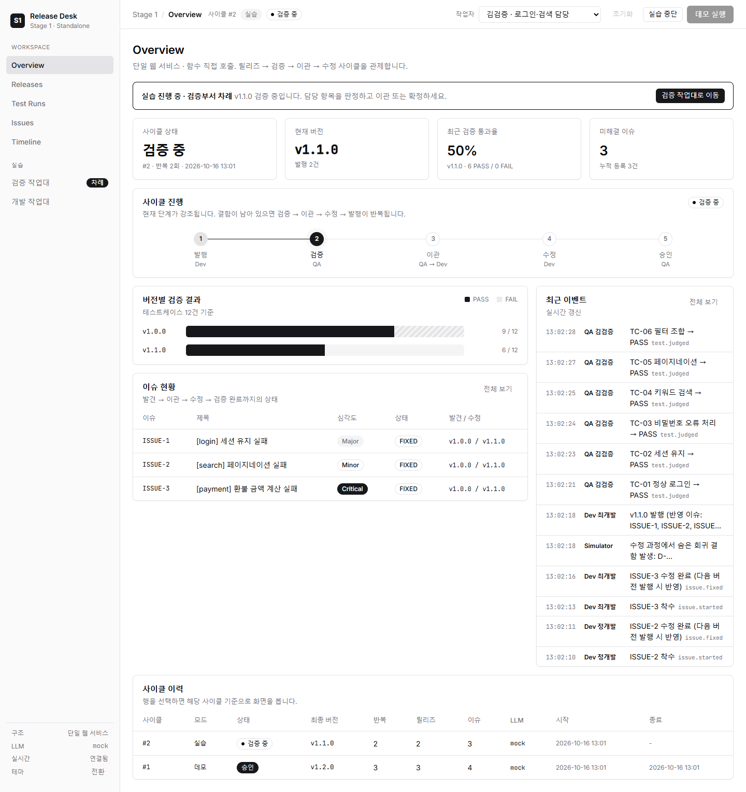
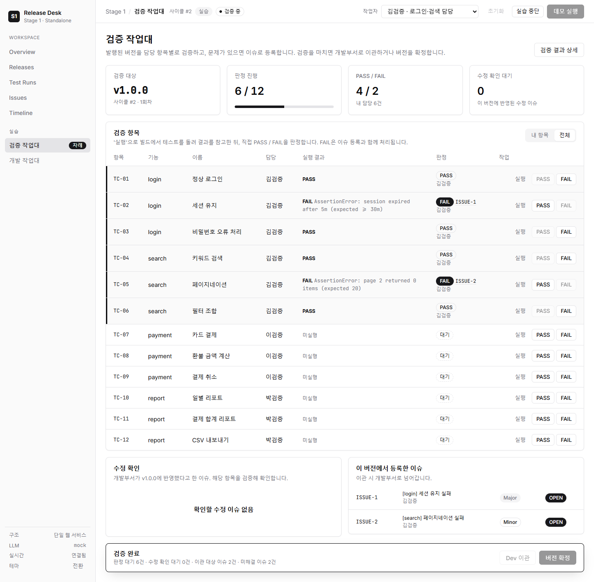
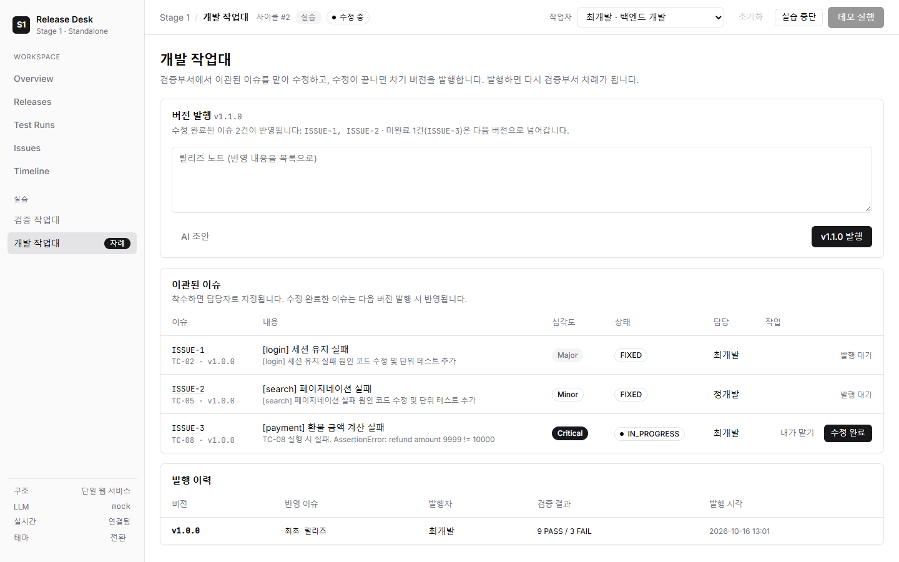

# Stage 1. Standalone — 모놀리식 웹 서비스

개발부서(Dev)와 검증부서(QA)의 업무를 **하나의 웹 서비스** 안에 구현한 단계입니다.
두 부서는 같은 프로세스에서 **함수를 직접 호출**하고, **같은 DB**를 공유합니다.

두 가지 방식으로 사이클을 진행할 수 있습니다.

| 방식 | 버튼 | 설명 |
| --- | --- | --- |
| 데모 | **데모 실행** | 정해진 루틴으로 발행 → 검증 → 이관 → 수정 → 승인까지 자동 진행 |
| 실습 | **실습 시작** | 부서원이 작업대에서 직접 버전 발행, 항목 검증·이슈 등록, 이슈 수정을 진행 |



## 실행

```powershell
cd 01_standalone
uv sync
uv run run.py            # http://localhost:8100  (루트 .env에 키가 있으면 LLM 모드)
uv run run.py --mock     # LLM 없이 규칙 기반으로 실행
```

| 환경변수 | 기본값 | 설명 |
| --- | --- | --- |
| `LLM_MODE` | `auto` | `auto`(키 있으면 llm) / `llm` / `mock` |
| `CLAUDE_MODEL` | `claude-opus-5-5` | 사용할 Claude 모델 |
| `STEP_DELAY` | `0.4` | 데모 단계 사이 지연(초). 흐름을 눈으로 보기 위한 값 |
| `TEST_DELAY` | `0.1` | 데모 테스트 1건당 지연(초) |

## 실습 모드

### 부서원 (가상 인물)

| 이름 | 부서 | 담당 |
| --- | --- | --- |
| 김검증 | 검증 | login, search 테스트케이스 (TC-01~06) |
| 이검증 | 검증 | payment 테스트케이스 (TC-07~09) |
| 박검증 | 검증 | report 테스트케이스 (TC-10~12) |
| 최개발 | 개발 | 이슈 수정, 버전 발행 |
| 정개발 | 개발 | 이슈 수정, 버전 발행 |

상단 **작업자**에서 본인을 선택합니다. 브라우저마다 기억되며, `http://localhost:8100/qa?as=김검증` 처럼 링크로 지정할 수도 있습니다.
검증 작업은 검증부서원만, 개발 작업은 개발부서원만 할 수 있습니다(서버에서 검사).

### 진행 순서

```text
[실습 시작]
  개발 작업대  최초 버전 v1.0.0 발행                               → 검증부서 차례
  검증 작업대  각자 담당 항목: [실행]으로 결과 확인 → PASS / FAIL 판정
               FAIL은 이슈 등록 폼 작성 (AI 초안 가능)
               수정 반영된 이슈는 [수정 확인] / [재현]
               모든 항목 판정 후
                 미해결 이슈가 있으면 [Dev 이관]                    → 개발부서 차례
                 미해결 이슈가 없으면 [버전 확정]                   → 사이클 완료
  개발 작업대  이슈 [착수] → [수정 완료] (수정 내역 입력, AI 초안 가능)
               릴리즈 노트 작성 (AI 초안 가능) → [vX.Y.0 발행]      → 검증부서 차례
```

- **실행**은 발행된 빌드에서 해당 테스트를 돌린 결과를 보여 주는 참고 정보입니다. 최종 판정은 검증부서원이 합니다.
  실행 결과와 판정이 다르면 "실행 결과와 다름"으로 표시됩니다.
- 이슈를 고치면 숨은 결함이 다음 빌드에서 사라집니다. 데모와 같은 회귀 규칙이 적용되어, 환불 계산(TC-08)을 고치면 결제 합계 리포트(TC-11)가 깨집니다.
- 수정이 일부만 끝나도 발행할 수 있습니다. 미완료 이슈는 다음 버전으로 넘어가며, 검증부서가 [Dev 이관]을 누르면 상태·담당자 그대로 개발부서가 이어서 수정합니다.
- 화면은 다른 부서원의 작업이 있을 때마다 실시간으로 갱신됩니다. 폼을 작성 중일 때는 갱신을 미뤄 입력 내용을 보호합니다.

| 검증 작업대 | 개발 작업대 |
| --- | --- |
|  |  |

## 구조

```text
01_standalone/
├─ run.py                      # 진입점 (uvicorn)
├─ pyproject.toml
├─ docs/                       # PRD, TODO, 유저 시나리오, 화면 캡처
├─ data/app.db                 # SQLite (자동 생성, 이전 버전 DB는 기동 시 컬럼 자동 보강)
└─ src/standalone/
   ├─ config.py                # .env 로딩, 설정
   ├─ domain/
   │  ├─ scenario.py           # 기능·테스트케이스·결함·회귀 규칙, 부서원
   │  └─ simulator.py          # 빌드/테스트 시뮬레이터 (순수 함수)
   ├─ infra/
   │  ├─ db.py                 # SQLite 스키마/마이그레이션/헬퍼
   │  ├─ events.py             # EventBus (DB 기록 + SSE)
   │  └─ llm.py                # Claude 호출 (구조화 출력, mock 대체)
   ├─ services/
   │  ├─ dev_service.py        # 발행, 이슈 수신, 수정 후 재발행 (+ 수정 내역·릴리즈 노트 작성)
   │  ├─ qa_service.py         # 검증, 이슈 등록/재오픈/확인, 이관 (+ 실패 로그 분석)
   │  ├─ issue_store.py        # 이슈 상태 변경 + 이력
   │  ├─ cycle.py              # CycleRunner: 데모 업무 흐름(하드코딩)
   │  └─ workbench.py          # Workbench: 실습 모드 (사람이 단계를 진행, 권한·조건 검사)
   └─ web/
      ├─ app.py                # FastAPI 라우트 (화면 + API + SSE)
      ├─ queries.py, ui.py     # 조회 쿼리, 템플릿 필터
      ├─ templates/            # Jinja2 화면 (+ qa.html, dev.html 작업대)
      └─ static/               # 모노톤 디자인 시스템 CSS, 실시간 JS, 작업대 JS
```

## 데모 동작 흐름

```text
[데모 실행] → CycleRunner
  dev.release_initial()            v1.0.0 발행 (숨은 결함 3건)
  loop:
    qa.verify(version)             12개 테스트, 수정 이슈 확인, 신규 이슈 등록(LLM 분석)
    전체 PASS → qa.approve() → APPROVED
    qa.transfer() → dev.receive_issues()
    dev.fix_and_release()          수정 내역·릴리즈 노트(LLM), 차기 버전 발행
```

데모와 실습은 동시에 진행할 수 없습니다. 실습 중에는 데모 실행·초기화 버튼이 비활성화됩니다.

## API

| Method | Path | 설명 |
| --- | --- | --- |
| POST | `/api/cycles` | 데모 실행 (진행 중인 사이클이 있으면 409) |
| POST | `/api/reset` | 데이터 초기화 (진행 중인 사이클이 있으면 409) |
| GET | `/api/state` | 실행 상태, 최근 사이클, 진행 중인 실습, LLM 호출 통계 |
| GET | `/api/cycles/{id}/summary` | 사이클 결과 요약 (점검용) |
| GET | `/api/events/stream` | 이벤트 SSE |

실습 모드 API (요청 본문의 `actor`에 작업자 이름):

| Method | Path | 부서 | 설명 |
| --- | --- | --- | --- |
| POST | `/api/work/start` · `/api/work/abort` | - | 실습 시작 / 중단 |
| POST | `/api/work/release` | Dev | 버전 발행 `{release_note}` |
| POST | `/api/work/results/{id}/execute` | QA | 빌드에서 테스트 실행 (참고 결과) |
| POST | `/api/work/results/{id}/judge` | QA | 판정 `{result: PASS}` |
| POST | `/api/work/issues` | QA | 이슈 등록 + FAIL 판정 `{result_id, title, severity, description}` |
| POST | `/api/work/issues/{key}/verify` | QA | 수정 확인 `{ok: true}` / 재현 `{ok: false}` |
| POST | `/api/work/transfer` · `/api/work/approve` | QA | Dev 이관 / 버전 확정 |
| POST | `/api/work/issues/{key}/start` · `/fix` | Dev | 착수 / 수정 완료 `{fix_note}` |
| POST | `/api/work/draft/issue/{id}` | QA | 이슈 AI 초안 |
| POST | `/api/work/draft/fix/{key}` · `/api/work/draft/release` | Dev | 수정 내역 / 릴리즈 노트 AI 초안 |

실습 시작·중단은 데모 실행·초기화와 같은 릴리즈 매니저 조작으로 보고 작업자를 검사하지 않습니다(인증이 없는 학습용 범위).

## LLM 활용

| 주체 | 작업 | 데모 | 실습 |
| --- | --- | --- | --- |
| QA | 실패 로그 → 이슈 제목·설명·심각도 | 자동 | 이슈 폼의 **AI 초안** |
| Dev | 이슈별 수정 내역 | 자동 | 수정 폼의 **AI 초안** |
| Dev | 릴리즈 노트 | 자동 | 발행 폼의 **AI 초안** |

모두 구조화 출력(JSON Schema), effort `low`이며, LLM 호출이 실패하면 mock 결과로 대체됩니다.

## 점검 결과

| 항목 | 결과 |
| --- | --- |
| 데모 (mock / LLM) | 9/3 · 11/1 · 12/0, 이슈 4건 VERIFIED. LLM은 약 46초 (지연 0, 호출 10회) |
| 실습 (실제 브라우저 클릭, 2026-10-16) | Edge에서 부서원 5명 역할로 v1.0.0(9/3) → v1.1.0(11/1, 회귀 발견) → v1.2.0(12/0) 확정, ISSUE-1~4 VERIFIED. 대화상자·AI 초안 포함, 페이지 오류 0건 |
| 권한·조건 검사 | 검증부서원의 발행 403, 다른 부서의 AI 초안 403, 판정 전 확정·이관 400, 수정 전 발행 400, 실습 중 데모·초기화 409 |
| 부분 수정 발행 (API) | ISSUE-1만 고쳐 발행 → 이관(미완료 ISSUE-2·3 유지) → 나머지 수정: 9/3 → 10/2 → 11/1 → 12/0 확정 |
| 이전 DB 호환 | 실습 기능 이전에 만든 `app.db`를 열면 컬럼 자동 추가, 기존 결과 보존 |

## 학습 포인트와 한계

- 데모의 업무 흐름은 `services/cycle.py`에, 실습의 단계 규칙은 `services/workbench.py`에 **코드로 고정**되어 있다.
- Dev와 QA가 **같은 프로세스·같은 DB**를 공유한다. 이슈 테이블 하나를 두 부서가 함께 수정하고, "차례"도 같은 DB의 사이클 상태 하나로 관리한다.
- 부서별 독립 운영·배포·장애 격리가 불가능하다.
- 다음 단계 [Stage 2. API](../02_api/README.md): 부서 시스템을 분리하고 REST로 연동한다.
