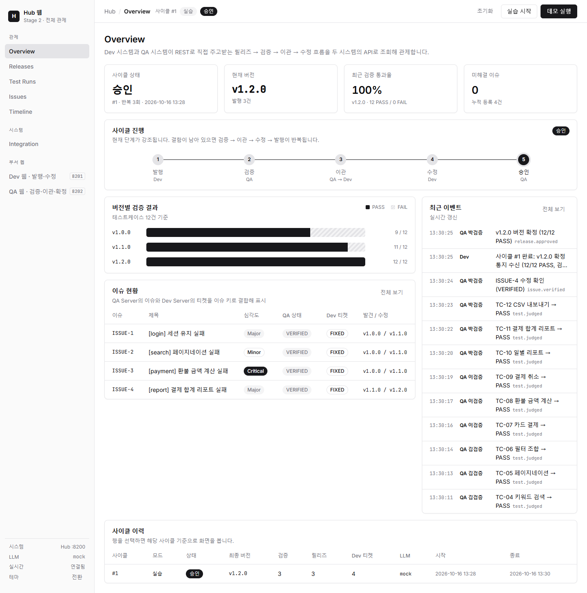
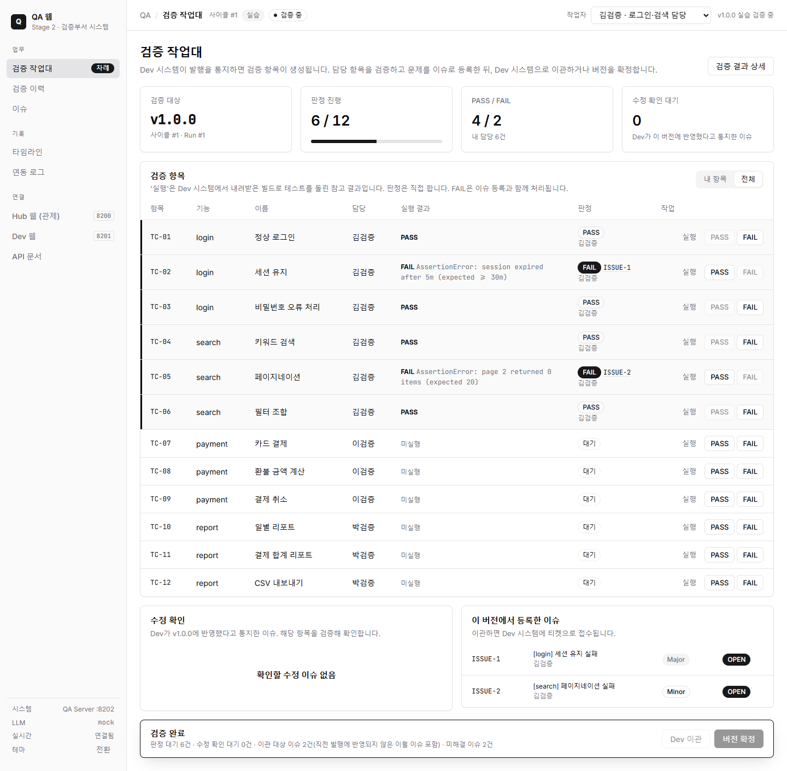
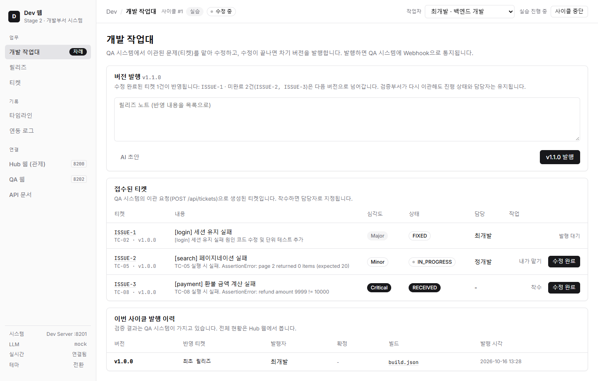
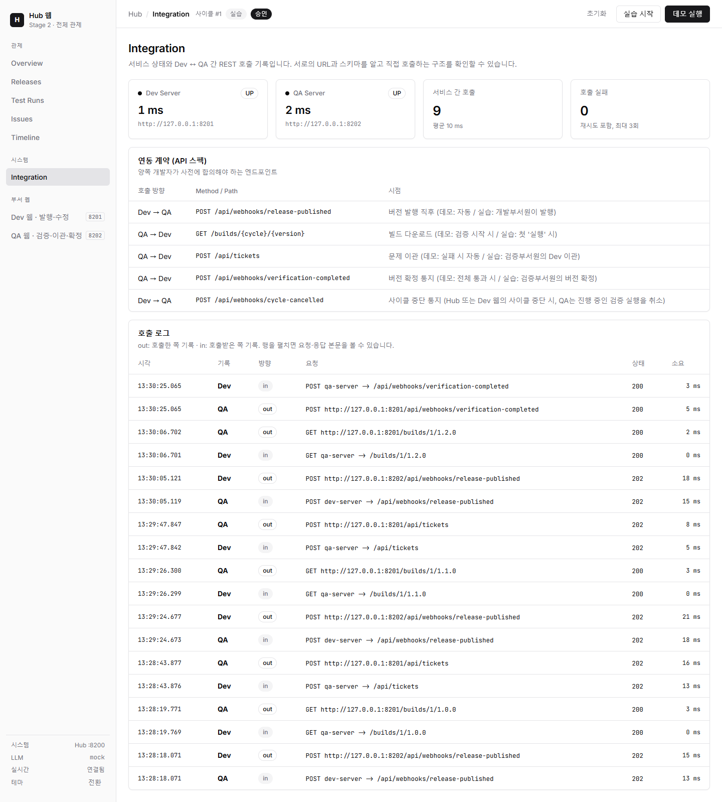

# Stage 2. API — 부서별 시스템 REST 연동

개발부서와 검증부서가 **각자의 시스템(프로세스·DB·웹 화면·부서원 명부)** 을 운영하고, 사전에 합의한 **REST API와 Webhook**으로 업무를 주고받는 단계입니다.
**Hub**는 흐름에 끼어들지 않고, 두 시스템의 API를 조회해 전체를 관제(observation)합니다.

| 웹 서비스 | 주소 | 역할 |
| --- | --- | --- |
| Hub 웹 | http://localhost:8200 | 전체 관제: 진행 단계와 차례, 릴리즈·검증·이슈 집계, 두 시스템 이벤트 병합, 서비스 간 호출 기록 |
| Dev 웹 | http://localhost:8201 | 개발부서 시스템: 버전 발행, 접수된 문제(티켓) 수정 |
| QA 웹 | http://localhost:8202 | 검증부서 시스템: 문제 탐지(검증·이슈 등록), Dev 이관 또는 버전 확정 |



## 실행

```powershell
cd 02_api
uv sync
uv run run.py                   # 3개 웹 서비스 동시 기동
uv run run.py --mock            # LLM 없이 실행
uv run run.py --only qa_server  # 특정 서비스만 실행 (장애 실습용)
```

각 서버의 API 문서: http://localhost:8201/docs, http://localhost:8202/docs

| 환경변수 | 기본값 | 설명 |
| --- | --- | --- |
| `LLM_MODE` | `auto` | `auto` / `llm` / `mock` |
| `DEV_URL`, `QA_URL` | `http://127.0.0.1:8201`, `:8202` | 상대 서비스 주소 (서로의 위치를 설정으로 알아야 함) |
| `STEP_DELAY`, `TEST_DELAY` | `0.4`, `0.1` | 데모 흐름 관찰용 지연(초) |

## 진행 방식

| 방식 | 시작 | 설명 |
| --- | --- | --- |
| 데모 | Hub 웹 또는 Dev 웹의 **데모 실행** | Webhook 체인으로 발행 → 검증 → 이관 → 수정 → 확정까지 자동 진행 |
| 실습 | Hub 웹 또는 Dev 웹의 **실습 시작** | 개발부서원은 Dev 웹, 검증부서원은 QA 웹에서 직접 진행 |

### 실습 흐름

```text
Dev 웹  [최개발] v1.0.0 발행 ───── POST /api/webhooks/release-published ─────▶ QA 시스템: 검증 항목 12건 '대기'
QA 웹   [김검증·이검증·박검증] 담당 항목 실행(빌드는 GET /builds/…로 다운로드) → PASS / FAIL + 이슈 등록
        수정 반영 이슈는 수정 확인 / 재현
        └ 미해결 이슈 있음 → [Dev 이관] ── POST /api/tickets ──▶ Dev 시스템: 티켓 접수
          (직전 버전에 반영되지 않은 이월 이슈도 다시 이관, Dev 티켓은 진행 상태 유지)
        └ 미해결 이슈 없음 → [버전 확정] ── POST /api/webhooks/verification-completed ──▶ Dev 시스템: 사이클 확정
Dev 웹  티켓 착수 → 수정 완료(수정 내역, AI 초안) → 릴리즈 노트(AI 초안) → v1.1.0 발행 ──▶ 다시 QA ...
Hub 웹  위 모든 과정을 두 시스템의 API로 조회해 관제 (차례 표시, 이벤트 병합, 호출 로그)
```

| 부서원 (가상 인물) | 시스템 | 담당 |
| --- | --- | --- |
| 김검증, 이검증, 박검증 | QA 시스템 명부 | login·search / payment / report 테스트케이스 |
| 최개발, 정개발 | Dev 시스템 명부 | 티켓 수정, 버전 발행 |

부서원 명부는 각 시스템이 따로 가집니다. 검증부서원은 Dev 웹에서, 개발부서원은 QA 웹에서 작업할 수 없습니다.
작업자는 상단에서 선택하거나 `http://localhost:8202/?as=김검증` 처럼 링크로 지정합니다.

| QA 웹 | Dev 웹 |
| --- | --- |
|  |  |

## 구조

```text
02_api/
├─ run.py                      # 3개 웹 서비스 기동/종료
├─ docs/                       # PRD, TODO, 유저 시나리오, 화면 캡처
├─ data/                       # dev.db, qa.db (시스템별 독립 DB, Hub는 DB 없음)
└─ src/
   ├─ common/                  # 설정, SQLite(+마이그레이션), EventBus, LLM, 연동 HTTP, 실습 공통
   │  ├─ http.py               # IntegrationClient(재시도 3회 + 호출 로그), 수신 로그 미들웨어
   │  ├─ service_api.py        # health / events / integration-logs 공통 API
   │  ├─ work.py               # WorkError, 부서원 명부(Members)
   │  └─ web/                  # 공통 레이아웃·매크로·타임라인·연동 로그 템플릿, CSS/JS, setup_web()
   ├─ dev_server/              # 개발부서 시스템 (:8201)
   │  ├─ catalog.py            # 제품·결함·빌드 산출물
   │  ├─ service.py            # 데모(자동 수정·발행) + 실습(발행, 티켓 착수·수정, AI 초안)
   │  ├─ app.py                # 웹 화면 + REST API
   │  └─ templates/            # layout, desk(개발 작업대), releases, tickets, ticket_detail
   ├─ qa_server/               # 검증부서 시스템 (:8202)
   │  ├─ catalog.py            # 테스트케이스, 판정 규칙
   │  ├─ service.py            # 데모(자동 검증) + 실습(실행·판정·이슈 등록·수정 확인·이관·확정, AI 초안)
   │  ├─ app.py                # 웹 화면 + REST API
   │  └─ templates/            # layout, desk(검증 작업대), runs, test_run_detail, issues, issue_detail
   └─ hub/                     # 관제 (:8200, DB 없음)
      ├─ upstream.py           # Dev/QA 조회, 두 시스템 SSE 병합 중계
      ├─ app.py                # 화면 조합 + 편의 조작(시작·중단·초기화 대리 호출, 초기화는 양쪽 확인 후 실행)
      └─ templates/            # layout, overview, releases, test_runs, issues, timeline, integration ...
```

## 연동 계약 (API 스펙)

| 호출 방향 | Method / Path | 시점 |
| --- | --- | --- |
| Dev → QA | `POST /api/webhooks/release-published` `{cycle_id, version, build_url, fixed_issue_keys, mode}` | 버전 발행 직후 |
| QA → Dev | `GET /builds/{cycle}/{version}` | 빌드 다운로드 (데모: 검증 시작 시 / 실습: 첫 실행 시) |
| QA → Dev | `POST /api/tickets` `{cycle_id, version, issues[]}` | 문제 이관 |
| QA → Dev | `POST /api/webhooks/verification-completed` `{cycle_id, version, run_id, passed, total}` | 버전 확정 통지 (Dev는 검증 중인 사이클·버전이 아니면 409) |
| Dev → QA | `POST /api/webhooks/cycle-cancelled` `{cycle_id, reason}` | 사이클 중단 통지 (QA는 진행 중인 검증 실행을 취소) |

- 모든 요청에 `X-Cycle-Id`(Correlation ID)를 실어 시스템 간 추적, 호출 쪽 `out` / 받는 쪽 `in`으로 기록 → Hub **Integration**
- 상대 시스템 장애 시 3회 재시도 후 실패. 실습에서는 작업이 취소되고 작업자에게 "다시 시도"를 안내한다. Dev 발행은 저장한 릴리즈를 삭제(롤백)하고, QA 이관·확정은 호출이 성공한 뒤에만 상태를 바꾸므로 되돌릴 것이 없다.
- 사이클 중단 통지가 실패해도 Dev의 중단은 유지되며, 실패는 Dev 이벤트(`integration.error`)로 남는다.



## 데이터 소유

| 데이터 | 소유 시스템 | 비고 |
| --- | --- | --- |
| 사이클, 릴리즈, 빌드 산출물 | Dev | 사이클의 차례(상태)는 Dev가 관리 |
| 티켓 (이관받은 문제 사본) | Dev | `RECEIVED → IN_PROGRESS → FIXED`, 담당자 |
| 테스트케이스·담당, 검증 실행·판정 | QA | 판정 대기 / PASS / FAIL, 판정자, 결정(이관/확정) |
| 이슈 (원본) | QA | `OPEN → TRANSFERRED → FIXED → VERIFIED / REOPENED`, 등록자 |
| 전체 현황 | (Hub는 보관하지 않음) | 매 요청마다 두 시스템 API를 조회해 조합 |

## 점검 결과

| 항목 | 결과 |
| --- | --- |
| 데모 (Hub에서 시작) | 9/3 → 11/1 → 12/0, 확정, QA 결정 이관 → 이관 → 확정, 서비스 간 호출 9회 |
| 실습 (Edge 브라우저 클릭, 2026-10-16) | v1.0.0 → v1.1.0(회귀) → v1.2.0, QA 결정: 이관 → 이관 → 확정, 이슈 4건 VERIFIED / 티켓 4건 FIXED, JS 오류 없음 |
| 권한·조건 | 타 부서원 작업 403, 판정 전 확정 400, 수정 전 발행 400, 진행 중 새 사이클 409 |
| 중단·초기화 | 사이클 중단 시 QA 검증 실행 CANCELLED, 중단된 사이클로 온 확정·이관 통지 409, 데모 중 초기화는 양쪽 모두 거절 |
| 화면 | Hub 9개, Dev 6개, QA 7개(총 22개) 화면 정상, 이모지 없음 |
| AI 초안 (LLM 모드) | 이슈·수정 내역·릴리즈 노트 초안 Claude 생성 확인 |

권한은 부서 단위로 검사한다(명부에 없는 작업자 403). Stage 1과 같이 같은 부서 안에서 담당자가 아닌 항목을 판정하는 것은 막지 않으며, 화면의 "내 항목" 필터와 행 강조로 안내한다.

## 학습 포인트와 한계

- 시스템이 분리되어 **독립 운영·장애 격리**가 가능하다. 부서원 명부, 이슈와 티켓도 각자 가진다.
- 그러나 Dev는 QA의 URL과 `release-published` 스키마를, QA는 Dev의 `tickets` 스키마를 **알고 있어야** 한다 (강결합).
- 실습의 "차례"는 사람이 버튼으로 넘기지만, 넘어가는 경로(어느 API를 부를지)는 **코드에 고정**되어 있다.
- 전체 그림은 어느 한 시스템에도 없다. Hub가 매번 양쪽을 조회해 조합해야 보인다.
- 다음 단계 [Stage 3. MCP](../03_mcp/README.md): AI 에이전트가 표준 프로토콜로 기능을 발견하고, 판단하여 호출한다.
