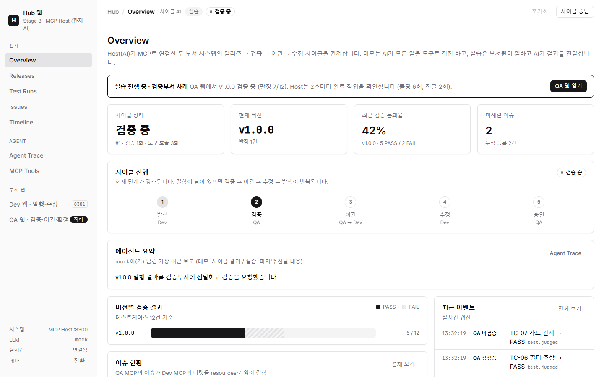
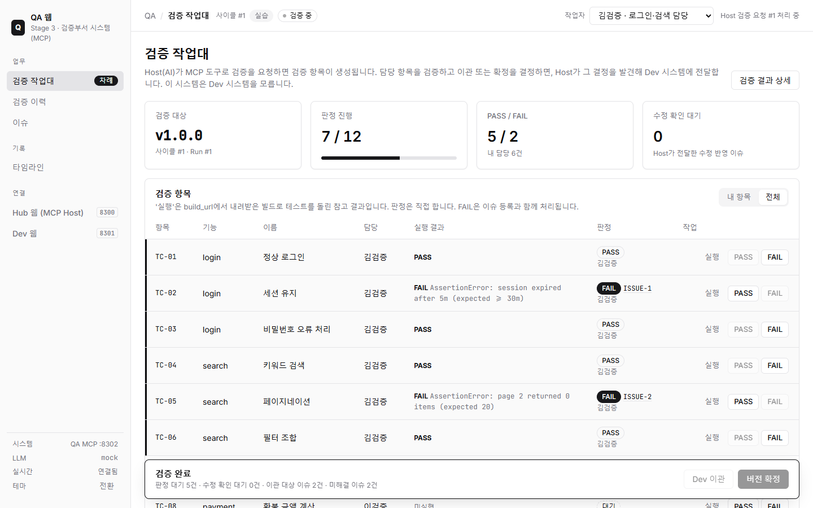
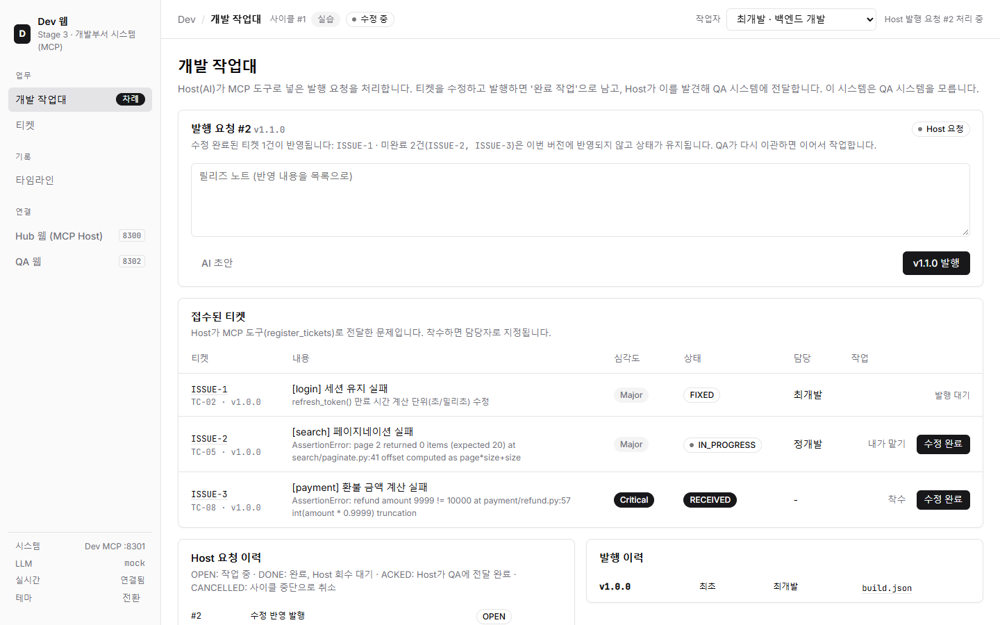

# Stage 3. MCP — AI Host가 부서 시스템을 도구로 연결

개발부서·검증부서 시스템을 **MCP 서버**로 노출하고, **Hub 웹 = MCP Host(Claude)** 가 도구를 발견해 호출하는 단계입니다.
Dev와 QA 시스템은 **서로를 모릅니다.** 두 시스템을 잇는 것은 Host의 AI뿐입니다.

| 웹 서비스 | 주소 | 역할 |
| --- | --- | --- |
| Hub 웹 (MCP Host) | http://localhost:8300 | 전체 관제 + AI 에이전트(데모: 모든 일을 도구로 직접 수행 / 실습: 두 부서 사이의 결과 전달) |
| Dev 웹 + Dev MCP | http://localhost:8301 (MCP `/mcp`) | 개발부서 시스템: 버전 발행, 접수된 티켓 수정 |
| QA 웹 + QA MCP | http://localhost:8302 (MCP `/mcp`) | 검증부서 시스템: 검증·이슈 등록, 이관 또는 확정 결정 |



## 실행

```powershell
cd 03_mcp
uv sync
uv run run.py               # 3개 웹 서비스 동시 기동 (루트 .env에 키가 있으면 Claude가 Host 에이전트)
uv run run.py --mock        # LLM 없이 규칙 기반 플래너/조정자
uv run run.py --only qa_mcp # 특정 서비스만 실행
```

| 환경변수 | 기본값 | 설명 |
| --- | --- | --- |
| `LLM_MODE` | `auto` | `auto` / `llm` / `mock` |
| `CLAUDE_MODEL` | `claude-opus-5-5` | Host 에이전트·AI 초안 모델 |
| `MAX_AGENT_TURNS` | `80` | 데모 에이전트 루프 최대 턴 |
| `HOST_PORT` / `DEV_PORT` / `QA_PORT` | `8300` / `8301` / `8302` | 포트 (화면의 포트 표시도 이 값을 따름) |

## 진행 방식

| 방식 | 시작 | AI(Host)의 역할 | 사람의 역할 |
| --- | --- | --- | --- |
| 데모 | Hub 웹 **데모 실행** | 발행·테스트·이슈 작성·이관·수정·승인을 MCP 도구로 **모두 직접** 수행 | 관찰 |
| 실습 | Hub 웹 **실습 시작** | 한 부서가 끝낸 작업을 **발견해 상대 부서에 전달**(조정) | Dev 웹·QA 웹에서 실제 업무 |

### 실습 흐름

```text
Hub(AI)  dev__request_release ────────────────▶ Dev 시스템: 발행 요청(작업 지시) 생성
Dev 웹   [최개발] v1.0.0 발행 → 작업 '완료'(Host 회수 대기)
Hub      2초마다 dev__list_completed_work / qa__list_completed_work 폴링 → 완료 작업 발견
Hub(AI)  qa__request_verification(version, build_url, …) ─▶ QA 시스템: 검증 항목 12건 '대기'
         dev__ack_work
QA 웹    [김검증·이검증·박검증] 실행·판정·이슈 등록·수정 확인 → 이관 또는 확정 결정 → 작업 '완료'
Hub(AI)  (이관) qa__transfer_issues → dev__register_tickets → dev__request_release → qa__ack_work
         (확정) qa__approve_release → qa__ack_work → 사이클 확정
Dev 웹   티켓 착수·수정(AI 초안) → 발행 → … 반복
```

- **MCP 도구 호출은 요청-응답 단위**입니다. 사람이 몇 분, 몇 시간 걸리는 일을 기다릴 수 없어서 Host가 '완료 작업'을 **폴링**합니다.
  Hub Overview에 폴링 횟수와 전달 횟수가 표시됩니다. (Stage 4의 A2A Task와 비교해 보세요.)
- 전달 판단은 Claude가 조정 규칙(시스템 프롬프트)을 읽고 합니다. Agent Trace에 전달마다 한 번의 실행이 기록됩니다.
- 부서원 명부는 각 시스템이 따로 가집니다. `http://localhost:8302/?as=김검증` 처럼 링크로 작업자를 지정할 수 있습니다.

| QA 웹 | Dev 웹 |
| --- | --- |
|  |  |

## 구조

```text
03_mcp/
├─ run.py
├─ docs/
├─ data/                       # dev.db, qa.db, host.db
└─ src/
   ├─ common/                  # 설정, SQLite(+마이그레이션), EventBus, LLM, 실습 공통, 웹 공통 계층
   ├─ dev_mcp/
   │  ├─ catalog.py            # 제품·결함·빌드 산출물
   │  ├─ service.py            # DevSystem: 데모 도구 동작 + 작업 지시(request/complete/ack) + 부서원 작업
   │  ├─ server.py             # MCP 도구·리소스 + Dev 웹 + /builds
   │  └─ templates/            # layout, desk(개발 작업대), tickets, ticket_detail
   ├─ qa_mcp/
   │  ├─ catalog.py            # 테스트케이스, 판정 규칙
   │  ├─ service.py            # QASystem: 데모 도구 동작 + 작업 지시 + 부서원 작업(판정·이슈·이관/확정 결정)
   │  ├─ server.py             # MCP 도구·리소스 + QA 웹
   │  └─ templates/            # layout, desk(검증 작업대), runs, test_run_detail, issues, issue_detail
   └─ host/                    # Hub 웹 = MCP Host
      ├─ mcp_hub.py            # 서버별 장기 세션, tools/list 발견, Claude tools 변환
      ├─ agent.py              # 데모 에이전트 루프 + 실습 조정자(폴링 → 전달 실행), 상태 추적
      ├─ planner.py            # mock 플래너(데모) / mock 조정자(실습)
      ├─ relay.py              # Dev/QA 이벤트 관찰 채널 (Hub 실시간 표시용)
      ├─ app.py                # 관제 화면 (업무 데이터는 MCP resources로 조회)
      └─ templates/            # layout, overview, trace, tools ...
```

## MCP 구성

| 서버 | 데모 도구 | 실습 조정자 Claude에 노출 | Host 코드만 호출 | resources |
| --- | --- | --- | --- | --- |
| Dev (9개) | `publish_initial_release`, `register_tickets`, `fix_ticket`, `publish_release`, `list_tickets` | `request_release`, `register_tickets`, `ack_work`, `list_tickets` | `list_completed_work`(폴링), `ack_work`(보험), `cancel_work`(중단) | `dev://cycles/{id}/releases`, `/tickets`, `/work` |
| QA (10개) | `run_tests`, `verify_fixed_issues`, `create_issue`, `transfer_issues`, `approve_release`, `list_issues` | `request_verification`, `transfer_issues`, `approve_release`, `ack_work`, `list_issues` | `list_completed_work`(폴링), `ack_work`(보험), `cancel_work`(중단) | `qa://test-cases`, `qa://cycles/{id}/test-runs`, `qa://test-runs/{id}`, `qa://cycles/{id}/issues`, `qa://status` |

- 데모 Claude에는 `cancel_work`를 뺀 17개 도구가, 실습 조정자 Claude에는 위 9개(`MANUAL_TOOLS`)만 전달됩니다.
- 조정자는 필수 도구(예: 이관이면 `transfer_issues` → `register_tickets` → `request_release`)가 모두 성공했을 때만 완료 작업을 ack합니다. 일부가 실패하면 ack하지 않고 다음 폴링에서 다시 전달합니다(3회 실패 시 사이클 실패).
- Hub에서 **사이클 중단**을 누르면 Host가 `cancel_work`로 Dev/QA의 진행 중 요청을 바로 취소합니다. Host 프로세스가 재시작될 때는 취소하지 않고 조정을 이어 갑니다.


## 점검 결과

| 항목 | mock | Claude (`claude-opus-5-5`) |
| --- | --- | --- |
| 데모 | 9/3 → 11/1 → 12/0, 도구 호출 21회 | 동일 결과, 15턴 · 약 48초 |
| 실습 (부서원 작업은 API로 수행) | v1.0.0 → v1.1.0(회귀) → v1.2.0 확정, 전달 7회 | 동일, 전달 7회 · 22턴 · 입력 약 4.9만 토큰. 상황마다 올바른 도구 순서로 전달하고 한 문장 보고 |
| 차례·권한 | Host 요청이 없는 부서의 작업 409, 타 부서원 403 | - |
| 화면 | Hub 8개, Dev 4개, QA 5개 화면 정상 | - |
| Dev MCP 중지 (데모) | - | Claude가 재시도 후 상황을 분석해 보고하고 종료 (사이클 FAILED) |
| 실제 브라우저 클릭 실습 (2026-10-16) | Playwright + Edge, APPROVED, 전달 7회, 도구 호출 17회, Agent Trace 41행, JS 오류 없음 | - |
| 중단 (2026-10-16) | QA 차례·Dev 차례 중단 직후 두 작업대에 진행 중 요청 없음, 새 사이클 정상 | - |
| Host 재시작 재개 (2026-10-16) | 전체 재시작, Host 단독 중지 중 Dev 발행 → 재기동 후 전달·완주(APPROVED) | - |
| 부분 수정 (2026-10-16) | ISSUE-1만 수정해 v1.1.0 발행(10/2) → QA가 ISSUE-2·3 재이관 → v1.2.0(11/1) → v1.3.0(12/0) APPROVED, 미완료 티켓 상태·담당자 유지 | - |

- Dev가 일부 티켓만 수정해 발행하면 나머지는 상태가 유지됩니다. QA는 다음 검증 후 반영되지 않은 이슈를 다시 **Dev 이관**할 수 있고(`transfer_issues`가 이월 이슈를 함께 반환), Dev는 새 이슈만 접수합니다.

화면 캡처(`docs/images`)는 2026-10-16 데이터 폴더를 분리한 사본(기본 포트 8300~8302, mock)에서 촬영했습니다.

## 학습 포인트와 한계

- **도구 자동 발견**: Host는 엔드포인트를 하드코딩하지 않는다. 서버에 도구를 추가하면 Claude가 사용할 수 있다.
- **흐름 결정 주체**: 데모는 Claude가 업무 절차 전체를, 실습은 Claude가 부서 간 전달 규칙을 프롬프트로 받아 판단한다.
- **수직 구조**: Dev/QA는 스스로 판단하거나 서로 대화하지 않는 수동적 도구다. 모든 연결이 Host 한 곳을 지난다.
- **장시간 작업의 어려움**: 사람의 작업 완료를 알 표준 방법이 없어 Host가 폴링한다. 진행 상황(몇 건 판정했는지)도 Host가 따로 조회해야 한다.
- 각 부서가 자기 에이전트를 갖고, 업무 단위로 위임하며, 진행 상황을 스스로 알려 준다면? → [Stage 4. A2A](../04_a2a/README.md)
