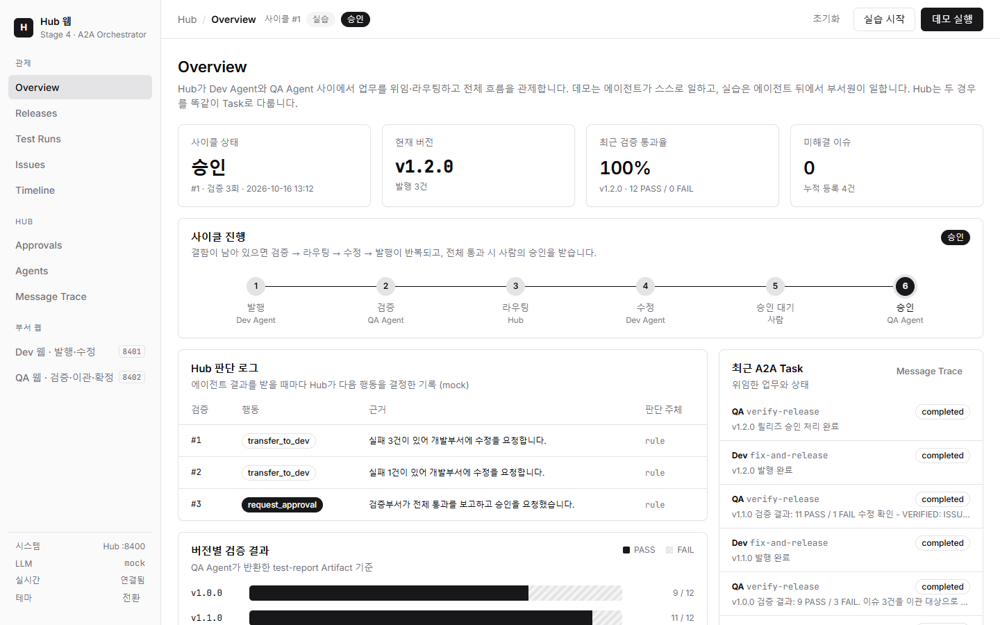
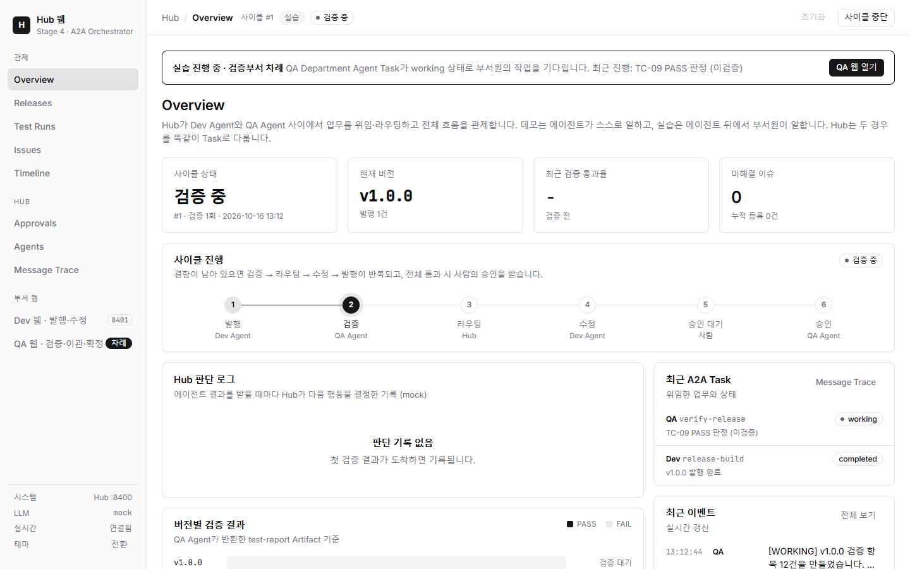
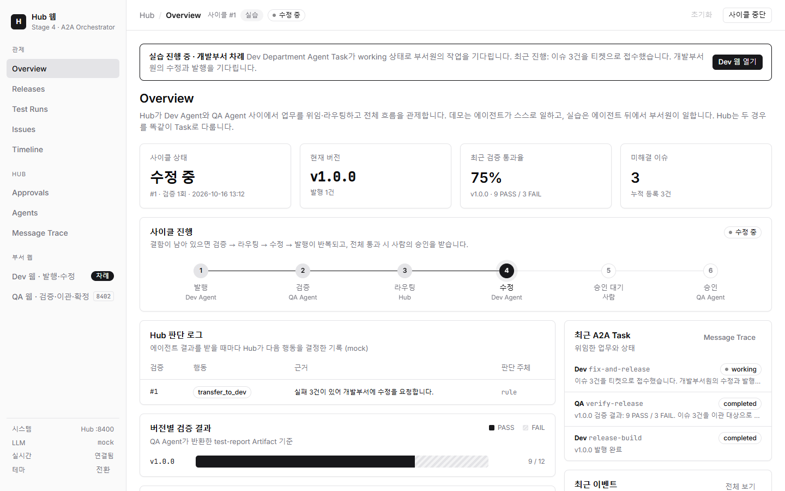
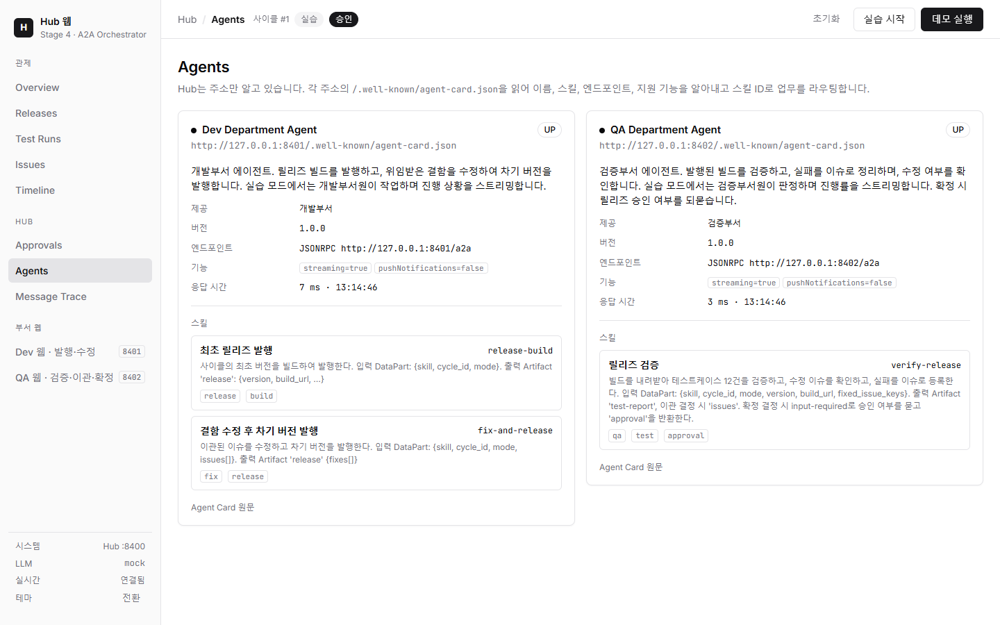
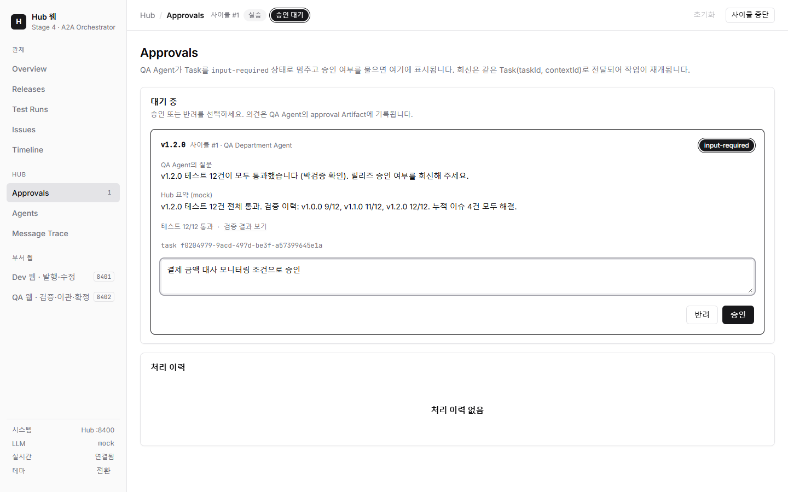
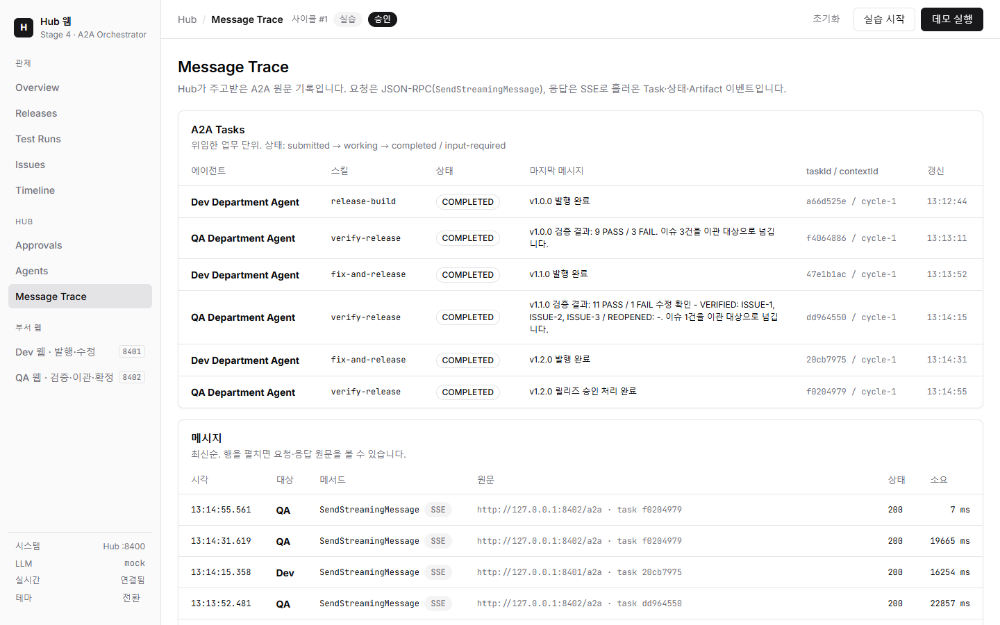
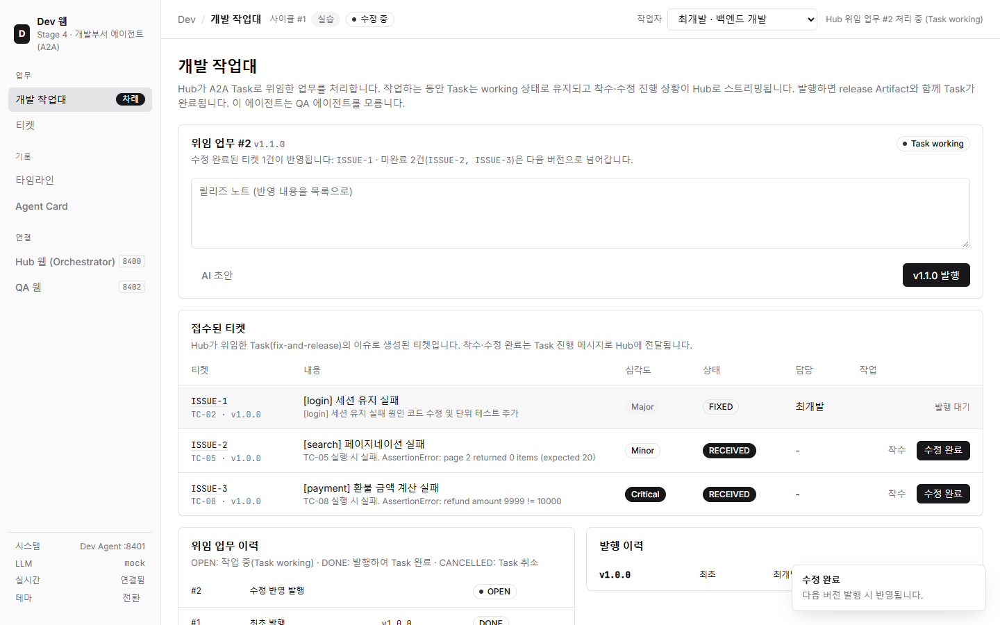
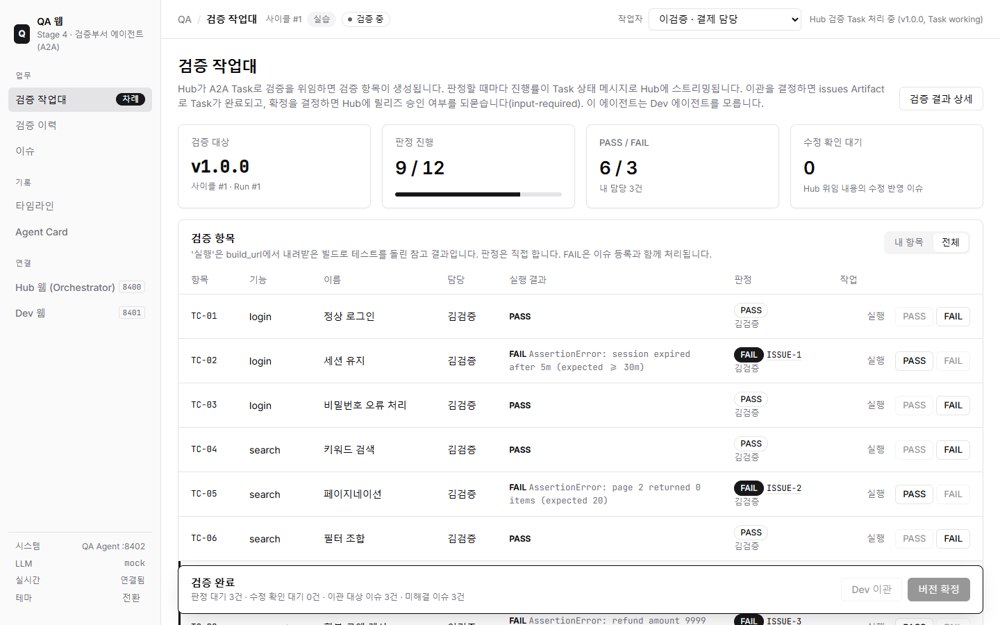

# Stage 4. A2A 개발 완료 보고서 — Dev Agent ↔ Hub ↔ QA Agent

> 같은 업무(개발 발행 → 검증 → 결함 이관 → 수정·재발행 → 승인)를 4가지 기술로 구현하는 학습 프로젝트의 네 번째 단계 보고서입니다.
> 이 단계는 Google이 제안하고 Linux Foundation에서 관리하는 **A2A(Agent2Agent) 프로토콜**로, 부서별 자율 에이전트가 **Hub(Orchestrator)** 를 통해 업무를 위임·회신합니다.
> 본문은 `04_a2a/src` 소스 코드를 근거로 하며, 2026-10-16 결함 수정과 문서 정합화(README/PRD/TODO/USER_SCENARIO)를 반영했습니다(12·13장).

---

## 0. 문서 정보

| 항목 | 내용 |
| --- | --- |
| 단계 | Stage 4 — A2A (Agent2Agent Protocol) |
| 폴더 | `04_a2a/` (독립 uv 프로젝트, `pyproject.toml` 이름 `a2a-practice-04-a2a`) |
| 포트 | Hub 웹(Orchestrator) **8400**, Dev 웹 + Dev Agent **8401**, QA 웹 + QA Agent **8402** |
| A2A 엔드포인트 | Dev `http://127.0.0.1:8401/a2a`, QA `http://127.0.0.1:8402/a2a` (JSON-RPC 바인딩), Agent Card `/.well-known/agent-card.json` |
| 주요 기술 | Python 3.12, uv, FastAPI, Jinja2, SQLite(WAL), httpx, `a2a-sdk[fastapi]` 1.1.2(protobuf 타입), `anthropic` 1.14.0, 모델 `claude-opus-5-5`(effort low) |
| 작성일 | 2026-10-16 |
| 상태 | **완료** (구현·점검·결함 수정 완료, 선택 항목 F-09/F-10/A2A+MCP 결합은 보류) |
| 관련 문서 | [README](../04_a2a/README.md) · [PRD](../04_a2a/docs/PRD.md) · [TODO](../04_a2a/docs/TODO.md) · [USER_SCENARIO](../04_a2a/docs/USER_SCENARIO.md) |
| 비교 대상 | Stage 1 `01_standalone`(단일 앱), Stage 2 `02_api`(REST/Webhook 연동), Stage 3 `03_mcp`(MCP Host ↔ MCP Server) |

---

## 1. 요약

Stage 4는 개발부서와 검증부서가 각자 **A2A Server(에이전트)** 를 운영하고, 그 사이를 **Hub**가 A2A Client로서 중개하는 구조입니다.

- **토폴로지**: `Dev Agent ↔ Hub ↔ QA Agent`. Dev와 QA는 서로의 존재를 모릅니다. 유일한 직접 접촉은 QA가 Hub로부터 받은 `build_url`로 Dev의 빌드 산출물(`GET /builds/{cycle_id}/{version}`)을 내려받는 일뿐입니다.
- **발견(Discovery)**: Hub는 에이전트의 **주소만** 압니다(`AGENT_URLS`). 각 주소의 `/.well-known/agent-card.json`을 읽어 스킬 ID(`release-build`, `fix-and-release`, `verify-release`)로 담당 에이전트를 고릅니다 (`04_a2a/src/hub/registry.py`).
- **위임 단위**: Hub는 함수 호출이 아니라 **업무 목표**를 Task로 위임합니다. "사이클 1의 최초 버전을 발행해 주세요", "v1.1.0을 검증해 주세요" 같은 TextPart 지시문과 구조화 입력 DataPart를 담은 Message 하나가 Task 하나가 됩니다.
- **결과**: 에이전트는 Task 상태(`working`/`input-required`/`completed` 등)를 SSE로 스트리밍하고, 업무 결과는 **Artifact**(`release`, `test-report`, `issues`, `approval`)로 돌려줍니다. Hub의 업무 현황 화면은 오직 이 Artifact로만 구성됩니다(부서 DB 직접 접근 없음).
- **사람의 개입**: 전체 통과 시 QA Agent가 Task를 `input-required`로 멈추고 "릴리즈 승인 여부를 회신해 주세요"라고 되묻습니다. Hub는 이를 **승인함(Approvals)** 에 올리고, 릴리즈 매니저의 승인/반려를 **같은 Task(taskId, contextId)** 로 회신합니다.
- **두 가지 진행 방식**: **데모**는 에이전트가 LLM·규칙으로 스스로 처리하고, **실습**은 에이전트 뒤에서 부서원(최개발·정개발, 김검증·이검증·박검증)이 Dev 웹·QA 웹으로 일합니다. Hub는 DataPart에 `mode: manual`만 추가할 뿐 두 경우를 구분하지 않습니다. 사람이 몇 분간 일하는 동안에도 Hub 입장에서는 `working` 상태의 Task 하나입니다.
- **결과 재현**: v1.0.0 9/3 → v1.1.0 11/1 → v1.2.0 12/0 → 승인 → APPROVED, ISSUE-1~4 VERIFIED. 사이클당 **A2A Task 6개**(Stage 3의 MCP 도구 호출 21회와 대비), mock 약 2초 / LLM 약 50초(지연 0 기준, Hub 판단 3회 + 에이전트 문서 작성).
- **감사와 관제**: Hub는 httpx 전송 계층을 감싼 `AuditTransport`로 모든 A2A 원문(JSON-RPC 요청, JSON/SSE 응답)을 `a2a_messages` 테이블에 남기고, **Message Trace** 화면에서 보여 줍니다.
- **2026-10-16 수정**: (1) Hub "실습 시작"/"사이클 중단" 버튼 무반응, (2) 실습에서 일부 티켓만 수정해 발행하면 QA가 이관도 확정도 못 하는 교착, (3) 승인 대기 중 중단 시 승인 건이 PENDING으로 남는 문제, (4) 중단이 FAILED로 기록될 수 있는 경합, (5) Hub 재시작 시 사이클이 중단되던 한계를 고쳤습니다. Hub는 재시작 후 `GetTask`·`SubscribeToTask`로 에이전트의 Task에 다시 붙어 사이클을 이어 갑니다. 실제 브라우저(Playwright + Edge) 실습 전 과정과 결함별 재현·회귀 시험으로 확인했습니다(12장).

---

## 2. 기술 배경 — A2A를 처음 접하는 독자를 위해

### 2.1 A2A는 무엇이고 왜 생겼나

A2A(Agent2Agent)는 **서로 다른 조직·프레임워크·벤더가 만든 AI 에이전트끼리** 업무를 주고받기 위한 개방형 프로토콜입니다. 2025년 Google이 공개했고 이후 Linux Foundation 산하 프로젝트로 이관되었습니다. 이 프로젝트가 쓰는 `a2a-sdk` 1.x는 프로토콜 1.0 계열을 구현하며, 타입이 protobuf 메시지로 정의되어 있습니다.

등장 배경은 다음과 같습니다.

| 문제 | 기존 방식의 한계 | A2A의 답 |
| --- | --- | --- |
| 에이전트마다 API가 제각각 | 연동할 때마다 REST 스펙·인증·콜백을 새로 합의 (Stage 2의 고민) | 공통 메시지 형식(Message/Part), 공통 메서드(SendMessage 등), 공통 상태(Task) |
| 상대가 무엇을 할 수 있는지 모름 | 문서·담당자에게 물어봄 | **Agent Card**: 이름, 스킬, 엔드포인트, 기능을 기계가 읽을 수 있게 공개 |
| 오래 걸리는 일 | 동기 HTTP는 타임아웃, 폴링은 낭비 (Stage 3의 고민) | **Task** 라이프사이클 + **스트리밍(SSE)** + **푸시 알림** |
| 중간에 사람·추가 정보가 필요 | 별도 API·Webhook을 설계 | 표준 상태 **`input-required`** / `auth-required` |
| 내부 구현 노출 | 도구 단위로 쪼개면 내부 절차가 밖으로 샘 | **불투명성(opacity)**: 상대의 LLM·DB·도구를 몰라도 협업 |

한 줄로 말하면, **MCP가 "에이전트 ↔ 도구/데이터"를 표준화했다면, A2A는 "에이전트 ↔ 에이전트(동료)"를 표준화**합니다.

### 2.2 핵심 개념

#### (1) Agent Card와 발견(Discovery)

Agent Card는 에이전트의 "명함"이자 기계가 읽는 자기소개서입니다. 관례적으로 `https://{host}/.well-known/agent-card.json`에 공개합니다.

| 필드(1.0 기준, JSON 표기) | 의미 |
| --- | --- |
| `name`, `description`, `version` | 에이전트 이름, 설명, 카드 버전 |
| `provider` | 운영 조직(`organization`, `url`) |
| `supportedInterfaces[]` | 접속 엔드포인트와 바인딩(`JSONRPC`, `GRPC`, `HTTP+JSON`)·프로토콜 버전 |
| `capabilities` | `streaming`, `pushNotifications`, 확장 등 지원 기능 |
| `defaultInputModes` / `defaultOutputModes` | 주고받을 수 있는 미디어 타입 |
| `skills[]` | 에이전트가 할 수 있는 업무(`id`, `name`, `description`, `tags`, `examples`) |
| `securitySchemes` 등 | 인증 방식(이 프로젝트는 로컬 학습용이라 사용하지 않음) |

발견 방식은 (a) 잘 알려진 URL(이 프로젝트의 방식), (b) 중앙 레지스트리/카탈로그, (c) 직접 설정 세 가지가 흔합니다.

#### (2) Task와 라이프사이클

클라이언트가 메시지를 보내면 서버는 즉답 Message를 줄 수도 있고, **Task**(추적 가능한 작업 단위)를 만들 수도 있습니다. Task는 `id`, `contextId`, `status{state, message, timestamp}`, `artifacts[]`, `history[]`를 가집니다.

```text
                 ┌──────────────┐
  SendMessage ──▶│  submitted   │
                 └──────┬───────┘
                        ▼
                 ┌──────────────┐   상태 메시지(진행 상황)를 여러 번 보낼 수 있음
         ┌──────▶│   working    │◀──────────────┐
         │       └──┬───┬───┬───┘               │
         │          │   │   │                   │ 같은 taskId로 회신(Message)
         │          │   │   └──────────▶ ┌────────────────┐
         │          │   │                │ input-required │  (중단·대기: 사람/클라이언트 입력 필요)
         │          │   │                └────────────────┘
         │          │   │                ┌────────────────┐
         │          │   └──────────────▶ │ auth-required  │  (인증 필요)
         │          │                    └────────────────┘
         │          ▼
   ┌─────────────────────────────────────────────────────────┐
   │ 종료 상태(terminal): completed / failed / canceled / rejected │
   └─────────────────────────────────────────────────────────┘
```

| 상태 | protobuf 열거값 | 의미 | 이 프로젝트에서 |
| --- | --- | --- | --- |
| submitted | `TASK_STATE_SUBMITTED` | 접수됨 | `new_task_from_user_message()`로 Task 생성 직후 |
| working | `TASK_STATE_WORKING` | 처리 중 | 데모 진행 메시지, 실습 부서원 대기 |
| input-required | `TASK_STATE_INPUT_REQUIRED` | 입력 대기(중단 상태, 종료 아님) | QA 릴리즈 승인 질문 |
| auth-required | `TASK_STATE_AUTH_REQUIRED` | 인증 대기 | 미사용 |
| completed | `TASK_STATE_COMPLETED` | 성공 종료 | 발행 완료, 이관, 승인/반려 회신 처리 |
| failed | `TASK_STATE_FAILED` | 오류 종료 | 예외 발생 시 `updater.failed()` |
| canceled | `TASK_STATE_CANCELED` | 취소 종료 | Hub의 `CancelTask` |
| rejected | `TASK_STATE_REJECTED` | 에이전트가 수행 거부 | 지원하지 않는 skill, 수정할 이슈 없음 |

`contextId`는 여러 Task와 메시지를 하나의 대화/업무 맥락으로 묶는 ID입니다. 이 프로젝트는 사이클마다 `cycle-N`을 지정합니다.

#### (3) Message와 Part

Message는 한 번의 발화입니다(`messageId`, `role`=`ROLE_USER`/`ROLE_AGENT`, `parts[]`, 선택적으로 `taskId`, `contextId`, `metadata`).
Part는 내용 조각입니다. 0.x 스펙에서는 `TextPart`/`DataPart`/`FilePart`로 나뉘었고, 1.0의 protobuf에서는 하나의 `Part`가 `text` / `data`(JSON 값) / `raw`(바이트) / `url`(파일 참조) 중 하나를 담고 `mediaType`, `filename`, `metadata`를 덧붙이는 형태입니다. 이 문서는 관례에 따라 TextPart/DataPart라고 부릅니다.

| Part | 용도 | 이 프로젝트에서 |
| --- | --- | --- |
| TextPart | 사람이 읽는 지시문·설명 | Hub의 지시문, 에이전트의 진행 메시지, 릴리즈 노트, 요약 |
| DataPart | 기계가 읽는 구조화 데이터(JSON) | `{skill, cycle_id, mode, ...}` 입력, Artifact 페이로드 |
| FilePart | 파일(인라인 바이트 또는 URL) | 미사용 — 빌드는 DataPart의 `build_url`로 참조 |

#### (4) Artifact

Artifact는 Task가 만들어 낸 **결과물**입니다(`artifactId`, `name`, `parts[]`). 상태 메시지가 "지금 무엇을 하고 있다"라면, Artifact는 "그래서 무엇을 만들었다"입니다. 한 Task가 여러 Artifact를 낼 수 있고, 스트리밍 중 조각(chunk)으로 나눠 보낼 수도 있습니다(`append`, `lastChunk`).

#### (5) 스트리밍(SSE)과 푸시 알림

| 방식 | 메서드/설정 | 특징 |
| --- | --- | --- |
| 요청-응답 | `SendMessage` | 완료(또는 중단 상태)까지 기다렸다 결과 반환. 긴 작업에 부적합 |
| 스트리밍 | `SendStreamingMessage` (`capabilities.streaming=true`) | HTTP 응답을 Server-Sent Events로 열어 두고 `task`, `statusUpdate`, `artifactUpdate`, `message` 이벤트를 흘려보냄. 종료·중단 상태가 되면 스트림 종료 |
| 재구독 | `SubscribeToTask` | 끊긴 스트림에 다시 붙기 |
| 푸시 알림 | `capabilities.pushNotifications=true` + Push Notification Config | 클라이언트가 Webhook URL을 등록, 서버가 상태 변화를 POST. 연결을 유지할 수 없는 장기 작업용 |
| 폴링 | `GetTask` | 클라이언트가 주기적으로 조회 |

이 프로젝트는 **스트리밍만** 사용합니다(`push_notifications=False`).

#### (6) JSON-RPC 메서드 (1.0 명칭)

| 메서드 | 용도 | 이 프로젝트 사용 |
| --- | --- | --- |
| `SendMessage` | 메시지 전송(비스트리밍) | 미사용 (카드가 streaming=true라 클라이언트가 스트리밍 선택) |
| `SendStreamingMessage` | 메시지 전송 + SSE 응답 | **모든 위임과 승인 회신** |
| `GetTask` | Task 조회 | **Hub 재시작 후 마지막 Task 상태 확인** |
| `ListTasks` | Task 목록 | 미사용 |
| `CancelTask` | Task 취소 요청 | **Hub 사이클 중단** |
| `SubscribeToTask` | 스트림 재구독 | **Hub 재시작 후 진행 중 Task에 다시 연결** |
| `Create/Get/List/DeleteTaskPushNotificationConfig` | 푸시 알림 설정 | 미사용 |
| `GetExtendedAgentCard` | 인증 후 확장 카드 | 미사용 |

0.x에서는 `message/send`, `message/stream`, `tasks/get`, `tasks/cancel` 같은 슬래시 표기였고 1.0에서 위 PascalCase로 바뀌었습니다. Hub 감사 로그(`04_a2a/src/hub/audit.py`)가 메서드명(`SendStreamingMessage`, `SubscribeToTask`)으로 스트리밍 여부를 판별하는 것도 이 명칭 때문입니다.

#### (7) 불투명성(Opacity)

A2A의 설계 원칙 중 가장 중요한 것입니다. 클라이언트는 원격 에이전트의 **내부 상태·도구·메모리·모델·DB를 볼 수 없고 볼 필요도 없습니다**. 공개되는 것은 Agent Card의 스킬 설명과 Task/Message/Artifact뿐입니다. 이 덕분에 에이전트 구현을 바꿔도(LLM → 규칙 → 사람) 협업 상대의 코드는 그대로입니다. 이 프로젝트의 "데모 vs 실습"이 바로 이 원칙의 시연입니다.

### 2.3 장점과 단점

| 장점 | 단점 / 주의 |
| --- | --- |
| 벤더·프레임워크 중립. Agent Card만 맞으면 교체 가능 | 아직 빠르게 변하는 스펙(0.x → 1.0에서 메서드명·타입 변경). SDK 버전 고정 필요 |
| 장시간 작업, 진행 상황, 사람 개입이 표준 상태로 표현됨 | Task 저장소가 메모리 기반이면 에이전트 재시작 시 진행 중 Task 유실(이 프로젝트의 한계) |
| 업무 단위 위임으로 호출 수가 적고 결합이 느슨함 | 불투명하기 때문에 내부 오류 원인 추적이 어려움. 감사·추적은 별도로 설계해야 함 |
| 스트리밍·푸시로 폴링 낭비 제거 | 분산 시스템 고유의 문제(타임아웃, 재시도, 중복, 일관성)가 그대로 남음 |
| 표준 감사 포인트(JSON-RPC 원문)로 관찰성 확보 | 인증·권한(securitySchemes) 설계는 각자 몫 |

### 2.4 대표 토폴로지

```text
(a) Hub / Orchestrator 형                    (b) Peer(직접 협업) 형

        ┌──────────┐                          ┌──────────┐     A2A     ┌──────────┐
        │   Hub    │  A2A Client              │ Dev Agent│◀──────────▶│ QA Agent │
        └─┬──────┬─┘                          └──────────┘             └──────────┘
     A2A  │      │  A2A                        각자 Client이자 Server. 상대 카드를 직접 조회
          ▼      ▼
   ┌──────────┐ ┌──────────┐                 (c) 계층형: Hub 자신도 Agent Card를 공개해
   │ Dev Agent│ │ QA Agent │                     상위 오케스트레이터의 '스킬'이 됨
   └──────────┘ └──────────┘                     (예: run-release-cycle — 이 프로젝트 F-09, 보류)
```

| 구분 | Hub/Orchestrator | Peer |
| --- | --- | --- |
| 흐름 지식 | Hub에 집중 (누가 다음에 무엇을 하는지) | 각 에이전트에 분산 |
| 관찰·감사·승인 | 한곳에서 가능 | 각자 기록, 합쳐 봐야 함 |
| 장애 | Hub가 단일 장애점 | 국소화되지만 전체 상태 파악 어려움 |
| 결합 | 에이전트끼리는 서로 모름 | 서로의 카드·계약을 알아야 함 |

### 2.5 이 프로젝트에의 매핑

| A2A 개념 | 이 프로젝트의 구현 | 코드 위치 |
| --- | --- | --- |
| A2A Server | Dev Agent, QA Agent (`DefaultRequestHandler` + `AgentExecutor`) | `04_a2a/src/dev_agent/server.py`, `04_a2a/src/qa_agent/server.py` |
| A2A Client | Hub (`ClientFactory(ClientConfig(streaming=True, httpx_client=...))`) | `04_a2a/src/hub/registry.py` |
| Agent Card | `agent_card()` → `create_agent_card_routes(card)` | 각 `server.py` |
| 발견·라우팅 | 15초 주기 카드 수집, `find(skill)` | `04_a2a/src/hub/registry.py` |
| Task 라이프사이클 | `TaskUpdater.start_work / update_status / requires_input / complete / cancel / failed / reject` | 각 `agent.py` |
| Message/Part | `user_message()`(TextPart + DataPart), `first_data()` | `04_a2a/src/common/a2a_parts.py` |
| Artifact | `release`, `test-report`, `issues`, `approval` | 각 `agent.py` |
| Streaming | `SendStreamingMessage` + 상태 메시지, QA 판정에 `metadata.progress` | `04_a2a/src/hub/workflow.py` `_delegate`, `_consume` |
| 재구독 | Hub 재시작 시 `GetTask` → `SubscribeToTask` | `hub/workflow.py` `recover`, `_resume` |
| input-required | QA 확정 시 승인 질문 → Hub 승인함 → 같은 Task로 회신 | `qa_agent/agent.py` `_conclude`, `_resume_approval`; `hub/workflow.py` `_approval` |
| CancelTask | Hub 사이클 중단 | `hub/workflow.py` `abort`; 각 Executor `cancel()` |
| contextId | `cycle-{N}` | `hub/workflow.py` `_delegate` |
| Opacity | Hub는 Artifact로만 현황 구성, 데모/실습 구분 없음 | `hub/store.py` 주석, `hub/workflow.py` |

---

## 3. 목표와 범위

### 3.1 목표

1. 공식 `a2a-sdk`로 Dev/QA Agent를 **독립 A2A Server**로 기동하고 Agent Card를 공개한다 (F-01).
2. Hub가 **Agent Card로 에이전트를 발견**하고 스킬 ID로 라우팅한다 (F-02).
3. Dev와 QA는 서로를 모르고 **Hub를 통해서만** 협업한다 (F-03).
4. Task/Message/Artifact(TextPart + DataPart)로 업무 데이터를 교환한다 (F-04).
5. QA 검증 진행률을 **스트리밍**으로 Hub 대시보드에 실시간 표시한다 (F-05).
6. `input-required` → 사람 승인 → 같은 Task로 재개한다 (F-06).
7. 모든 A2A 트래픽을 **원문 감사 로그**로 남기고 Message Trace로 보여 준다 (F-07).
8. LLM / mock 모드를 Hub·Dev·QA 각각 지원한다 (F-08).
9. 실습 모드: 같은 스킬 + `mode: manual`, Task를 working으로 유지한 채 부서원 대기, 진행 스트리밍, 이관/확정, CancelTask, 차례·권한 검사 (F-11 ~ F-15).
10. 일부 티켓만 수정해 발행해도 사이클이 막히지 않고(F-16), Hub가 재시작해도 사이클을 이어 간다(F-17).

### 3.2 범위

| 포함 | 제외(보류) |
| --- | --- |
| Hub 웹 8개 화면, Dev 웹 4개 화면(+Agent Card), QA 웹 6개 화면 | Hub 자체 Agent Card(`run-release-cycle`, F-09) |
| 데모/실습 두 방식, 승인/반려, 중단 | Peer 모드(Dev ↔ QA 직접 협업, F-10) |
| 감사 로그, 레지스트리 상태(UP/DOWN), SSE 중계 | A2A + MCP 결합(에이전트 내부에서 MCP 도구 사용) |
| LLM 구조화 출력 + mock 폴백, Hub 재시작 후 이어 가기 | 인증·권한(securitySchemes), 푸시 알림, Task 영속 저장소(에이전트 재시작 복구) |
| uv 단일 명령 3개 프로세스 기동 | 다중 사이클 동시 실행(한 번에 하나) |

### 3.3 업무 시나리오(공통)

| 항목 | 값 |
| --- | --- |
| 제품 | Commerce Web, 기능 login/search/payment/report (`dev_agent/catalog.py`) |
| 테스트케이스 | TC-01~12 (`qa_agent/catalog.py`) |
| 초기 결함 | D-101 → TC-02(세션 유지), D-102 → TC-05(페이지네이션), D-103 → TC-08(환불 금액 계산) |
| 회귀 | D-103 수정 시 D-201 → TC-11(결제 합계 리포트) 발생 (`REGRESSIONS = {"D-103": "D-201"}`) |
| 기대 결과 | v1.0.0 9/3 → v1.1.0 11/1 → v1.2.0 12/0 → Hub 승인 → APPROVED, ISSUE-1~4 VERIFIED |
| 담당 | QA 김검증(login·search, TC-01~06), 이검증(payment, TC-07~09), 박검증(report, TC-10~12) / Dev 최개발(백엔드), 정개발(프론트엔드) |
| 심각도 규칙(mock) | payment Critical, login Major, report Major, search Minor (`FEATURE_SEVERITY`) |
| 최대 검증 횟수 | 5회 (`config.MAX_ITERATIONS`) |

---

## 4. 시스템 구성

### 4.1 전체 구성도

```text
 사람(브라우저)
 ┌──────────────────┐   ┌──────────────────────┐   ┌───────────────────────────┐
 │ 릴리즈 매니저     │   │ 개발부서원            │   │ 검증부서원                  │
 │ 플랫폼 운영자     │   │ 최개발·정개발         │   │ 김검증·이검증·박검증        │
 └────────┬─────────┘   └──────────┬───────────┘   └─────────────┬─────────────┘
          │ HTTP/SSE               │ HTTP/SSE                    │ HTTP/SSE
          ▼                        ▼                             ▼
 ┌─────────────────────────┐  ┌──────────────────────────┐  ┌──────────────────────────┐
 │ Hub :8400 (Orchestrator)│  │ :8401  Dev 웹 + Dev Agent │  │ :8402  QA 웹 + QA Agent   │
 │ ┌─────────────────────┐ │  │ ┌──────────┐ ┌──────────┐│  │ ┌──────────┐ ┌──────────┐ │
 │ │ Web (Jinja2, SSE)   │ │  │ │ Dev 웹   │ │A2A Server││  │ │ QA 웹    │ │A2A Server│ │
 │ ├─────────────────────┤ │  │ │ (사람용) │ │ /a2a     ││  │ │ (사람용) │ │ /a2a     │ │
 │ │ Agent Registry      │ │  │ └────┬─────┘ └────┬─────┘│  │ └────┬─────┘ └────┬─────┘ │
 │ │ Workflow Engine     │ │  │      └──DevWork───┘      │  │      └──QAWork────┘       │
 │ │ Decider (Claude)    │ │  │   (Future + TaskUpdater) │  │  (Future + TaskUpdater)   │
 │ │ Approvals           │ │  │ dev.db   Claude(수정/노트)│  │ qa.db   Claude(이슈 분석)  │
 │ │ AuditTransport      │ │  │ GET /builds/{cid}/{ver}  │  │                           │
 │ └─────────────────────┘ │  └─────────────▲────────────┘  └─────────────┬─────────────┘
 │ hub.db                  │                │                             │
 └───┬──────────────────┬──┘                │  build_url 다운로드(일반 HTTP)│
     │ A2A JSON-RPC+SSE │ A2A JSON-RPC+SSE  └─────────────────────────────┘
     │ (Dev 담당 스킬)   │ (QA 담당 스킬)
     ▼                  ▼
  Dev Agent /a2a     QA Agent /a2a

 * Dev와 QA 사이에 A2A 연결은 없다. QA는 Hub가 전달한 build_url만 안다.
```

### 4.2 Hub 내부 구성

```text
                     ┌──────────────────────────── Hub (hub/app.py) ────────────────────────────┐
  POST /api/cycles ─▶│ Workflow.start("demo")                                                   │
  POST /api/work/start ─▶ Workflow.start("manual")                                              │
                     │      │ asyncio.create_task(_run)                                          │
                     │      ▼                                                                    │
                     │ ┌───────────────┐  find(skill)   ┌──────────────┐ GetAgentCard(15초 주기)  │
                     │ │ Workflow      │───────────────▶│ Registry     │──────────────────────────┼─▶ 에이전트
                     │ │ Engine        │                │ AgentEntry[] │                          │
                     │ │ (상태 머신)    │                └──────┬───────┘                          │
                     │ │               │ _delegate()           │ Client(streaming)                │
                     │ │               │───────────────────────┴──▶ httpx.AsyncClient ───────────┼─▶ SendStreamingMessage
                     │ │               │                              (transport=AuditTransport) │    CancelTask
                     │ │               │◀── task / statusUpdate / artifactUpdate (SSE) ──────────┤
                     │ │               │                                                          │
                     │ │  _decide() ───┼──▶ Decider ──▶ LLMClient.json(구조화 출력) / _rule()     │
                     │ │  _approval() ─┼──▶ approvals 행 + asyncio.Future ◀── POST /api/approvals │
                     │ └──────┬────────┘                                                          │
                     │        │ 기록                                                             │
                     │        ▼                                                                  │
                     │ hub.db: cycles, tasks, artifacts, releases, test_runs, issues, decisions, │
                     │         approvals, a2a_messages(감사), agents, events                     │
                     │        │                                                                  │
                     │        ▼                                                                  │
                     │ EventBus ──▶ GET /api/events/stream (브라우저 SSE) ──▶ 화면 부분 갱신      │
                     └───────────────────────────────────────────────────────────────────────────┘
```

| 구성 요소 | 책임 | 코드 |
| --- | --- | --- |
| Agent Registry | `AGENT_URLS`의 카드 수집(시작 시 + 15초 주기 + 사이클 시작 시), UP/DOWN·지연 시간 기록, 카드 변경 시 클라이언트 재생성, 스킬 → 에이전트 선택 | `hub/registry.py` |
| Workflow Engine | 사이클 상태 머신, Task 위임(`_delegate`·`_consume`), Artifact → Hub 현황 반영, 승인 대기, 중단(CancelTask), 재시작 후 이어 가기(`recover`·`_resume`) | `hub/workflow.py` |
| Decider | 검증 결과마다 다음 행동 결정. 허용 행동을 상태에 맞게 제한, Claude 구조화 출력 또는 규칙 | `hub/decider.py` |
| Approvals | `input-required` 수신 시 승인 요청 저장, 사람의 결정을 Future로 워크플로에 전달 | `hub/workflow.py` `_approval`, `decide_approval`; `hub/app.py` `/api/approvals/{id}` |
| Audit / Message Trace | httpx 전송 계층 래퍼로 모든 A2A 원문(요청 JSON-RPC, 응답 JSON/SSE)을 실시간성 손상 없이 복사 기록 | `hub/audit.py`, `hub/templates/messages.html` |
| Web | 관제 화면, 차례/승인 배너, SSE 중계 | `hub/app.py`, `hub/templates/*` |

### 4.3 에이전트의 두 얼굴 — 사람용 웹 + A2A 서버

Dev/QA 서버는 **하나의 FastAPI 프로세스** 안에 두 개의 얼굴을 가집니다.

```text
                         ┌───────────── Dev(8401) / QA(8402) 프로세스 ─────────────┐
 Hub(A2A Client) ──────▶ │ /a2a  (JSON-RPC)  ─▶ DefaultRequestHandler               │
                         │                       └─▶ *AgentExecutor.execute/cancel  │
                         │                              │                           │
                         │                              │ 데모: 스스로 처리         │
                         │                              │ 실습: work.wait_for_staff │
                         │                              ▼                           │
                         │                    ┌───────────────────┐                 │
                         │                    │ DevWork / QAWork  │  waiting:       │
                         │                    │ (업무 로직, DB)    │  {id: (Future,  │
                         │                    └───────────────────┘       TaskUpdater)}
                         │                              ▲                           │
 부서원(브라우저) ─────▶ │ /, /tickets, /runs ... (웹)  │                           │
                         │ /api/work/*  (실습 API) ─────┘ future.set_result()       │
                         │                               updater.start_work/update_status
                         │ /.well-known/agent-card.json  (Agent Card)               │
                         └──────────────────────────────────────────────────────────┘
```

- **A2A 서버 쪽**: Hub가 위임한 Task를 받습니다. 실습이면 `asyncio.Future`를 만들고 `(Future, TaskUpdater)`를 `waiting` 딕셔너리에 등록한 뒤 기다립니다.
- **웹 쪽**: 부서원이 버튼을 누르면 `/api/work/*`가 호출되고, 업무 로직이 **같은 프로세스의 같은 `waiting` 엔트리**를 찾아 `TaskUpdater`로 진행 메시지를 보내거나 `Future`에 결과를 넣어 Task를 완료시킵니다.
- 즉 사람의 행동이 곧바로 A2A Task 이벤트로 변환되며, Hub는 그 뒤에 사람이 있는지 알지 못합니다.

### 4.4 프로세스와 기동

`run.py`는 `dev_agent` → `qa_agent` → `hub` 순서로 `python -m <module>` 프로세스를 0.8초 간격으로 띄웁니다(`PYTHONPATH=src`). `--mock`이면 `LLM_MODE=mock`, `--only`면 해당 서비스만 실행하고, Ctrl+C로 전체를 종료합니다(terminate, 5초 후 kill). Hub만 다시 띄우면(`--only hub`) 진행 중이던 사이클이 이어집니다(8.6절).

---

## 5. 소스 구조

### 5.1 트리

```text
04_a2a/
├─ run.py                         # 3개 프로세스 기동/종료, --mock, --only
├─ pyproject.toml                 # fastapi, uvicorn, jinja2, httpx, a2a-sdk[fastapi], anthropic, python-dotenv
├─ README.md
├─ docs/  PRD.md TODO.md USER_SCENARIO.md images/*.png
├─ data/                          # 실행 시 생성: hub.db, dev.db, qa.db
└─ src/
   ├─ common/
   │  ├─ config.py                # 포트, URL, AGENT_URLS, MODEL, 지연, MAX_ITERATIONS, llm_mode()
   │  ├─ db.py                    # SQLite 래퍼(WAL), 공통 스키마(events, integration_logs, members), migrate()
   │  ├─ events.py                # EventBus: DB 기록 + SSE 구독자 전달, keep-alive
   │  ├─ llm.py                   # LLMClient.json(): 구조화 출력, 실패 시 mock 폴백
   │  ├─ a2a_parts.py             # normalize(), first_data(), user_message()
   │  ├─ work.py                  # WorkError(상태 코드 포함), Members(부서원 명부)
   │  └─ web/
   │     ├─ setup.py              # 정적 자산 + 공통/서비스 템플릿 ChoiceLoader
   │     ├─ ui.py                 # 배지 톤, 상태 라벨, 시간 필터
   │     ├─ templates/ base.html _macros.html timeline.html
   │     └─ static/ css/app.css  js/app.js  js/workbench.js
   ├─ dev_agent/
   │  ├─ __main__.py              # uvicorn 127.0.0.1:8401
   │  ├─ catalog.py               # 제품·기능·결함·회귀 규칙, build_manifest()
   │  ├─ agent.py                 # DevWork + DevAgentExecutor
   │  ├─ server.py                # Agent Card, /a2a, Dev 웹, /builds, 실습 API
   │  └─ templates/ layout desk tickets ticket_detail
   ├─ qa_agent/
   │  ├─ __main__.py              # uvicorn 127.0.0.1:8402
   │  ├─ catalog.py               # 테스트케이스 12건, 심각도, run_test()
   │  ├─ agent.py                 # QAWork + QAAgentExecutor
   │  ├─ server.py                # Agent Card, /a2a, QA 웹, 실습 API
   │  └─ templates/ layout desk runs test_run_detail issues issue_detail
   └─ hub/
      ├─ __main__.py              # uvicorn 127.0.0.1:8400
      ├─ store.py                 # hub.db 스키마
      ├─ registry.py              # Agent Card 수집, 클라이언트 생성, 스킬 라우팅
      ├─ audit.py                 # AuditTransport(_TeeStream), current_cycle ContextVar
      ├─ decider.py               # 다음 행동 판단
      ├─ workflow.py              # 상태 머신, _delegate/_consume, Artifact 반영, 승인, 중단, 재시작 복구
      ├─ app.py                   # 페이지, API, SSE
      └─ templates/ layout overview releases release_detail test_runs test_run_detail
                    issues issue_detail timeline approvals agents messages
```

### 5.2 공통 계층 (`04_a2a/src/common`)

| 모듈 | 핵심 내용 |
| --- | --- |
| `config.py` | `.env`를 단계 폴더 → 루트 순서로 읽음. `AGENT_URLS` 기본값 `DEV_URL,QA_URL`. `llm_mode()`는 `LLM_MODE=mock`이거나 `auto`인데 `ANTHROPIC_API_KEY`가 없으면 `mock`. httpx/카드 리졸버 로그는 WARNING으로 낮춤 |
| `db.py` | `Database(path, schema)` — `isolation_level=None`(autocommit), WAL, `JSON_COLUMNS`(features, defects, fixed_issue_keys, payload, build, outcome) 자동 디코딩, list/dict 인자는 JSON 직렬화. `migrate()`로 실습 모드용 컬럼을 기존 DB에 추가. `reset(keep=...)` |
| `events.py` | `emit()`은 events 테이블 기록 + 구독자 큐 전달, `publish()`는 DB에 남기지 않는 일시 이벤트(진행률, 상태 전이). `stream()`은 `retry: 3000`, 15초마다 `: keep-alive` |
| `llm.py` | `AsyncAnthropic().beta.messages.create(model, max_tokens=8000, output_config={"effort": "low", "format": {"type": "json_schema", "schema": ...}}, betas=["server-side-fallback-2026-07-01"], fallbacks="default")`. `stop_reason != "end_turn"`, API 오류, JSON 파싱 오류는 모두 `fallback()`으로 대체하고 `(결과, "llm"|"mock")` 반환 |
| `a2a_parts.py` | `normalize()` — DataPart가 protobuf `Value`라 정수가 float로 돌아오는 문제(1 → 1.0)를 되돌림. `first_data(parts)` — `a2a.helpers.get_data_parts`로 첫 DataPart dict 추출. `user_message(text, data, task_id, context_id)` — `ROLE_USER`, uuid `message_id`, TextPart + DataPart |
| `work.py` | `WorkError(message, status)` → 서버의 예외 핸들러가 JSON `{"error": ...}`와 상태 코드(400/403/404/409/502)로 변환. `Members.require(name)` — 해당 시스템 명부에 없으면 403 |

### 5.3 Dev Agent (`04_a2a/src/dev_agent`)

#### DevAgentExecutor (`agent.py`)

```text
execute(context, event_queue)
 ├─ data = first_data(context.message.parts)
 ├─ current_task 없으면 new_task_from_user_message() 를 큐에 넣어 Task 생성(submitted)
 ├─ updater = TaskUpdater(event_queue, task_id, context_id)
 ├─ skill == "release-build"
 │    ├─ manual: _say("최초 버전 발행 업무를 접수했습니다. 개발부서원의 발행을 기다립니다.")
 │    │          result = await work.wait_for_staff(cycle_id, task_id, "initial", updater)
 │    └─ demo  : _demo_initial() → save_release(v1.0.0, INITIAL_DEFECTS)
 │    └─ _finish(): add_artifact(name="release", [TextPart(릴리즈 노트), DataPart(result)]) → complete("vX 발행 완료")
 ├─ skill == "fix-and-release"
 │    ├─ issues 비어 있으면 reject("수정할 이슈가 없습니다.")
 │    ├─ work.upsert_tickets(cycle_id, issues)      # 신규·재현은 RECEIVED, 미수정 이월 티켓은 상태 유지
 │    ├─ manual: tickets.received 이벤트, _say("이슈 N건을 티켓으로 접수했습니다...")
 │    │          result = await work.wait_for_staff(..., "fix", updater)
 │    └─ demo  : _demo_fix(): 이슈마다 "ISSUE-k 수정 중" → write_fix_note(LLM) → FIXED
 │               → write_release_note(LLM) → next_defects()(회귀 주입) → save_release() + fixes[]
 │    └─ _finish()
 ├─ 그 외: reject("지원하지 않는 요청입니다: skill=...")
 ├─ except CancelledError → updater.cancel("작업이 취소되었습니다.")
 └─ except Exception      → updater.failed("처리 중 오류: ...")

cancel(context, event_queue)
 ├─ work_orders에서 task_id의 OPEN 주문을 찾고 waiting Future가 있으면 future.cancel()
 │    → execute()의 await가 CancelledError로 깨어나 Task를 canceled로 마무리
 └─ 없으면 TaskUpdater(...).cancel() 직접 전송
```

#### DevWork — 실습 대기 메커니즘

| 단계 | 코드 | 설명 |
| --- | --- | --- |
| 대기 시작 | `wait_for_staff()` | 남아 있던 대기 Future를 정리 → `work_orders`에 `OPEN` 행 삽입(`task_id`, `kind`=initial/fix) → Future 생성 → `waiting[work_id] = (future, updater)` → `work.requested` 이벤트 → `await future` |
| 진행 보고 | `_progress(text)` | 현재 OPEN 주문의 updater로 `start_work(new_agent_message([TextPart]))` — 상태 `working`을 유지하며 메시지만 갱신 → Hub로 status-update 스트리밍 |
| 차례 검사 | `_order(kinds)` | OPEN 주문이 없거나 `waiting`에 없으면 409 "지금은 개발부서 차례가 아닙니다. (Hub가 위임한 업무가 없습니다)" |
| 착수/수정 | `start_fix()`, `fix()` | 티켓 상태 RECEIVED → IN_PROGRESS → FIXED, `ticket_history` 기록, "ISSUE-1 착수 (최개발)", "ISSUE-1 수정 완료 (최개발)" 진행 메시지 |
| 발행 | `release()` | initial: 노트가 비면 기본 문구. fix: 수정 완료·미발행 티켓이 없으면 400, 노트 필수. 일부만 수정해도 발행 가능(나머지는 QA가 다시 이관). `save_release()` → `work_orders` DONE → `future.set_result(result)` → Executor가 Artifact 후 complete |
| 정리 | `finally` | `waiting`에서 제거, 여전히 OPEN이면 CANCELLED |
| 재시작 | `__init__` | 이전 프로세스의 OPEN 주문은 CANCELLED (Task 연결이 끊겼으므로) |
| AI 초안 | `draft_fix()`, `draft_release()` | 부서원용 LLM 초안 (수정 내역, 릴리즈 노트) |

#### 빌드 산출물

`catalog.build_manifest(version, defects)`는 `{product, version, features, behaviors:[{id, breaks, log}]}`를 만들고 `releases.build`에 저장합니다. `GET /builds/{cycle_id}/{version}`이 이를 그대로 반환하며, QA의 `catalog.run_test(build, tc)`는 `behaviors[].breaks`에 해당 TC가 있으면 FAIL과 로그를 돌려줍니다. 회귀는 `apply_fixes()`가 수정된 TC의 결함을 제거하면서 `REGRESSIONS`에 정의된 결함을 추가하는 방식입니다.

### 5.4 QA Agent (`04_a2a/src/qa_agent`)

#### QAAgentExecutor (`agent.py`)

```text
execute(context, event_queue)
 ├─ task = context.current_task
 ├─ task is None → new_task_from_user_message() enqueue
 ├─ task.status.state == INPUT_REQUIRED  → _resume_approval(...)   # 같은 Task로 온 승인/반려 회신
 ├─ skill == "verify-release"
 │    ├─ manual → _manual(): mark_fixed(fixed_issue_keys) → open_manual_run()(12건 PENDING)
 │    │            → _say("v… 검증 항목 12건을 만들었습니다. 검증부서원의 판정을 기다립니다.")
 │    │            → outcome = await wait_for_staff(run_id, updater)
 │    │            → _conclude(..., outcome.decision, outcome.decided_by)
 │    └─ demo   → _demo(): 빌드 다운로드 → TC 12건 실행(진행률 metadata) → 수정 확인(VERIFIED/REOPENED)
 │                 → 신규 실패 analyze()(LLM) → insert_issue() → _conclude(TRANSFERRED if failed else APPROVED)
 ├─ 그 외 → reject
 ├─ CancelledError → cancel,  Exception → failed

_conclude(decision)
 ├─ add_artifact("test-report", [TextPart(요약), DataPart(report)])
 ├─ TRANSFERRED: transfer_payload()(OPEN/REOPENED/미수정 TRANSFERRED → TRANSFERRED)
 │               add_artifact("issues", [TextPart, DataPart({"issues": [...]})]) → complete()
 └─ APPROVED   : test_runs.approval = PENDING
                 requires_input([TextPart("…릴리즈 승인 여부를 회신해 주세요."),
                                 DataPart({question, version, run_id, options:["approve","reject"]})])

_resume_approval(data, text)
 ├─ decision = data.decision 또는 텍스트 → approve/승인/yes/y 이면 승인
 ├─ test_runs.approval / approval_comment 갱신, approval.received 이벤트
 └─ add_artifact("approval", [TextPart, DataPart({cycle_id, version, run_id, approved, comment})]) → complete()
```

#### QAWork — 실습 대기와 진행률 스트리밍

| 단계 | 코드 | 설명 |
| --- | --- | --- |
| 검증 준비 | `mark_fixed()` | Hub DataPart의 `fixed_issue_keys`를 근거로 QA 이슈를 FIXED, `fixed_in_version` 설정 (QA는 Dev로부터 직접 듣지 않는다) |
| 항목 생성 | `open_manual_run()` | `test_runs`(mode=manual, RUNNING) + `test_results` 12건 PENDING(담당자 = 기능 담당) |
| 대기 | `wait_for_staff(run_id, updater)` | `waiting[run_id] = (future, updater)` 후 `await future`. `finally`에서 RUNNING이면 CANCELLED |
| 실행 | `execute()` | build_url에서 빌드를 한 번 내려받아 `test_runs.build`에 캐시, `run_test()` 결과를 참고 로그(`sim_log`)로 저장. 판정은 사람이 함 |
| 판정 | `judge()` | 결과 저장 → `update_counts()` → `_progress(run, "TC-07 PASS 판정 (이검증)", progress=True)` |
| 이슈 등록 | `staff_issue()` | FAIL 처리 + 이슈 생성(같은 TC에 활성 이슈가 있으면 연결) → 진행 메시지 "TC-05 FAIL 판정 (김검증) · ISSUE-2 등록 [Minor] ..." |
| 수정 확인 | `verify_issue()` | FIXED이고 이번 버전 반영인 이슈만 VERIFIED/REOPENED |
| 결정 가능 여부 | `readiness()` | pending=0, unverified=0이어야 함. 이관은 이관 대상(`TO_TRANSFER`: OPEN/REOPENED + 지난 발행에 반영되지 않은 TRANSFERRED)이 있을 때, 확정은 미해결(OPEN/TRANSFERRED/REOPENED/FIXED)이 0일 때 |
| 결정 | `decide()` | run DONE + decision 기록 → `future.set_result({decision, decided_by, run_id})` |
| 진행률 메타데이터 | `_progress()` | `update_status(TASK_STATE_WORKING, message, metadata={"progress": {done, total, test_case_id, passed}})` |

### 5.5 Hub (`04_a2a/src/hub`)

#### Registry (`registry.py`)

- 공유 `httpx.AsyncClient(transport=AuditTransport(...), timeout=httpx.Timeout(60, read=None))` — **읽기 타임아웃 없음**. 실습에서 사람이 몇 분간 일하는 동안 SSE 스트림이 열려 있어야 하기 때문입니다.
- `_refresh_one()`: `A2ACardResolver(self.http, url).get_agent_card()` → 실패 시 `agents` 행을 DOWN(+예외 타입) 처리. 성공 시 카드가 바뀌었으면 `ClientFactory(ClientConfig(streaming=True, httpx_client=self.http)).create(card)`로 클라이언트를 새로 만듭니다(공유 httpx 클라이언트를 닫지 않기 위해 기존 클라이언트는 close하지 않음). 카드는 `MessageToDict`로 JSON 저장, 지연 시간 기록.
- `find(skill)`: 상태 UP이고 해당 스킬 ID를 공개한 첫 번째 에이전트.

#### Workflow Engine (`workflow.py`)

```text
_run(cycle_id, mode, resume=False)
  current_cycle.set(cycle_id)                      # 감사 로그에 사이클 번호를 붙이기 위한 ContextVar
  agents = _route()                                # 카드 재수집 + find(skill). 없으면 FAILED "스킬을 제공하는 에이전트가 없습니다: ..."
                                                   #   (재시작 복구 때는 에이전트가 뜰 때까지 최대 15초 재시도)
  resume=False → result = _delegate(releaser, "release-build", "사이클 N의 최초 버전을 발행해 주세요.", {...}); step = "release"
  resume=True  → step, result = _resume()          # 마지막 Task에 다시 연결 (아래)
  _loop(step, result):
    반복:
      step == "release" → _record_release(result) → _set(VERIFYING, iteration=발행 수, version)
                          → result = _delegate(verifier, "verify-release", "vX을(를) 검증해 주세요.", {...})
      report = _record_test_report(result)         # test-report / issues Artifact → hub.test_runs, issues
      allowed = INPUT_REQUIRED(또는 approval Artifact 있음) → [request_approval, abort]
                COMPLETED + issues + 반복 여유               → [transfer_to_dev, abort]
                그 외                                         → [abort] (규칙, LLM 호출 없음)
      decision = _decide(...)                      # decisions 테이블 + 이벤트
      request_approval → _approval(...) ; return
      abort            → _fail(reason)  ; return
      transfer_to_dev  → _set(TRANSFERRING) → _record_transfer() → sleep(STEP_DELAY)
                         → _set(FIXING) → result = _delegate(fixer, "fix-and-release", ...) ; step = "release"
  except CancelledError → 종료 중(detach)이 아니면 CANCELLED "사용자 중단 (CancelTask 전송)"
  except Exception      → 중단 요청 중(_aborting)이면 CANCELLED, 아니면 FAILED(사유 300자)
```

재시작 복구(`recover()` → `_run(resume=True)` → `_resume()`)는 다음과 같습니다.

```text
Hub 기동(lifespan) → recover(): 진행 중(ACTIVE) 사이클 중 가장 최근 것만 이어 가고 나머지는 CANCELLED
_resume(): tasks 테이블에서 사이클의 마지막 Task 행
  행 없음      → 최초 발행부터 다시 위임
  GetTask(id)  → 실패(TaskNotFound 등) → AgentLost "에이전트도 재시작되어 Task가 사라졌습니다" → FAILED
             → SUBMITTED/WORKING        → SubscribeToTask(id)로 재구독 (첫 이벤트 = 현재 Task 스냅샷)
             → COMPLETED/INPUT_REQUIRED → GetTask 결과(Task)를 한 번 흘려보냄
  _consume()로 상태·Artifact 반영 → skill에 따라 step = "release" 또는 "verify" → _loop()
```

재시작 전에 이미 반영한 결과를 두 번 기록하지 않도록 `_record_release`·`_record_test_report`는 `task_id`가 이미 있으면 건너뛰고, `_decide`는 같은 검증 회차의 판단을 재사용하며, `_approval`은 같은 Task의 승인 행(PENDING이면 다시 대기, 결정됐으면 그 결정)과 이미 도착한 `approval` Artifact를 재사용합니다. Hub를 정상 종료할 때(`lifespan` 종료)는 `detach()`로 워크플로만 멈추고 에이전트 Task는 취소하지 않습니다.

업무 위임은 `_delegate()`, Task 이벤트 처리는 `_consume()` 한 곳에서 일어납니다(재구독도 같은 `_consume()`을 씁니다).

```text
_delegate(cycle_id, agent, skill, text, data, task_id="", context_id="")
  message = user_message(text, data, task_id, context_id or f"cycle-{cycle_id}")
  _consume(agent.client.send_message(SendMessageRequest(message=message)))

_consume(events)          # SendStreamingMessage와 SubscribeToTask 스트림을 같은 방식으로 처리
  async for event in events:
      kind = event.WhichOneof("payload")
      "task"            → task_id/context_id/state 확보, tasks 행 INSERT(재구독이면 UPDATE)
                          재구독 스냅샷의 마지막 상태 메시지·Artifact도 반영
      "status_update"   → state 갱신, TextPart 합쳐 last_message, DataPart는 message_data
                          metadata.progress 있으면 → bus.publish("test.progress")  (DB 미기록, 진행 막대)
                          아니면               → bus.emit("task.status", "[WORKING] ...") (타임라인)
      "artifact_update" → result.artifacts[name] = (text, data), artifacts 테이블 INSERT(같은 task·name은 1회)
  전송 오류(에이전트 중단 등)               → AgentLost "… 연결이 끊겼습니다 …"
  최종 state가 FAILED / REJECTED / CANCELED → RuntimeError
  최종 state가 COMPLETED / INPUT_REQUIRED가 아님 → AgentLost "스트림이 … 상태에서 끊겼습니다"
```

스트림은 Task가 종료 상태 또는 `input-required`(중단 상태)가 되면 서버가 닫으므로, `async for`가 끝난 시점의 `result.state`로 분기할 수 있습니다. 그 밖의 상태에서 스트림이 끝났다면 에이전트 연결이 끊긴 것입니다.

#### Audit (`audit.py`)

```text
httpx 요청 ──▶ AuditTransport.handle_async_request
                 ├─ 요청 본문 JSON-RPC 파싱: method(SendStreamingMessage/CancelTask/GetTask/SubscribeToTask), taskId
                 │  본문이 없고 경로가 agent-card.json 이면 method = "GetAgentCard"
                 ├─ a2a_messages INSERT (ts ms, cycle_id=current_cycle, agent, method, url, request_body, streaming)
                 ├─ 실제 전송 (httpx.AsyncHTTPTransport)
                 └─ 응답 stream을 _TeeStream으로 감쌈
                       ├─ __aiter__: 청크를 그대로 흘려보내면서 복사(실시간성 유지)
                       └─ aclose(): 모아 둔 원문을 finish()로 전달
                             → status, duration_ms, response_body(JSON 들여쓰기 / SSE data 라인별 정리, 60,000자 제한),
                               task_id(정규식으로 응답에서 추출) UPDATE
```

스트리밍 응답은 스트림이 닫힐 때 기록되므로, 실습 중 열려 있는 Task의 응답은 Message Trace에서 "(수신 중)"으로 표시됩니다.

#### Decider (`decider.py`)

허용 행동 목록(`allowed`)을 JSON Schema의 `enum`으로 넣어 **LLM이 상태에 맞지 않는 행동을 고를 수 없도록** 합니다(예: QA가 승인을 묻지 않았는데 `request_approval` 불가). LLM 결과가 허용 목록 밖이면 규칙으로 대체합니다. 결과에 `decided_by`(모델명 또는 `rule`)를 붙입니다. 상세는 10장.

#### App (`app.py`)

페이지 8종, API(시작/실습 시작/중단/승인/에이전트 새로고침/초기화/상태/요약), SSE. `render()`가 매 요청마다 에이전트 장애 배너, 승인 대기 수, 실습 차례(`TURN` 매핑), 최근 working Task를 계산해 레이아웃 배너에 넘깁니다.

### 5.6 TaskUpdater 사용 정리

| 메서드 | 결과 상태 | 사용처 |
| --- | --- | --- |
| `start_work(message)` | working | Dev `_say()`, Dev `_progress()` |
| `update_status(TASK_STATE_WORKING, message, metadata=...)` | working (+metadata) | QA `_say()`, QA `_progress()` |
| `add_artifact(parts, name=...)` | (상태 변화 없음, artifact-update 이벤트) | release / test-report / issues / approval |
| `requires_input(message)` | input-required | QA `_conclude()` 확정 시 |
| `complete(message)` | completed | Dev `_finish()`, QA 이관, QA 승인 회신 처리 |
| `reject(message)` | rejected | 지원하지 않는 skill, 이슈 없는 fix 요청 |
| `cancel(message)` | canceled | CancelledError 처리, `cancel()` 직접 경로 |
| `failed(message)` | failed | 예외 처리 |
| `new_agent_message(parts)` | — | `ROLE_AGENT` 메시지 생성 |

---

## 6. 데이터 모델

세 서비스는 **각자 자기 DB 파일**(`04_a2a/data/*.db`)을 가지며, 서로의 DB를 읽지 않습니다. 모든 DB에는 공통 테이블 `events`, `integration_logs`(이 단계에서는 미사용, 공통 스키마 잔존), `members`가 있습니다.

### 6.1 hub.db (`04_a2a/src/hub/store.py`)

| 테이블 | 주요 컬럼 | 채워지는 근거 |
| --- | --- | --- |
| `agents` | url(PK), name, card(JSON), status(UP/DOWN), latency_ms, error, checked_at | Agent Card 수집 |
| `cycles` | id, status, iteration, current_version, llm_mode(판단 주체 라벨), **mode**(demo/manual, 마이그레이션), error, started_at, finished_at | 워크플로 |
| `tasks` | cycle_id, agent, skill, task_id, context_id, state, last_message, request(JSON), started_at, updated_at | `_delegate` 스트림 이벤트 |
| `a2a_messages` | ts(ms), cycle_id, agent, method, url, task_id, status, duration_ms, request_body, response_body, streaming | `AuditTransport` |
| `artifacts` | cycle_id, agent, task_id, name, text, payload(JSON) | artifact-update 이벤트 원본 |
| `releases` | cycle_id, version, build_url, features, fixed_issue_keys, release_note, agent, task_id | `release` Artifact |
| `test_runs` | cycle_id, version, total, passed, failed, status, results(JSON), verified, reopened, agent, task_id, approval | `test-report` Artifact (+승인 결과) |
| `issues` | cycle_id, key, test_case_id, title, description, severity, status, version_found, fixed_in_version, fix_note, analyzed_by | `issues` Artifact, `release.fixes[]`, `test-report.verified/reopened` |
| `issue_history` | cycle_id, key, from_status, to_status, source, note | 위 반영 시마다 |
| `decisions` | cycle_id, iteration, action, reason, brief, decided_by | Decider |
| `approvals` | cycle_id, agent, task_id, context_id, version, question, brief, status(PENDING/APPROVED/REJECTED/CANCELLED/EXPIRED), comment | `input-required` 수신, 사람의 결정, 중단(CANCELLED)·실패(EXPIRED) |

### 6.2 dev.db (`04_a2a/src/dev_agent/agent.py` `SCHEMA`, `MIGRATIONS`)

| 테이블 | 주요 컬럼 |
| --- | --- |
| `releases` | cycle_id, version, features, build(JSON 매니페스트), fixed_issue_keys, release_note, **released_by**, released_at, UNIQUE(cycle_id, version) |
| `tickets` | cycle_id, key, test_case_id, title, description, severity, version_found, status(RECEIVED/IN_PROGRESS/FIXED), fix_note, fixed_in_version, **assignee** |
| `ticket_history` | ticket_id, from_status, to_status, actor, note, ts |
| `work_orders` | cycle_id, task_id, kind(initial/fix), status(OPEN/DONE/CANCELLED), outcome(JSON), requested_at, done_at |
| `members` | 최개발(백엔드 개발), 정개발(프론트엔드 개발) |

### 6.3 qa.db (`04_a2a/src/qa_agent/agent.py` `SCHEMA`, `MIGRATIONS`)

| 테이블 | 주요 컬럼 |
| --- | --- |
| `test_cases` | id, feature, name, **assignee** (초기화 시에도 유지) |
| `test_runs` | cycle_id, task_id, version, build_url, total, passed, failed, status(RUNNING/DONE/CANCELLED), approval(PENDING/APPROVED/REJECTED/CANCELLED), approval_comment, **mode, build, decision, decided_by** |
| `test_results` | run_id, test_case_id, passed, log, **result(PENDING/PASS/FAIL), assignee, sim_log, checked_by, checked_at** |
| `issues` | cycle_id, key(ISSUE-N), test_case_id, version_found, title, description, severity, status, fixed_in_version, analyzed_by(llm/mock/검증부서원), **reporter** |
| `issue_history` | issue_id, from_status, to_status, actor, note |
| `members` | 김검증(로그인·검색), 이검증(결제), 박검증(리포트) |

### 6.4 사이클 상태 머신 (Hub `cycles.status`)

```text
                       start(mode)
                           │
                           ▼
                     ┌───────────┐  release Artifact
                     │ RELEASING │──────────────────────┐
                     └───────────┘                      │
                                                        ▼
            ┌─────────────────────────────────── ┌───────────┐
            │                                    │ VERIFYING │◀───────────────────┐
            │                                    └─────┬─────┘                    │
            │       QA completed + issues               │  QA input-required       │
            │       판단 transfer_to_dev                 │  판단 request_approval   │
            │                ┌──────────────────────────┤                          │
            │                ▼                          ▼                          │
            │       ┌──────────────┐          ┌───────────────────┐                │
            │       │ TRANSFERRING │          │ AWAITING_APPROVAL │                │
            │       └──────┬───────┘          └────────┬──────────┘                │
            │              ▼                   approve │        │ reject           │
            │        ┌──────────┐                      ▼        ▼                  │
            │        │  FIXING  │──release Artifact─┐ APPROVED  REJECTED           │
            │        └──────────┘                   └──────────────────────────────┘
            │
            ├── 판단 abort / 반복 5회 초과 / 스킬 에이전트 없음 / Task failed·rejected / 에이전트 연결 끊김·Task 유실 / 예외 ──▶ FAILED
            └── Hub 사이클 중단(CancelTask, 경합 포함) ─────────────────────────────────────────────────────────────▶ CANCELLED
                (Hub 재시작은 상태를 유지한 채 이어 감)
```

- 화면의 파이프라인(`_macros.html` `pipeline`)은 `RELEASING → VERIFYING → TRANSFERRING(라우팅/Hub) → FIXING → AWAITING_APPROVAL(사람) → APPROVED` 6단계입니다.

### 6.5 기타 상태 전이

```text
QA 이슈      OPEN ──이관 결정──▶ TRANSFERRED ──(Hub가 fixed_issue_keys 전달)──▶ FIXED ──▶ VERIFIED
                                  │                                           └──▶ REOPENED ──이관──▶ TRANSFERRED ...
                                  └─(이번 발행에 미반영)── TRANSFERRED 유지 ──다음 이관 결정에 포함──▶ TRANSFERRED
Hub 이슈     OPEN(issues Artifact) ─▶ TRANSFERRED(Hub 라우팅) ─▶ FIXED(release.fixes) ─▶ VERIFIED/REOPENED(test-report)
Dev 티켓     RECEIVED ─착수─▶ IN_PROGRESS ─수정 완료─▶ FIXED (재현 재위임 시 다시 RECEIVED, 미수정 이월은 상태 유지)
Dev 주문     OPEN ─발행─▶ DONE  |  OPEN ─취소/재시작─▶ CANCELLED
QA 검증      RUNNING ─결정─▶ DONE |  RUNNING ─취소/재시작─▶ CANCELLED ;  approval: PENDING ─▶ APPROVED/REJECTED/CANCELLED
Hub 승인     PENDING ─▶ APPROVED / REJECTED  |  사이클 중단 시 CANCELLED, 실패 시 EXPIRED (Hub 재시작 시 PENDING 유지)
A2A Task     SUBMITTED ─▶ WORKING ─▶ COMPLETED / INPUT_REQUIRED ─(회신)─▶ COMPLETED ; CANCELED / FAILED / REJECTED
```

---

## 7. 인터페이스

### 7.1 Agent Card — Dev Department Agent

`04_a2a/src/dev_agent/server.py` `agent_card()`를 1.0 JSON 표기로 재구성한 내용입니다(실제 응답은 `GET http://127.0.0.1:8401/.well-known/agent-card.json`, 기본값 필드는 직렬화에서 생략될 수 있음).

```json
{
  "name": "Dev Department Agent",
  "description": "개발부서 에이전트. 릴리즈 빌드를 발행하고, 위임받은 결함을 수정하여 차기 버전을 발행합니다. 실습 모드에서는 개발부서원이 작업하며 진행 상황을 스트리밍합니다.",
  "version": "1.0.0",
  "provider": { "organization": "개발부서", "url": "http://127.0.0.1:8401" },
  "supportedInterfaces": [
    { "url": "http://127.0.0.1:8401/a2a", "protocolBinding": "JSONRPC", "protocolVersion": "1.0" }
  ],
  "capabilities": { "streaming": true, "pushNotifications": false },
  "defaultInputModes": ["text/plain", "application/json"],
  "defaultOutputModes": ["text/plain", "application/json"],
  "skills": [
    {
      "id": "release-build",
      "name": "최초 릴리즈 발행",
      "description": "사이클의 최초 버전을 빌드하여 발행한다. 입력 DataPart: {skill, cycle_id, mode}. 출력 Artifact 'release': {version, build_url, ...}",
      "tags": ["release", "build"],
      "examples": ["cycle 1의 최초 버전을 발행해 주세요."]
    },
    {
      "id": "fix-and-release",
      "name": "결함 수정 후 차기 버전 발행",
      "description": "이관된 이슈를 수정하고 차기 버전을 발행한다. 입력 DataPart: {skill, cycle_id, mode, issues[]}. 출력 Artifact 'release' {fixes[]}",
      "tags": ["fix", "release"],
      "examples": ["이 이슈들을 수정해서 다음 버전을 발행해 주세요."]
    }
  ]
}
```

### 7.2 Agent Card — QA Department Agent

```json
{
  "name": "QA Department Agent",
  "description": "검증부서 에이전트. 발행된 빌드를 검증하고, 실패를 이슈로 정리하며, 수정 여부를 확인합니다. 실습 모드에서는 검증부서원이 판정하며 진행률을 스트리밍합니다. 확정 시 릴리즈 승인 여부를 되묻습니다.",
  "version": "1.0.0",
  "provider": { "organization": "검증부서", "url": "http://127.0.0.1:8402" },
  "supportedInterfaces": [
    { "url": "http://127.0.0.1:8402/a2a", "protocolBinding": "JSONRPC", "protocolVersion": "1.0" }
  ],
  "capabilities": { "streaming": true, "pushNotifications": false },
  "defaultInputModes": ["text/plain", "application/json"],
  "defaultOutputModes": ["text/plain", "application/json"],
  "skills": [
    {
      "id": "verify-release",
      "name": "릴리즈 검증",
      "description": "빌드를 내려받아 테스트케이스 12건을 검증하고, 수정 이슈를 확인하고, 실패를 이슈로 등록한다. 입력 DataPart: {skill, cycle_id, mode, version, build_url, fixed_issue_keys}. 출력 Artifact 'test-report', 이관 결정 시 'issues'. 확정 결정 시 input-required로 승인 여부를 묻고 'approval'을 반환한다.",
      "tags": ["qa", "test", "approval"],
      "examples": ["v1.1.0을 검증해 주세요."]
    }
  ]
}
```

> Hub는 **이 두 카드 외에 에이전트에 대해 아는 것이 없습니다.** 스킬 설명의 "입력 DataPart" 문구가 사실상의 입력 계약 문서 역할을 합니다(JSON Schema 수준의 기계 검증은 하지 않음).

### 7.3 스킬별 입출력 계약 (코드 기준)

| 스킬 | 입력(Hub → 에이전트, DataPart) | 진행(status-update) | 출력(Artifact) | 종료 상태 |
| --- | --- | --- | --- | --- |
| `release-build` | `{skill, cycle_id, mode}` | 데모 "최초 빌드를 준비하고 있습니다." / 실습 "…개발부서원의 발행을 기다립니다." | `release`: TextPart(릴리즈 노트) + DataPart `{cycle_id, version, build_url, features, fixed_issue_keys:[], release_note}` | completed |
| `fix-and-release` | `{skill, cycle_id, mode, issues:[{key, test_case_id, title, description, severity, version_found, analyzed_by}]}` | "이슈 N건을 접수했습니다…", "ISSUE-1 수정 중: …" / 실습 "ISSUE-1 착수 (최개발)", "ISSUE-1 수정 완료 (최개발)" | `release`: 위 + `fixed_issue_keys:[...]`, `fixes:[{key, fix_note}]` | completed (이슈 없으면 rejected) |
| `verify-release` | `{skill, cycle_id, mode, version, build_url, fixed_issue_keys}` | 데모 "TC-05 FAIL (5/12)" + `metadata.progress` / 실습 "TC-07 PASS 판정 (이검증)" + `metadata.progress`, "ISSUE-1 수정 확인 (VERIFIED) - 김검증" | `test-report`: TextPart(요약) + DataPart `{cycle_id, run_id, version, total, passed, failed, results[], verified[], reopened[], created[]}`; 이관 시 `issues`: DataPart `{issues:[...]}` | 이관 → completed / 확정 → **input-required** (`skill`이 `verify-release`가 아니면 rejected) |
| (승인 회신, 같은 Task) | `{decision: "approve"|"reject", comment}` + TextPart "approve"/"reject" | — | `approval`: TextPart + DataPart `{cycle_id, version, run_id, approved, comment}` | completed |

### 7.4 Hub가 보내는 Message 예시 (JSON-RPC 요청)

아래는 `user_message()`와 `SendMessageRequest`가 만들어 내는 요청을 1.0 JSON 표기로 정리한 것입니다. `messageId`/`id`는 uuid이며 예시에서는 줄였습니다. DataPart 숫자는 protobuf `Value`라 전송 시 `1.0`처럼 실수로 보일 수 있고, 수신 측 `normalize()`가 정수로 되돌립니다.

**(1) release-build (데모)**

```json
{
  "jsonrpc": "2.0",
  "id": "2b1c…",
  "method": "SendStreamingMessage",
  "params": {
    "message": {
      "messageId": "7f3a…",
      "contextId": "cycle-1",
      "role": "ROLE_USER",
      "parts": [
        { "text": "사이클 1의 최초 버전을 발행해 주세요." },
        { "data": { "skill": "release-build", "cycle_id": 1, "mode": "demo" } }
      ]
    }
  }
}
```

**(2) verify-release (실습)**

```json
{
  "jsonrpc": "2.0",
  "id": "c41e…",
  "method": "SendStreamingMessage",
  "params": {
    "message": {
      "messageId": "a90d…",
      "contextId": "cycle-2",
      "role": "ROLE_USER",
      "parts": [
        { "text": "v1.1.0을(를) 검증해 주세요." },
        { "data": {
            "skill": "verify-release", "cycle_id": 2, "mode": "manual",
            "version": "1.1.0",
            "build_url": "http://127.0.0.1:8401/builds/2/1.1.0",
            "fixed_issue_keys": ["ISSUE-1", "ISSUE-2", "ISSUE-3"]
        } }
      ]
    }
  }
}
```

**(3) fix-and-release**

```json
{
  "jsonrpc": "2.0",
  "id": "5d77…",
  "method": "SendStreamingMessage",
  "params": {
    "message": {
      "messageId": "e012…",
      "contextId": "cycle-1",
      "role": "ROLE_USER",
      "parts": [
        { "text": "이슈 3건을 수정하고 차기 버전을 발행해 주세요." },
        { "data": {
            "skill": "fix-and-release", "cycle_id": 1, "mode": "demo",
            "issues": [
              { "key": "ISSUE-1", "test_case_id": "TC-02", "title": "[login] 세션 유지 실패",
                "description": "TC-02 실행 시 실패. AssertionError: session expired after 5m (expected >= 30m)",
                "severity": "Major", "version_found": "1.0.0", "analyzed_by": "mock" },
              { "key": "ISSUE-2", "test_case_id": "TC-05", "title": "[search] 페이지네이션 실패",
                "description": "…", "severity": "Minor", "version_found": "1.0.0", "analyzed_by": "mock" },
              { "key": "ISSUE-3", "test_case_id": "TC-08", "title": "[payment] 환불 금액 계산 실패",
                "description": "…", "severity": "Critical", "version_found": "1.0.0", "analyzed_by": "mock" }
            ]
        } }
      ]
    }
  }
}
```

**(4) 승인 회신 (input-required 재개, 같은 Task)**

```json
{
  "jsonrpc": "2.0",
  "id": "91aa…",
  "method": "SendStreamingMessage",
  "params": {
    "message": {
      "messageId": "0c5e…",
      "taskId": "3f9b2c1e-…",
      "contextId": "cycle-1",
      "role": "ROLE_USER",
      "parts": [
        { "text": "approve" },
        { "data": { "decision": "approve", "comment": "운영 반영 후 결제 대사 모니터링" } }
      ]
    }
  }
}
```

### 7.5 스트림 이벤트 예시 (SSE 응답)

`SendStreamingMessage`의 응답은 `text/event-stream`이며, 각 `data:` 줄이 JSON-RPC 응답 하나입니다. `result`는 `StreamResponse`이고 그 안의 oneof(`task` / `statusUpdate` / `artifactUpdate` / `message`)가 Hub 코드의 `event.WhichOneof("payload")` 분기와 대응합니다. (Message Trace에는 `_pretty()`가 data 라인별로 정리한 형태로 남습니다. 아래는 가독성을 위해 줄바꿈했습니다.)

**verify-release (데모) 응답 흐름**

```text
data: {"jsonrpc":"2.0","id":"c41e…","result":{"task":{
        "id":"3f9b2c1e-…","contextId":"cycle-1",
        "status":{"state":"TASK_STATE_SUBMITTED"},
        "history":[{"role":"ROLE_USER","parts":[{"text":"v1.0.0을(를) 검증해 주세요."},{"data":{…}}]}]}}}

data: {"jsonrpc":"2.0","id":"c41e…","result":{"statusUpdate":{
        "taskId":"3f9b2c1e-…","contextId":"cycle-1",
        "status":{"state":"TASK_STATE_WORKING",
                  "message":{"role":"ROLE_AGENT","parts":[{"text":"v1.0.0 빌드를 내려받고 있습니다."}]}}}}}

data: {"jsonrpc":"2.0","id":"c41e…","result":{"statusUpdate":{
        "taskId":"3f9b2c1e-…","contextId":"cycle-1",
        "status":{"state":"TASK_STATE_WORKING",
                  "message":{"role":"ROLE_AGENT","parts":[{"text":"TC-02 FAIL (2/12)"}]}},
        "metadata":{"progress":{"done":2,"total":12,"test_case_id":"TC-02","passed":false}}}}}

   … TC-03 ~ TC-12 동일 형식 …

data: {"jsonrpc":"2.0","id":"c41e…","result":{"statusUpdate":{ … "parts":[{"text":"TC-02 실패 로그를 분석하고 있습니다."}] …}}}

data: {"jsonrpc":"2.0","id":"c41e…","result":{"artifactUpdate":{
        "taskId":"3f9b2c1e-…","contextId":"cycle-1",
        "artifact":{"artifactId":"…","name":"test-report","parts":[
          {"text":"v1.0.0 검증 결과: 9 PASS / 3 FAIL"},
          {"data":{"cycle_id":1,"run_id":1,"version":"1.0.0","total":12,"passed":9,"failed":3,
                   "results":[{"test_case_id":"TC-01","name":"정상 로그인","feature":"login","passed":true,"log":"OK"}, …],
                   "verified":[],"reopened":[],"created":["ISSUE-1","ISSUE-2","ISSUE-3"]},
           "mediaType":"application/json"}]}}}}

data: {"jsonrpc":"2.0","id":"c41e…","result":{"artifactUpdate":{
        "taskId":"3f9b2c1e-…","contextId":"cycle-1",
        "artifact":{"artifactId":"…","name":"issues","parts":[
          {"text":"개발부서 이관 대상 이슈 3건 (QA Agent 결정)"},
          {"data":{"issues":[{"key":"ISSUE-1","test_case_id":"TC-02", … }, … ]}}]}}}}

data: {"jsonrpc":"2.0","id":"c41e…","result":{"statusUpdate":{
        "taskId":"3f9b2c1e-…","contextId":"cycle-1",
        "status":{"state":"TASK_STATE_COMPLETED",
                  "message":{"role":"ROLE_AGENT","parts":[{"text":"v1.0.0 검증 결과: 9 PASS / 3 FAIL. 이슈 3건을 이관 대상으로 넘깁니다."}]}}}}}
```

**release-build (실습) 응답 흐름** — 부서원이 발행 버튼을 누를 때까지 두 번째 이벤트 이후 스트림이 조용히 열려 있습니다.

```text
data: {"result":{"task":{"id":"8c2d…","contextId":"cycle-2","status":{"state":"TASK_STATE_SUBMITTED"}}}}
data: {"result":{"statusUpdate":{"taskId":"8c2d…","status":{"state":"TASK_STATE_WORKING",
        "message":{"parts":[{"text":"최초 버전 발행 업무를 접수했습니다. 개발부서원의 발행을 기다립니다."}]}}}}}
        … (사람이 일하는 동안 대기: Hub의 읽기 타임아웃 None) …
data: {"result":{"artifactUpdate":{"taskId":"8c2d…","artifact":{"name":"release","parts":[
        {"text":"Commerce Web 1.0.0 최초 릴리즈\n- 기능: login, search, payment, report"},
        {"data":{"cycle_id":2,"version":"1.0.0","build_url":"http://127.0.0.1:8401/builds/2/1.0.0",
                 "features":["login","search","payment","report"],"fixed_issue_keys":[],"release_note":"…"},
         "mediaType":"application/json"}]}}}}
data: {"result":{"statusUpdate":{"taskId":"8c2d…","status":{"state":"TASK_STATE_COMPLETED",
        "message":{"parts":[{"text":"v1.0.0 발행 완료"}]}}}}}
```

### 7.6 input-required 교환

```text
Hub                                              QA Agent
 │ SendStreamingMessage(v1.2.0 검증, 새 Task)       │
 │────────────────────────────────────────────────▶│
 │◀── task(submitted) / statusUpdate(working)… ─────│
 │◀── artifactUpdate(test-report: 12/0) ────────────│
 │◀── statusUpdate(TASK_STATE_INPUT_REQUIRED) ──────│  message:
 │        스트림 종료(중단 상태)                    │   TextPart "v1.2.0 테스트 12건이 모두 통과했습니다 (QA Agent 확인).
 │                                                 │            릴리즈 승인 여부를 회신해 주세요."
 │                                                 │   DataPart {"question":"release-approval","version":"1.2.0",
 │                                                 │             "run_id":3,"options":["approve","reject"]}
 │ Decider: allowed=[request_approval, abort]       │
 │   → request_approval + brief                     │
 │ approvals 행(PENDING, task_id, context_id)       │
 │ ── 사람: Approvals 화면에서 승인/반려 + 의견 ──  │
 │ SendStreamingMessage(taskId=같은 Task, contextId=cycle-N,
 │   TextPart "approve", DataPart {decision, comment})
 │────────────────────────────────────────────────▶│ execute(): current_task.state == INPUT_REQUIRED
 │                                                 │   → _resume_approval()
 │◀── artifactUpdate(approval {approved, comment}) ─│
 │◀── statusUpdate(TASK_STATE_COMPLETED) ───────────│ "v1.2.0 릴리즈 승인 처리 완료"
 │ cycles.status = APPROVED / REJECTED             │
```

중요한 점은 회신이 **새 Task가 아니라 같은 Task의 다음 턴**이라는 것입니다. QA Agent는 `InMemoryTaskStore`에 남아 있는 Task의 상태가 `INPUT_REQUIRED`인지로 회신 여부를 판별합니다.

### 7.7 CancelTask

```json
{ "jsonrpc": "2.0", "id": "…", "method": "CancelTask", "params": { "id": "8c2d…" } }
```

- Hub: `_aborting` 표시 → 현재 사이클의 `SUBMITTED/WORKING/INPUT_REQUIRED` Task마다 `cancel_task(CancelTaskRequest(id))` → hub `tasks.state = CANCELED` → 워크플로 asyncio Task 취소 후 종료까지 대기 (`workflow.py` `abort`).
- 에이전트: `cancel()`이 대기 Future를 취소 → `execute()`가 `CancelledError`를 잡아 `updater.cancel("작업이 취소되었습니다.")` → Task canceled. 대기 중이 아니면(예: 승인 회신을 기다리는 input-required Task) `TaskUpdater.cancel()`을 직접 보내고, QA는 `test_runs.approval`도 CANCELLED로 바꿉니다.

### 7.8 일반 HTTP / 웹 라우트

**Hub (8400)** — `04_a2a/src/hub/app.py`

| 메서드 | 경로 | 설명 |
| --- | --- | --- |
| GET | `/` | Overview (`?cycle=N`으로 과거 사이클) |
| GET | `/releases`, `/releases/{version}` | 릴리즈 목록/상세 (release Artifact 기반) |
| GET | `/test-runs`, `/test-runs/{run_id}` | 검증 결과 (test-report Artifact 기반) |
| GET | `/issues`, `/issues/{key}` | 이슈와 이력 |
| GET | `/timeline` | 이벤트 |
| GET | `/approvals` | 승인함 |
| GET | `/agents` | Agent Card, 상태, 지연 |
| GET | `/messages` | Message Trace (Task 표 + 원문) |
| POST | `/api/cycles` | 데모 시작 (`start("demo")`), 진행 중이면 409 |
| POST | `/api/work/start` | 실습 시작 (`start("manual")`) |
| POST | `/api/work/abort` | 사이클 중단(CancelTask), 진행 중 아니면 409 |
| POST | `/api/approvals/{id}` | `{decision: approve|reject, comment}`; 처리 불가 시 409 |
| POST | `/api/agents/refresh` | 카드 즉시 재수집 |
| POST | `/api/reset` | Dev/QA `/admin/reset` 호출 후 Hub 초기화(agents 유지), 실행 중이면 409 |
| GET | `/api/state` | running, 최근 사이클, 승인 대기, 에이전트, LLM 호출 수 |
| GET | `/api/cycles/{id}/summary` | 점검용 요약(릴리즈, 이슈, 판단, Task, 메시지 수) |
| GET | `/api/events/stream` | 브라우저용 SSE |

**Dev (8401)** — `04_a2a/src/dev_agent/server.py`

| 메서드 | 경로 | 설명 |
| --- | --- | --- |
| GET | `/.well-known/agent-card.json` | Agent Card |
| POST | `/a2a` | A2A JSON-RPC (SendMessage, SendStreamingMessage, GetTask, CancelTask …) |
| GET | `/`, `/tickets`, `/tickets/{key}`, `/timeline` | Dev 웹 |
| GET | `/health` | `{service, status, llm, llm_calls}` |
| GET | `/builds/{cycle_id}/{version}` | 빌드 매니페스트(QA가 다운로드) |
| POST | `/api/work/release` | 발행 `{actor, release_note}` |
| POST | `/api/work/issues/{key}/start`, `/api/work/issues/{key}/fix` | 착수, 수정 완료 `{actor, fix_note}` |
| POST | `/api/work/draft/fix/{key}`, `/api/work/draft/release` | AI 초안 |
| POST | `/admin/reset` | 초기화 |
| GET | `/api/events/stream` | SSE |

**QA (8402)** — `04_a2a/src/qa_agent/server.py`

| 메서드 | 경로 | 설명 |
| --- | --- | --- |
| GET | `/.well-known/agent-card.json`, POST `/a2a` | A2A |
| GET | `/`, `/runs`, `/runs/{id}`, `/issues`, `/issues/{key}`, `/timeline` | QA 웹 |
| GET | `/health` | 상태 |
| POST | `/api/work/results/{id}/execute` | 참고 실행 |
| POST | `/api/work/results/{id}/judge` | `{actor, result: PASS|FAIL}` |
| POST | `/api/work/issues` | 이슈 등록 + FAIL 판정 |
| POST | `/api/work/issues/{key}/verify` | `{actor, ok}` 수정 확인/재현 |
| POST | `/api/work/transfer`, `/api/work/approve` | 이관 / 확정 결정 |
| POST | `/api/work/draft/issue/{id}` | AI 초안 |
| POST | `/admin/reset` | 초기화(test_cases 유지) |

### 7.9 브라우저 SSE 이벤트

세 서비스 모두 `EventBus.stream()`을 `/api/events/stream`으로 노출하며, `app.js`가 구독합니다.

| type | 저장 | 화면 처리 |
| --- | --- | --- |
| `test.progress` | 저장 안 함 | 상단 진행 막대 "테스트 실행 5/12 · TC-05 FAIL" |
| `task.state`, `cycle.status` | 저장 안 함 | 부분 갱신 |
| `task.status`, `task.delegated`, `decision`, `release.published`, `issue.created`, `approval.requested`, `cycle.completed` … | events 테이블 | 타임라인 맨 위 추가, 일부 토스트, 부분 갱신 |
| `system.reset` | — | 페이지 이동 |

부분 갱신은 같은 URL을 다시 받아 `[data-live][id]` 영역만 교체하며, 대화상자가 열려 있거나 입력 중이면 미룹니다(`app.js` `isEditing`).

---

## 8. 동작 흐름

### 8.1 데모 — Task 단위 시퀀스 (6 Tasks)

```text
 Hub                         Dev Agent                          QA Agent
  │ registry.refresh() — GetAgentCard × 2                           │
  │ 라우팅: release-build·fix-and-release → Dev, verify-release → QA │
  │                                                                 │
  │ [Task 1] release-build ─────────▶│                              │
  │◀─ working "최초 빌드를 준비…"     │                              │
  │◀─ artifact release v1.0.0        │                              │
  │◀─ completed "v1.0.0 발행 완료"    │                              │
  │ _record_release → hub.releases                                  │
  │                                                                 │
  │ [Task 2] verify-release v1.0.0 (build_url) ───────────────────▶│
  │                                  │◀── GET /builds/1/1.0.0 ──────│
  │◀─ working "TC-01 PASS (1/12)" … "TC-12 PASS (12/12)" (metadata.progress) ─│
  │◀─ working "TC-02 실패 로그를 분석하고 있습니다." ×3 (LLM 분석)  │
  │◀─ artifact test-report 9/3, artifact issues [ISSUE-1,2,3] ──────│
  │◀─ completed ────────────────────────────────────────────────────│
  │ 판단 #1 allowed=[transfer_to_dev, abort] → transfer_to_dev       │
  │ TRANSFERRING → FIXING                                           │
  │                                                                 │
  │ [Task 3] fix-and-release (issues 3건) ─▶│                        │
  │◀─ working "이슈 3건을 접수했습니다. v1.1.0 작업을 시작합니다."   │
  │◀─ working "ISSUE-1 수정 중: …" ×3 (fix_note LLM)                 │
  │◀─ working "릴리즈 노트를 작성하고 빌드를 생성합니다." (LLM)      │
  │      (D-103 제거 → 회귀 D-201 주입, Simulator 이벤트)            │
  │◀─ artifact release v1.1.0 {fixed_issue_keys, fixes[]}, completed │
  │                                                                 │
  │ [Task 4] verify-release v1.1.0 (fixed_issue_keys=ISSUE-1~3) ──▶│
  │◀─ … 11/1, VERIFIED ISSUE-1~3, 신규 ISSUE-4(TC-11) ──────────────│
  │◀─ artifact test-report, artifact issues [ISSUE-4], completed ────│
  │ 판단 #2 → transfer_to_dev                                        │
  │                                                                 │
  │ [Task 5] fix-and-release (ISSUE-4) ─▶│ … v1.2.0                  │
  │                                                                 │
  │ [Task 6] verify-release v1.2.0 ───────────────────────────────▶│
  │◀─ … 12/0, VERIFIED ISSUE-4, artifact test-report ───────────────│
  │◀─ input-required "릴리즈 승인 여부를 회신해 주세요." ────────────│
  │ 판단 #3 allowed=[request_approval, abort] → request_approval     │
  │ AWAITING_APPROVAL, approvals 행 + brief                          │
  │ ── 사람 승인 ──                                                  │
  │ (Task 6 계속) 회신 "approve" ─────────────────────────────────▶│
  │◀─ artifact approval {approved:true}, completed ─────────────────│
  │ APPROVED                                                        │
```

| # | 스킬 | 대상 | 버전 | 주요 Artifact | 종료 | Hub 판단 |
| --- | --- | --- | --- | --- | --- | --- |
| 1 | release-build | Dev | 1.0.0 | release | completed | — |
| 2 | verify-release | QA | 1.0.0 | test-report(9/3), issues(3) | completed | transfer_to_dev |
| 3 | fix-and-release | Dev | 1.1.0 | release(fixes 3) | completed | — |
| 4 | verify-release | QA | 1.1.0 | test-report(11/1), issues(1) | completed | transfer_to_dev |
| 5 | fix-and-release | Dev | 1.2.0 | release(fixes 1) | completed | — |
| 6 | verify-release | QA | 1.2.0 | test-report(12/0) → (회신 후) approval | input-required → completed | request_approval |

요청 수로 보면 SendStreamingMessage는 7회(Task 6개 + 승인 회신 1회)이고, 사이클 시작 시 GetAgentCard 2회가 같은 사이클 번호로 감사 로그에 남습니다(백그라운드 15초 주기 수집은 사이클 컨텍스트가 없어 cycle_id 없이 기록).

### 8.2 실습 — 사용자 관점

| 단계 | 담당 / 웹 | 사용자 행동 | 화면 반응 |
| --- | --- | --- | --- |
| 1 | 매니저 / Hub | **실습 시작** | 토스트 "사이클 #N - 개발부서가 최초 버전을 발행하면 검증이 시작됩니다." 배너 "실습 진행 중 · 개발부서 차례", 사이드바 Dev 웹에 "차례" |
| 2 | 최개발 / Dev | 위임 업무 카드 → **v1.0.0 발행**(확인 대화상자) | Dev 작업대 "Task working" 카드가 사라짐, Hub 배너가 "검증부서 차례" |
| 3 | 김·이·박검증 / QA | 담당 항목 **실행**(참고 결과) → **PASS** 또는 **FAIL**(이슈 폼, AI 초안) | QA 진행 4칸 카드 갱신, Hub 상단 진행 막대, 배너 "최근 진행: TC-07 PASS 판정 (이검증)" |
| 4 | 박검증 / QA | 모든 항목 판정 후 **Dev 이관** | QA "개발부서 차례" 배너, Hub 판단 기록 `transfer_to_dev`, Dev 웹에 티켓 3건 RECEIVED |
| 5 | 최·정개발 / Dev | 티켓 **착수 → 수정 완료**(AI 초안) | Hub 배너 "최근 진행: ISSUE-1 수정 완료 (최개발)" |
| 6 | 정개발 / Dev | 릴리즈 노트(AI 초안) → **v1.1.0 발행** | QA에 새 검증 항목 12건 + "수정 확인" 3건 |
| 7 | 검증부서 / QA | 수정 확인 3건, 회귀 TC-11 FAIL + 이슈 등록 → **Dev 이관** | 반복 |
| 8 | 검증부서 / QA | v1.2.0 전 항목 PASS, ISSUE-4 수정 확인 → **버전 확정** | Hub 배너 "승인 대기 1건 — QA Agent가 릴리즈 승인 여부를 묻고 있습니다 (Task 상태: input-required)" |
| 9 | 매니저 / Hub | **Approvals**에서 의견 입력 → **승인** | 토스트 "QA Agent의 Task로 회신했습니다.", 사이클 "승인" |
| 10 | 운영자 / Hub | **Message Trace** | 각 Task의 SSE 응답에 부서원 진행 메시지가 statusUpdate로 기록 |

작업자는 상단 셀렉트에서 고르거나 `http://localhost:8402/?as=김검증`처럼 링크로 지정합니다(`workbench.js`, localStorage 저장). 다른 부서 사람을 고르면 작업대에 경고 배너가 뜨고, 서버도 403으로 막습니다.

### 8.3 실습 — 시스템 관점 (Task가 working으로 머무는 동안)

```text
 Hub(_delegate, SSE 수신 중)         QA Agent 프로세스                                  검증부서원 브라우저
  │ SendStreamingMessage(mode=manual) │                                                │
  │──────────────────────────────────▶│ execute → _manual                              │
  │                                   │  mark_fixed(fixed_issue_keys)                  │
  │                                   │  open_manual_run(): test_results 12건 PENDING  │
  │◀── statusUpdate working "…판정을 기다립니다." ──                                    │
  │                                   │  waiting[run_id] = (Future, TaskUpdater)       │
  │                                   │  await Future   ← 여기서 수 분간 멈춤           │
  │      (스트림 유지, read timeout None)                                               │
  │                                   │◀── POST /api/work/results/7/judge {PASS} ──────│ 이검증
  │                                   │  judge(): 저장, update_counts()                │
  │                                   │  _progress(): updater.update_status(WORKING,   │
  │                                   │     "TC-07 PASS 판정 (이검증)",                 │
  │◀── statusUpdate + metadata.progress{done:7,total:12,…} ──                           │
  │ bus.publish(test.progress) → 브라우저 진행 막대                                     │
  │ tasks.last_message 갱신 → 배너 "최근 진행: …"                                       │
  │                                   │     …                                          │
  │                                   │◀── POST /api/work/transfer ────────────────────│ 박검증
  │                                   │  decide(): readiness 검사 → Future.set_result  │
  │                                   │  _manual 재개 → _conclude(TRANSFERRED)         │
  │◀── artifactUpdate test-report / issues, statusUpdate completed ──                   │
  │ 스트림 종료 → 판단 → 다음 Task                                                       │
```

포인트:

1. **Hub 코드에 실습 전용 분기가 없습니다.** `_run()`은 `mode`를 DataPart에 실어 보낼 뿐이고, 결과 처리(`_record_*`, `_decide`)는 데모와 동일합니다.
2. **진행 상황은 에이전트가 먼저 알려 줍니다(push over SSE).** Stage 3의 MCP Host는 같은 상황에서 2초마다 상태 조회 도구를 호출해야 했습니다.
3. **업무 데이터는 Artifact가 도착해야 Hub에 반영됩니다.** 실습 중 Hub의 Test Runs/Issues 화면은 비어 있다가, QA가 이관/확정을 결정해 test-report·issues Artifact가 오면 채워집니다. 진행 메시지(텍스트, progress)만 실시간입니다. 이는 "Hub는 Artifact로만 집계하고 부서 DB에 직접 접근하지 않는다"는 설계에 따른 의도된 동작입니다.
4. **차례·권한은 에이전트가 지킵니다.** 위임받은 업무(OPEN 주문 / RUNNING 검증)가 없으면 409, 명부에 없는 작업자는 403.
5. **Dev 쪽도 같은 구조**입니다. `start_fix()`/`fix()`가 `_progress()`로 `updater.start_work(...)`를 호출해 "ISSUE-1 착수 (최개발)"을 흘려보내고, `release()`가 Future를 완료시켜 release Artifact로 Task를 끝냅니다.

### 8.4 중단(CancelTask) 흐름

```text
 매니저: Hub "사이클 중단" → 확인 대화상자 "중단" (data-action=work-abort)
   │ POST /api/work/abort
   ▼
 Workflow.abort()
   ├─ _aborting = True
   ├─ hub.tasks 중 현재 사이클의 SUBMITTED/WORKING/INPUT_REQUIRED 조회
   ├─ 각 Task: client.cancel_task(CancelTaskRequest(id)) ──▶ 에이전트 /a2a  method=CancelTask
   │                                                         └─ Executor.cancel()
   │                                                              ├─ 대기 Future.cancel()
   │                                                              └─ execute(): CancelledError → updater.cancel("작업이 취소되었습니다.")
   │                                                                 work_orders / test_runs → CANCELLED
   ├─ hub.tasks.state = CANCELED
   └─ self._task.cancel() → _run(): CancelledError ─┐
      (그 사이 스트림으로 canceled가 먼저 와서        ├─▶ _cancelled(): cycles CANCELLED("사용자 중단 (CancelTask 전송)"),
       _consume이 예외를 내도 _aborting이면) ────────┘     PENDING 승인 → CANCELLED, test_runs.approval PENDING → CANCELLED
 이후 Dev 웹에서 발행 시도 → 409 "지금은 개발부서 차례가 아닙니다."
```

### 8.5 반려 흐름

승인함에서 **반려** → `decide_approval(id, False, comment)` → 같은 Task로 TextPart "reject" + DataPart `{decision:"reject", comment}` → QA `_resume_approval()`이 `approved=false`로 `test_runs.approval = REJECTED`, approval Artifact `{approved:false, comment}` → completed → Hub `cycles.status = REJECTED`, 이벤트 "사이클 #N 종료: 릴리즈 반려", Hub `test_runs.approval = REJECTED`.

### 8.6 장애 흐름

| 상황 | 처리 |
| --- | --- |
| QA Agent 중지 후 사이클 시작 | `registry.refresh()`에서 카드 수집 실패 → DOWN → `find("verify-release")` 없음 → FAILED "스킬을 제공하는 에이전트가 없습니다: verify-release". Hub 화면에 "연동 장애" 배너 |
| 에이전트 내부 예외 | `updater.failed()` → Hub `_consume`이 RuntimeError → FAILED |
| 지원하지 않는 요청 | `updater.reject()` → FAILED |
| 반복 5회 초과 | 규칙으로 abort → FAILED "검증 5회 후에도 결함이 남아 최대 반복 횟수에 도달했습니다." |
| Hub 재시작 | 기동 시 `recover()`가 진행 중 사이클의 마지막 Task를 `GetTask`로 확인 → 진행 중이면 `SubscribeToTask`로 재구독, 끝났으면 결과를 회수해 다음 단계로. 승인 대기는 같은 승인 건으로 복원. 타임라인 "Hub 재시작: … Task …에 다시 연결합니다" |
| 에이전트 재시작(사이클 진행 중) | Hub 스트림이 끊김 → FAILED "… 연결이 끊겼습니다 [skill]. 에이전트가 중단·재시작되면 진행 중이던 Task는 복구되지 않습니다". 에이전트 쪽은 Dev OPEN 주문 / QA manual RUNNING 검증 CANCELLED |
| Hub와 에이전트가 함께 재시작 | `GetTask`가 TaskNotFound → FAILED "…에서 Task …을(를) 찾을 수 없습니다. 에이전트도 재시작되어 Task가 사라졌습니다" |
| 실패·중단 사유 표시 | `cycles.error`를 모든 Hub 화면 상단 배너로 표시("사이클 #N 오류/중단") |

---

## 9. 화면 구성

### 9.1 Hub 웹 (8400)

공통 레이아웃(`hub/templates/layout.html`): 상단에 **초기화 / 실습 시작 / 데모 실행**(실행 중이면 **사이클 중단**), 승인 대기 배너 또는 실습 차례 배너, 사이드바(관제 / Hub / 부서 웹, 차례 배지), 하단 시스템·LLM·실시간 연결 상태, 테마 전환.

| 화면 | 경로 | 내용 |
| --- | --- | --- |
| Overview | `/` | 상태 카드 4개(사이클 상태, 현재 버전, 최근 통과율, 미해결 이슈), 6단계 파이프라인, **Hub 판단 로그**(행동·근거·판단 주체), 버전별 결과 막대, 이슈 현황(Artifact 기반), 최근 A2A Task, 최근 이벤트, 사이클 이력(모드, Task 수, 메시지 수, 판단 주체) |
| Releases | `/releases`, `/releases/{v}` | release Artifact 기반 발행 이력과 상세(반영/발견 이슈, 검증 결과) |
| Test Runs | `/test-runs`, `/test-runs/{id}` | test-report Artifact의 결과 12건 |
| Issues | `/issues`, `/issues/{key}` | Hub가 Artifact로 구성한 이슈와 이력(source: QA/Dev/Hub) |
| Timeline | `/timeline` | 이벤트 500건 |
| Approvals | `/approvals` | input-required 대기 건: QA의 질문, Hub 요약(brief), 테스트 통과 수, task id, 의견 입력, 승인/반려. 처리 이력(승인/반려/중단/만료와 의견·사유) |
| Agents | `/agents` | 에이전트별 카드: 설명, 제공 조직, 버전, 엔드포인트, 기능(streaming 등), 응답 시간, 스킬 목록, 카드 원문 |
| Message Trace | `/messages` | A2A Task 표(에이전트, 스킬, 상태, 마지막 메시지, taskId/contextId), 메시지 표(시각, 대상, 메서드+SSE 배지, 요청/응답 원문, 상태 코드, 소요 시간) |



| Hub: 실습 QA 차례(진행 스트리밍) | Hub: 실습 Dev 차례 |
| --- | --- |
|  |  |

| Agents | Approvals |
| --- | --- |
|  |  |



### 9.2 Dev 웹 (8401)

| 화면 | 경로 | 내용 |
| --- | --- | --- |
| 개발 작업대 | `/` | 위임 업무 카드(`Task working` 배지, 다음 버전, 반영될 티켓, 릴리즈 노트 입력, AI 초안, 발행), 접수된 티켓(착수/내가 맡기/수정 완료), 위임 업무 이력(OPEN/DONE/CANCELLED), 발행 이력(build.json 링크). 데모면 "관찰용" 배너 |
| 티켓 | `/tickets`, `/tickets/{key}` | 티켓 목록, 상세와 상태 이력 |
| 타임라인 | `/timeline` | Dev Agent 이벤트('Hub' 행은 A2A 위임) |
| Agent Card | `/.well-known/agent-card.json` | 원문 JSON |



### 9.3 QA 웹 (8402)

| 화면 | 경로 | 내용 |
| --- | --- | --- |
| 검증 작업대 | `/` | 상태 카드(검증 대상, 판정 진행, PASS/FAIL·내 담당 수, 수정 확인 대기), 검증 항목 12건(담당, 참고 실행 결과, 판정, "실행 결과와 다름" 표시, 내 항목/전체 탭), 수정 확인(재현/수정 확인), 이 버전에서 등록한 이슈, 하단 액션바(**Dev 이관** / **버전 확정**, 비활성 사유 요약), 이슈 등록 대화상자(AI 초안) |
| 검증 이력 | `/runs`, `/runs/{id}` | 회차별 결과(모드, 결정, 결정자, 승인) |
| 이슈 | `/issues`, `/issues/{key}` | 이슈와 상태 이력 |
| 타임라인 | `/timeline` | QA Agent 이벤트 |
| Agent Card | `/.well-known/agent-card.json` | 원문 JSON |



### 9.4 공통 UI

- 모노톤(shadcn 스타일) CSS `common/web/static/css/app.css`, 이모지 미사용, 라이트/다크 테마.
- 상태 배지 톤과 한글 라벨은 `common/web/ui.py`(`TONES`, `STATUS_LABELS`)에서 일괄 관리합니다. A2A 상태(SUBMITTED/WORKING/INPUT_REQUIRED/COMPLETED/CANCELED)와 판단 행동(transfer_to_dev/request_approval/abort)도 배지로 표시됩니다.
- `base.html`이 `app.js`(SSE, 부분 갱신, 토스트, 승인/초기화/데모 버튼)와 `workbench.js`(작업자 선택, 실습 시작/중단, 작업대 버튼)를 로드합니다.

---

## 10. LLM 활용

### 10.1 판단의 분산

```text
 ┌─────────── Hub ───────────┐   ┌────────── Dev Agent ──────────┐   ┌────────── QA Agent ──────────┐
 │ Decider                   │   │ write_fix_note()  (FIX_SCHEMA) │   │ analyze()  (ISSUE_SCHEMA)     │
 │  다음 행동 결정 + 근거     │   │ write_release_note()(NOTE_…)   │   │  실패 로그 → 제목/설명/심각도 │
 │  승인자용 요약(brief)      │   │  데모: 자동 / 실습: AI 초안     │   │  데모: 자동 / 실습: AI 초안   │
 └───────────────────────────┘   └────────────────────────────────┘   └──────────────────────────────┘
     흐름 판단(무엇을 다음에)           수정·문서화(어떻게 고쳤나)              결함 분석(무엇이 문제인가)
```

Hub는 Dev/QA가 LLM을 쓰는지 모릅니다. 각 서비스가 자기 `LLMClient`를 가지며 `LLM_MODE`에 따라 독립적으로 동작합니다(`/health`의 `llm`, `llm_calls`로 확인).

### 10.2 공통 호출 방식 (`common/llm.py`)

- `claude-opus-5-5`, `max_tokens=8000`, `output_config.effort = "low"`, `output_config.format = {type: "json_schema", schema}` — 구조화 출력으로 JSON만 받습니다.
- `betas=["server-side-fallback-2026-07-01"]`, `fallbacks="default"` 지정.
- 실패(API 오류, `stop_reason != end_turn`, 텍스트 블록 없음, JSON 파싱 실패) → `failures += 1`, 경고 로그, **mock 폴백**. 따라서 LLM 장애가 사이클 실패로 번지지 않습니다.

### 10.3 Hub 판단 — 구조화 출력 스키마

`hub/decider.py`의 스키마는 호출 시점의 허용 행동으로 `enum`을 동적으로 구성합니다.

```json
{
  "type": "object",
  "properties": {
    "action": { "type": "string", "enum": ["transfer_to_dev", "abort"] },
    "reason": { "type": "string", "description": "판단 근거 1~2문장" },
    "brief":  { "type": "string", "description": "request_approval일 때 승인자에게 보여 줄 요약(이력·위험 요소 포함 3문장 이내). 그 외에는 빈 문자열" }
  },
  "required": ["action", "reason", "brief"],
  "additionalProperties": false
}
```

| QA 결과 | allowed (`enum`) | LLM 호출 |
| --- | --- | --- |
| Task `input-required` | `["request_approval", "abort"]` | 예 |
| Task `completed` + issues Artifact + 반복 여유 | `["transfer_to_dev", "abort"]` | 예 |
| 그 외(이슈 없이 완료, 5회째 등) | `["abort"]` | 아니오(규칙, `decided_by: rule`) |

프롬프트에 들어가는 상태(`workflow.py` `_decide`):

```json
{
  "cycle_id": 1, "iteration": 3, "max_iterations": 5,
  "last_test_report": { "version": "1.2.0", "total": 12, "passed": 12, "failed": 0, "verified": ["ISSUE-4"], "reopened": [] },
  "history": [
    { "version": "1.0.0", "passed": 9,  "failed": 3, "total": 12 },
    { "version": "1.1.0", "passed": 11, "failed": 1, "total": 12 },
    { "version": "1.2.0", "passed": 12, "failed": 0, "total": 12 }
  ],
  "issues": [
    { "key": "ISSUE-1", "severity": "Major",    "status": "VERIFIED", "title": "…" },
    { "key": "ISSUE-4", "severity": "Major",    "status": "VERIFIED", "title": "…" }
  ]
}
```

LLM 출력 예(README 기록, 승인 요청 시 brief):

> 통과 테스트 수는 v1.0.0 9/12, v1.1.0 11/12를 거쳐 v1.2.0에서 12/12가 되었고, ISSUE-1~4는 모두 수정 후 검증을 마쳤습니다.
> 다만 두 Critical 이슈가 모두 금액 계산 정합성 문제이고 ISSUE-4는 이번 회차에서야 해소되었으므로, 운영 반영 후 결제·환불 금액을 대사로 모니터링할 것을 권고합니다.

(LLM 모드에서는 QA의 Claude가 ISSUE-4 심각도를 Critical로 판단할 수 있어, mock 규칙의 report=Major와 다를 수 있습니다.)

### 10.4 에이전트 내부 LLM

| 서비스 | 함수 | 스키마 | mock 결과 |
| --- | --- | --- | --- |
| QA | `analyze(test_case, version, log)` | `{title(40자 이내), description(2~3문장), severity: Critical|Major|Minor}` | 제목 `[feature] name 실패`, 설명 `TC 실행 시 실패. <로그 첫 줄>`, 심각도 `FEATURE_SEVERITY` |
| Dev | `write_fix_note(ticket)` | `{fix_note}` | `<제목> 원인 코드 수정 및 단위 테스트 추가` |
| Dev | `write_release_note(version, tickets)` | `{release_note}` | `Commerce Web <ver> 유지보수 릴리즈` + 이슈별 "수정" 목록 |

QA 이슈의 `analyzed_by`에는 `llm`/`mock`/`검증부서원`이 기록되어 issues Artifact로 Hub까지 전달됩니다.

### 10.5 mock 판단 규칙 (`Decider._rule`)

```text
request_approval 허용 → request_approval, brief = "v{ver} 테스트 {n}건 전체 통과. 검증 이력: v1.0.0 9/12, …. 누적 이슈 {k}건 모두 해결."
transfer_to_dev 허용 & iteration < 5 → transfer_to_dev, reason = "실패 {n}건이 있어 개발부서에 수정을 요청합니다."
그 외 → abort
LLM 결과의 action이 allowed 밖 → 규칙 결과로 대체
```

### 10.6 호출 횟수 (데모, LLM 모드)

| 주체 | 호출 | 횟수 |
| --- | --- | --- |
| Hub | 판단 | 3 |
| QA | 이슈 분석 | 4 (v1.0.0 3건, v1.1.0 1건) |
| Dev | 수정 내역 | 4 |
| Dev | 릴리즈 노트 | 2 |
| 합계 | | 13 (지연 0 기준 약 50초) |

실습에서는 Hub 판단 3회만 자동이며, Dev/QA LLM은 부서원이 **AI 초안**을 누를 때만 호출됩니다.

---

## 11. 예외 처리와 운영

### 11.1 예외 처리 매트릭스

| 위치 | 예외 | 처리 |
| --- | --- | --- |
| 에이전트 Executor | `asyncio.CancelledError` | `updater.cancel()` → Task canceled |
| 에이전트 Executor | 그 외 `Exception` | 로그 + `updater.failed("처리 중 오류: …")` |
| 에이전트 Executor | 알 수 없는 skill / 빈 issues | `updater.reject()` |
| 실습 API | `WorkError` | JSON `{"error": …}` + 400/403/404/409/502 |
| QA 빌드 다운로드 | `httpx.HTTPError` | `WorkError(…, 502)` → 데모는 Task failed |
| Hub `_consume` | 최종 상태 FAILED/REJECTED/CANCELED | RuntimeError → 사이클 FAILED (중단 중이면 CANCELLED) |
| Hub `_consume` | 전송 오류, 비종료 상태에서 스트림 종료 | `AgentLost`(연결 끊김 사유) → FAILED |
| Hub `_resume` | `GetTask` 실패(Task 없음) | `AgentLost`(Task 유실 사유) → FAILED |
| Hub `_run` | `CancelledError` | 종료(detach) 중이 아니면 CANCELLED 후 재발생 |
| Hub `_run` | 그 외 | `_aborting`이면 CANCELLED, 아니면 FAILED(사유 300자) |
| Hub abort | `cancel_task` 실패 | 경고 로그 후 계속(워크플로는 취소) |
| Registry | 카드 수집 실패 | DOWN + 예외 타입 저장, 화면 장애 배너 |
| Audit | 전송 오류 | 응답 본문 자리에 오류 기록 후 재발생 |
| LLM | 모든 호출 실패 | mock 폴백 |
| Hub 승인 API | 이미 처리/중단/만료 | 409 |
| Hub 시작/초기화 | 진행 중 | 409 |

### 11.2 상태 복구 정책

- **Hub 재시작**: 에이전트의 Task는 에이전트 프로세스(`InMemoryTaskStore`)에 그대로 있으므로 **이어 갑니다**(`Workflow.recover`). 진행 중 사이클이 여럿이면 최신 것만 잇고 나머지는 CANCELLED. 활성 사이클에 속하지 않은 PENDING 승인만 EXPIRED. 정상 종료 시에는 `detach()`로 에이전트 Task를 취소하지 않습니다.
- **에이전트 재시작**: Task 저장소가 메모리라 진행 중 Task가 사라지므로 **이어 가지 않고 정리**합니다.
  - Dev: OPEN 주문 CANCELLED (`DevWork.__init__`). QA: manual RUNNING 검증 CANCELLED, 과거 결과의 `result` 컬럼 보정 (`QAWork.__init__`).
  - Hub: 스트림 끊김 또는 `GetTask` 실패를 `AgentLost`로 받아 사유와 함께 FAILED.
- DB 스키마는 `CREATE TABLE IF NOT EXISTS` + `migrate()`(컬럼 추가)로 기존 파일과 호환됩니다.

### 11.3 운영 설정

| 환경변수 | 기본값 | 설명 |
| --- | --- | --- |
| `LLM_MODE` | `auto` | `auto`(키 있으면 llm) / `llm` / `mock` |
| `ANTHROPIC_API_KEY` | — | LLM 사용 시 |
| `CLAUDE_MODEL` | `claude-opus-5-5` | 모델 |
| `AGENT_URLS` | `http://127.0.0.1:8401,http://127.0.0.1:8402` | Hub가 카드를 수집할 주소 |
| `HUB_PORT`/`DEV_PORT`/`QA_PORT` | 8400/8401/8402 | 포트 |
| `HUB_URL`/`DEV_URL`/`QA_URL` | `http://127.0.0.1:{port}` | 카드와 build_url에 쓰이는 주소 |
| `STEP_DELAY`, `TEST_DELAY` | 0.4, 0.1 | 관찰용 지연(초). 0이면 mock 약 2초 |

### 11.4 관찰 포인트

- **Hub `/api/state`**: running, 최근 사이클, 승인 대기, 에이전트 상태, LLM 호출/실패 수.
- **Hub `/api/cycles/{id}/summary`**: 회귀 점검용 요약(릴리즈별 통과 수, 이슈 상태, 판단, Task 상태, 메시지 수).
- **Dev/QA `/health`**: LLM 라벨과 호출 수.
- **Message Trace**: 원문 기반 디버깅(누가, 언제, 어떤 메서드로, 얼마나 걸렸고, 무엇을 받았나).

---

## 12. 점검 결과

### 12.1 점검 이력

| 일자 | 항목 | 방법 | 결과 |
| --- | --- | --- | --- |
| 초기 구현 | A2A 직접 호출(Hub 없이) | Agent Card 조회, SendStreamingMessage, Artifact, input-required 재개 | 정상 |
| 초기 구현 | 스트리밍 진행률, Message Trace | Hub 화면 관찰 | 정상 |
| 초기 구현 | 반려 | 승인함 반려 | 사이클 REJECTED, QA approval Artifact·test run에 반려와 의견 기록 |
| 초기 구현 | QA Agent 중지 후 시작 | `--only` 운용 | 카드 수집 실패 → FAILED "스킬을 제공하는 에이전트가 없습니다: verify-release" |
| 2026-10-15 | mock / LLM(`claude-opus-5-5`) 데모 | 데모 실행 → 승인 | 9/3 → 11/1 → 12/0, ISSUE-1~4 VERIFIED, Task 6개, APPROVED. LLM은 약 50초, Hub 판단 3회 |
| 2026-10-15 | mock / LLM 실습 | 부서원 작업을 API로 수행 | 이관 → 이관 → 확정 → 승인 → APPROVED, Task 6개 completed |
| 2026-10-15 | 차례·권한, 중단, 전 화면 | API, 화면 | 409/403, CancelTask 후 발행 409, Hub 8·Dev 4·QA 6개 화면 정상 |
| 2026-10-15 | 4단계 전체 회귀 | Stage 1~4 동일 시나리오 | 모두 9/3 → 11/1 → 12/0 → 승인 |

### 12.2 2026-10-16 결함 수정과 검증

모든 시험은 mock 모드, 지연 0(`STEP_DELAY=0`, `TEST_DELAY=0`)으로 실제 3개 프로세스를 띄워 수행했습니다. 시험 전 `04_a2a/data`를 백업하고 끝난 뒤 바이트 단위로 복원했습니다.

| # | 결함 | 원인 | 조치(파일) | 검증 |
| --- | --- | --- | --- | --- |
| 1 | Hub "실습 시작"/"사이클 중단" 버튼 무반응 | 공통 `base.html`이 `members`가 있을 때만 `workbench.js` 로드(Hub는 `members=None`) | `common/web/templates/base.html`에서 항상 로드 | 브라우저 클릭으로 시작·중단 동작, JS 오류 없음 |
| 2 | 실습 부분 수정 시 교착: Dev가 일부 티켓만 고쳐 발행하면 QA가 이관도 확정도 불가 | 미수정 이슈가 QA에서 `TRANSFERRED`로 남고, 재실패 시 그 이슈에 연결될 뿐 OPEN/REOPENED가 늘지 않아 `can_transfer=false`, 미해결이 있어 `can_approve=false` | Stage 1~3과 같이 부분 발행은 허용하고(작업대 안내 "미완료는 다음 버전으로 넘어갑니다"), 지난 발행에 반영되지 않은 `TRANSFERRED` 이슈를 이관 대상(`TO_TRANSFER`)에 포함(`qa_agent/agent.py` `readiness`, `transfer_payload`, `_blocker`). Dev는 이월 티켓의 진행 상태를 유지(`dev_agent/agent.py` `upsert_tickets`) | 수정 전 재현: 3건 중 1건만 수정해 v1.1.0 발행 → 이관 400 "이관할 이슈(OPEN/REOPENED)가 없습니다", 확정 400 "미해결 이슈가 2건". 수정 후: 이관 200, 남은 2건 재위임 → v1.0.0 9/3 → v1.1.0 10/2 → v1.2.0 11/1(회귀) → v1.3.0 12/0 → APPROVED, ISSUE-1~4 VERIFIED |
| 3 | 승인 대기 중 중단 시 승인 행이 PENDING으로 남음 | `abort()`가 승인 행을 정리하지 않음 | `_cancelled()`가 사이클의 PENDING 승인을 CANCELLED(사유 기록), `test_runs.approval`도 CANCELLED. QA는 input-required Task 취소 시 `approval` CANCELLED. 승인함 처리 이력은 한글 라벨(중단/만료) 표시 (`hub/workflow.py`, `qa_agent/agent.py`, `hub/templates/approvals.html`, `common/web/ui.py`) | API: 데모 → 승인 대기 → 중단 → 사이클 CANCELLED, 승인 CANCELLED, `/api/state` 대기 0건, 승인 시도 409. 브라우저: 승인함을 연 채 "사이클 중단" 클릭 → 대기 상자 1 → 0(실시간 갱신), 처리 이력 "중단 / 사용자 중단 (CancelTask 전송)", 페이지 오류 없음 |
| 4 | 중단이 FAILED로 기록될 수 있는 경합 | `cancel_task`를 기다리는 동안 스트림에 canceled가 먼저 오면 `_delegate`가 RuntimeError를 내어 FAILED 경로로 감 | `abort()`가 먼저 `_aborting`을 세우고, `_run`·`_consume`은 이 동안의 예외를 CANCELLED로 처리. `abort()`는 워크플로 종료까지 기다림 (`hub/workflow.py`) | 실습 Dev 대기 중 중단 3회, QA 대기 중 중단 1회, 데모 진행 중 임의 시점(0.05~1.2초) 중단 12회 → 16회 모두 CANCELLED, 에이전트 Task canceled, Dev 주문·QA 검증 CANCELLED |
| 5 | Hub 재시작 시 사이클 중단 | Hub가 기동 시 활성 사이클을 CANCELLED 처리, 종료 시 `abort()`로 에이전트 Task까지 취소 | 기동 시 `recover()` → `_resume()`이 `GetTask`/`SubscribeToTask`로 마지막 Task에 재연결하고 단계별로 이어 감. 재기록 방지(릴리즈·검증·판단·승인 재사용). 종료 시 `detach()`. 에이전트 쪽 Task 유실은 `AgentLost`로 사유를 남기고 FAILED, 사유는 화면 상단 배너 (`hub/workflow.py`, `hub/app.py`, `hub/audit.py`, `common/web/templates/base.html`) | 실습 한 사이클에서 Hub를 3번 강제 종료: (a) Dev 대기 중 종료 → Hub 없이 부서원 발행 → 재기동 시 `GetTask`로 완료 결과 회수 후 QA 위임, (b) Dev 수정 대기 중 종료 → 즉시 재기동 → `SubscribeToTask`로 재구독 후 부서원 작업이 스트림으로 도착, (c) 승인 대기 중 종료 → 재기동 후 같은 승인 건(#1) PENDING → 승인. 결과 9/3 → 11/1 → 12/0 → APPROVED, Task 6개 completed, 판단 3건(중복 없음), GetTask 3회·SubscribeToTask 1회 기록. Dev Agent 강제 종료 → FAILED "Dev Department Agent 연결이 끊겼습니다 [release-build] …". Hub+Dev 동시 재시작 → FAILED "…Task …을(를) 찾을 수 없습니다. 에이전트도 재시작되어 Task가 사라졌습니다" |
| 6 | 문서와 코드 차이 | — | PRD·README·TODO·USER_SCENARIO를 코드에 맞춤: `/builds/{cycle_id}/{version}`, 상태 `TRANSFERRING`·`CANCELLED`, Task 상태 `rejected`·`canceled`, 스킬 입력의 `mode`(QA는 `skill` 필수), release 출력 필드, QA 화면 6개 | 문서 대조 |

### 12.3 회귀 점검 (2026-10-16, 수정 후)

| 항목 | 방법 | 결과 |
| --- | --- | --- |
| mock 데모 | Hub API: `POST /api/cycles` → 승인 대기 → `POST /api/approvals/{id}` approve | v1.0.0 9/3 → v1.1.0 11/1 → v1.2.0 12/0 → APPROVED, ISSUE-1~4 VERIFIED, Task 6개 completed, 판단 transfer_to_dev·transfer_to_dev·request_approval, A2A 메시지 9건(SendStreamingMessage 7 + GetAgentCard 2) |
| 실습 전 과정(실제 브라우저) | Playwright + Edge(headless) 클릭: Hub 실습 시작 → Dev 웹(`?as=최개발`) 발행(확인 대화상자) → QA 웹 실행·PASS·FAIL(이슈 대화상자 + AI 초안) → Dev 이관 → Dev 착수·수정 완료(대화상자 + AI 초안) → 재발행 … → QA 버전 확정 → Hub 승인함 승인 클릭 | 9/3 → 11/1 → 12/0 → APPROVED, Task 6개 completed, ISSUE-1~4 VERIFIED, 페이지 오류 없음(콘솔 오류는 favicon 404뿐) |
| 화면 | 같은 브라우저 시험 중 1440x900으로 촬영 | `04_a2a/docs/images` 8장 재촬영(overview, hub_manual_qa, hub_manual_dev, qa_web, dev_web, approvals, message_trace, agents) |

### 12.4 측정치

| 지표 | Stage 4 | 비교(Stage 3) |
| --- | --- | --- |
| 사이클당 위임 단위 | A2A Task 6개 (+ 승인 회신 1회, 같은 Task) | MCP 도구 호출 21회 |
| mock 소요(지연 0) | 약 2초 | — |
| LLM 소요(지연 0) | 약 50초 | — |
| Hub LLM 판단 | 3회 | — |
| 실습 중 상태 파악 | 에이전트가 푸시(SSE 상태 메시지) | Host가 2초 주기 폴링 |

---

## 13. 한계와 알려진 이슈

### 13.1 알려진 한계 (설계상)

| 항목 | 내용 | 대안 |
| --- | --- | --- |
| 에이전트 재시작 시 사이클 실패 | 에이전트가 `InMemoryTaskStore`와 메모리의 대기 Future로 Task를 들고 있으므로, 사이클 중간에 에이전트가 재시작되면 Task가 사라집니다. Hub는 연결 끊김 또는 `GetTask` 실패를 감지해 사유와 함께 FAILED 처리하며, 새 사이클로 다시 시작해야 합니다. (Hub 재시작은 2026-10-16부터 이어 감) | 영속 TaskStore(DB) + 에이전트 기동 시 대기 상태(`waiting`) 복원 |
| Hub 단일 장애점 | Hub가 멈춘 동안 위임·승인·감사가 멈춤. 재기동하면 이어 가지만, 그 사이 부서원의 진행 메시지는 Hub 타임라인에 남지 않음(최종 상태와 Artifact는 회수) | 이중화, 또는 Peer 구성 |
| 재시작 복구 범위 | 위임 요청을 보낸 직후 첫 `task` 이벤트를 받기 전에 Hub가 종료되면 그 Task의 id를 모르므로, 재기동 후 같은 단계를 다시 위임함(에이전트는 이전 대기를 취소) | `ListTasks`(contextId 필터)로 고아 Task 탐색 |
| Artifact 도착 전 현황 공백 | 실습 중 Hub의 Test Runs/Issues는 QA 결정 전까지 비어 있음(진행 메시지만 실시간) | 의도된 설계. 필요하면 중간 Artifact(append 청크) 송신 |
| 사이클 동시 실행 불가 | `Workflow`는 한 번에 하나만 실행, 에이전트도 대기 Future를 하나만 유지(새 대기 시 이전 대기 취소) | 사이클별 컨텍스트 분리 |
| 입력 계약 검증 없음 | 스킬 입력은 설명 문자열로만 공개, JSON Schema 검증 없음 | 스킬 확장 필드/스키마 문서화 |
| 인증 없음 | 로컬 학습용으로 securitySchemes 미사용, `/admin/reset`도 무인증 | 운영 시 필수 |
| 선택 기능 보류 | Hub 자체 Agent Card(F-09), Peer 모드(F-10), A2A+MCP 결합 | 14.4 참고 |

### 13.2 문서와 코드의 차이

2026-10-16에 모두 **수정 완료**했습니다(12.2 #6). 남은 차이는 없습니다.

| # | 항목 | 정리 결과 |
| --- | --- | --- |
| 1 | 빌드 산출물 경로 | PRD·TODO를 `GET /builds/{cycle_id}/{version}`로 수정 |
| 2 | 사이클 상태 | PRD·README에 `TRANSFERRING`, `CANCELLED` 추가 |
| 3 | Task 상태 | README에 `rejected`(지원하지 않는 skill, 빈 이슈), `canceled`(CancelTask) 추가 |
| 4 | Dev 스킬 입출력 | PRD에 입력 `mode`, 출력 `cycle_id`·`features`·`release_note` 반영 |
| 5 | QA 스킬 입력 | PRD에 `skill: "verify-release"` 필수(없으면 rejected)와 `mode` 반영 |
| 6 | QA 화면 수 | README를 6개(+Agent Card)로 수정 |

### 13.3 코드 검토 중 발견한 잠재 이슈

| # | 내용 | 상태 |
| --- | --- | --- |
| 1 | 실습 부분 수정 시 교착 | **수정 완료** (12.2 #2) |
| 2 | 승인 대기 중 중단 시 승인 행 잔존 | **수정 완료** (12.2 #3) |
| 3 | 중단이 FAILED로 기록될 수 있는 경합 | **수정 완료** (12.2 #4) |
| 4 | Hub 재시작 시 사이클 중단 | **수정 완료** (12.2 #5). 에이전트 재시작은 13.1 한계로 유지 |

참고: Stage 1~3도 같은 `readiness` 규칙(이관은 OPEN/REOPENED만)을 쓰므로 코드상 부분 수정 발행 시 같은 교착이 생길 수 있어 보입니다(미검증). Stage 4 범위 밖이라 수정하지 않았습니다.

---

## 14. 학습 포인트

### 14.1 MCP Host vs A2A Hub

| 관점 | Stage 3 MCP Host | Stage 4 A2A Hub |
| --- | --- | --- |
| 호출 대상 | **도구(함수)**: `run_tests`, `create_issue`, `get_status` … | **동료 에이전트의 업무 스킬**: `release-build`, `verify-release`, `fix-and-release` |
| 요청의 의미 | "이 함수를 이 인자로 실행해" | "v1.1.0을 검증해 줘"(목표만) |
| 절차의 주인 | Host(LLM)가 절차를 짜고 도구를 순서대로 호출 | 각 에이전트가 자기 업무 절차를 스스로 결정 |
| 호출 수 | 21회 도구 호출 | 6개 Task |
| 내부 노출 | 도구 목록이 곧 내부 기능 분해 | 불투명. 스킬 설명·Task·Artifact만 공개 |
| 장시간 작업 | 도구 결과는 즉답, 진행 상황은 폴링 | Task 상태 + SSE 스트리밍 |
| 사람 개입 | 별도 설계 필요 | `input-required` 표준 상태 |
| 비유 | 작업자가 공구를 직접 다룬다 | 팀장이 다른 팀에 업무를 맡기고 보고를 받는다 |

두 프로토콜은 경쟁이 아니라 **층이 다릅니다**. 에이전트 내부에서는 MCP로 도구를 쓰고, 에이전트끼리는 A2A로 협업하는 조합이 자연스럽습니다.

### 14.2 불투명성의 실제 효과

- Hub 코드(`hub/workflow.py`)에는 데모/실습 분기가 **없습니다**. `mode` 값을 전달만 하고, 받는 것은 똑같이 상태 메시지와 Artifact입니다.
- QA Agent를 LLM 기반에서 사람 기반(실습)으로 바꾸는 것은 Hub 입장에서 **구현 교체**일 뿐이며, Agent Card 스킬이 같으므로 Hub 변경이 필요 없었습니다.
- 반대로 불투명성 때문에 Hub는 에이전트 내부 오류의 원인을 볼 수 없습니다. 그래서 **원문 감사 로그**와 에이전트의 의미 있는 상태 메시지가 중요합니다.

### 14.3 허브 구조의 장단점

| 장점 | 단점 |
| --- | --- |
| **관찰성**: 모든 Task와 진행 메시지가 Hub를 지나므로 대시보드 하나로 전체를 봄 | **단일 장애점**: Hub 중단 = 전체 중단 |
| **감사**: 전송 계층 한 곳에서 모든 A2A 원문을 기록(Message Trace) | **흐름 지식 집중**: 업무 순서(발행 → 검증 → 판단 → 수정)가 Hub 코드에 고정 |
| **승인(Human-in-the-loop)**: 승인함 하나로 사람의 결정을 수렴 | **병목**: 모든 메시지가 Hub를 경유 |
| **결합 최소화**: Dev와 QA는 서로를 몰라 독립적으로 교체 가능 | Artifact로만 보기 때문에 중간 데이터 가시성에 한계 |
| **판단의 일관성**: 허용 행동을 상태로 제한해 LLM 오판 방지 | 에이전트 재시작 시 진행 중 Task 유실(현 구현: 메모리 TaskStore) |

### 14.4 확장 방향

1. **Peer 모드(F-10)**: QA가 Dev의 Agent Card를 직접 읽어 `fix-and-release`를 위임. Hub는 관찰자(감사·승인 전용)로 축소. A2A는 토폴로지를 강제하지 않으므로 프로토콜 변경 없이 가능.
2. **Hub 자체 Agent Card(F-09)**: Hub가 `run-release-cycle` 스킬을 공개해 상위 오케스트레이터(예: 포트폴리오 관리 에이전트)의 하위 에이전트가 되는 계층형 구성.
3. **A2A + MCP 결합**: QA Agent 내부에서 MCP 서버(테스트 러너, 이슈 트래커)를 도구로 사용. 바깥 계약(Agent Card)은 그대로.
4. **신뢰성**: Hub 재시작 재구독(`GetTask`·`SubscribeToTask`)은 구현됨. 남은 과제는 에이전트 쪽 영속 TaskStore(DB)와 대기 상태 복원, 푸시 알림(Webhook)으로 에이전트 재시작까지 견디는 것.
5. **보안**: Agent Card `securitySchemes`(API 키, OAuth2), 서명된 카드, 감사 로그 무결성.
6. **계약 강화**: 스킬 입력/출력을 JSON Schema로 공개하고 Hub에서 검증.

### 14.5 4단계 전체에서 본 Stage 4의 위치

| 단계 | 연동 방식 | 협업 단위 | 사람 개입 |
| --- | --- | --- | --- |
| 1 Standalone | 함수 호출(단일 프로세스) | 메서드 | 화면 |
| 2 API | REST + Webhook | 엔드포인트 | 별도 API 설계 |
| 3 MCP | Host ↔ Server 도구 호출 | 도구(함수) 21회 | 폴링 |
| **4 A2A** | Hub ↔ Agent Task 위임 | **업무 목표(Task) 6개** | **input-required + 스트리밍** |

---

## 부록 A. 실행 방법

### A.1 준비

```powershell
cd D:\users\yk\A2A_Class\A2A-Practice\04_a2a
uv sync                       # Python 3.12, a2a-sdk[fastapi], anthropic 등 설치
# LLM 사용 시: 04_a2a\.env 또는 루트 .env 에 ANTHROPIC_API_KEY=... 지정
```

### A.2 기동

```powershell
uv run run.py                 # 3개 프로세스: Dev 8401 → QA 8402 → Hub 8400
uv run run.py --mock          # LLM 없이(Hub 판단, Dev/QA 문서 작성 모두 규칙)
uv run run.py --only qa_agent # 특정 서비스만(장애 실습용)
```

출력 예:

```text
  Dev Agent http://localhost:8401/.well-known/agent-card.json
  QA Agent  http://localhost:8402/.well-known/agent-card.json
  Hub       http://localhost:8400
Ctrl+C로 전체 종료
```

### A.3 데모

1. `http://localhost:8400` → **데모 실행**.
2. Overview의 파이프라인·판단 로그, 상단 진행 막대를 관찰합니다.
3. 승인 대기 배너 → **승인함으로 이동** → 의견 입력 → **승인**(또는 **반려**).
4. **Message Trace**에서 Task별 SSE 원문, **Agents**에서 카드 원문을 확인합니다.

### A.4 실습

1. 창 3개: `http://localhost:8400`, `http://localhost:8401/?as=최개발`, `http://localhost:8402/?as=김검증` (필요 시 이검증·박검증·정개발 창 추가).
2. Hub **실습 시작** → Dev 작업대 **v1.0.0 발행**.
3. QA 작업대: 담당 항목 **실행** → **PASS**/**FAIL**(이슈 등록, AI 초안) → 전원 판정 후 **Dev 이관**.
4. Dev 작업대: 티켓 **착수 → 수정 완료** → 릴리즈 노트 → **v1.1.0 발행**.
5. 반복 후 v1.2.0 전 항목 PASS + 수정 확인 → **버전 확정** → Hub 승인함에서 **승인**.
6. 중단 실습: 진행 중 Hub **사이클 중단** → Dev/QA 작업대가 대기 해제되고 작업 시도 시 409. 승인 대기 중이었다면 승인 건은 처리 이력에 "중단"으로 남습니다.
7. 재시작 실습: 사이클 진행 중 Hub 프로세스만 재기동(`uv run run.py --only hub`) → 타임라인 "Hub 재시작: … 다시 연결합니다" 후 그대로 진행.

### A.5 A2A 직접 호출 (Hub 없이)

```powershell
# Agent Card
Invoke-RestMethod http://localhost:8402/.well-known/agent-card.json | ConvertTo-Json -Depth 6

# 비스트리밍 SendMessage (QA, 데모 검증) - 사전에 Dev가 해당 cycle/version을 발행해 두어야 build_url이 유효
$body = @'
{"jsonrpc":"2.0","id":"1","method":"SendMessage","params":{"message":{
 "messageId":"m-1","contextId":"cycle-99","role":"ROLE_USER",
 "parts":[{"text":"v1.0.0을 검증해 주세요."},
          {"data":{"skill":"verify-release","cycle_id":99,"mode":"demo","version":"1.0.0",
                   "build_url":"http://127.0.0.1:8401/builds/99/1.0.0","fixed_issue_keys":[]}}]}}}
'@
Invoke-RestMethod -Method Post -Uri http://localhost:8402/a2a -ContentType "application/json" -Body $body
```

(1.0 JSON-RPC 바인딩은 버전 헤더 협상이 있을 수 있으므로, 직접 호출은 `a2a-sdk`의 `ClientFactory`를 쓰는 편이 안전합니다. 위 예시는 메시지 구조 이해용입니다.)

### A.6 초기화

Hub 상단 **초기화** → Hub 데이터(에이전트 등록 정보 제외)와 Dev/QA 업무 데이터 삭제(QA 테스트케이스·부서원 명부는 재시드). 사이클 실행 중에는 409.

---

## 부록 B. 용어 정리

| 용어 | 설명 |
| --- | --- |
| A2A (Agent2Agent) | 에이전트 간 업무 위임·회신을 위한 개방형 프로토콜. 이 프로젝트는 `a2a-sdk` 1.1.2(프로토콜 1.0, protobuf 타입) 사용 |
| Agent Card | 에이전트의 이름·스킬·엔드포인트·기능을 공개하는 JSON. `/.well-known/agent-card.json` |
| Skill | Agent Card에 공개된 업무 단위(`id`, `name`, `description`, `tags`, `examples`) |
| Hub / Orchestrator | 에이전트를 발견하고 업무를 위임·라우팅·판단·승인·감사하는 중앙 A2A Client |
| A2A Server / Client | 요청을 받아 Task를 수행하는 쪽 / 요청을 보내는 쪽 |
| AgentExecutor | `a2a-sdk`에서 에이전트 업무를 구현하는 클래스(`execute`, `cancel`) |
| DefaultRequestHandler | JSON-RPC 요청을 Executor·TaskStore와 연결하는 SDK 기본 핸들러 |
| TaskUpdater | Executor가 Task 상태·메시지·Artifact를 이벤트 큐에 보내는 도우미 |
| InMemoryTaskStore | Task를 메모리에 보관하는 저장소(에이전트 재시작 시 유실, Hub 재시작과는 무관) |
| Task | 추적 가능한 작업 단위. `id`, `contextId`, `status`, `artifacts`, `history` |
| contextId | 관련 Task를 묶는 맥락 ID. 이 프로젝트는 `cycle-N` |
| Message | 한 번의 발화. `role`(`ROLE_USER`/`ROLE_AGENT`) + `parts` |
| Part (TextPart / DataPart / FilePart) | 메시지·Artifact의 내용 조각(텍스트 / JSON / 파일) |
| Artifact | Task의 결과물. 이 프로젝트: `release`, `test-report`, `issues`, `approval` |
| status-update / artifact-update | 스트리밍 응답의 이벤트 종류(`statusUpdate`, `artifactUpdate`) |
| SSE (Server-Sent Events) | HTTP 응답을 열어 두고 서버가 이벤트를 밀어 보내는 방식 |
| Push Notification | 서버가 클라이언트 Webhook으로 상태 변화를 알리는 방식(미사용) |
| input-required | 에이전트가 요청자에게 추가 입력을 요구하며 멈춘 상태(종료 아님). 같은 Task로 회신하면 재개 |
| CancelTask | 진행 중 Task 취소 요청 메서드 |
| SendStreamingMessage | 메시지를 보내고 SSE로 Task 이벤트를 받는 메서드 |
| Opacity (불투명성) | 상대 에이전트의 내부 구현을 몰라도 협업할 수 있다는 원칙 |
| Registry | Hub의 에이전트 목록·상태·카드 저장소, 스킬 라우팅 |
| Decider | Hub의 다음 행동 판단기(`transfer_to_dev`, `request_approval`, `abort`) |
| 구조화 출력 | JSON Schema로 LLM 응답 형식을 강제하는 기능(`output_config.format`) |
| brief | 승인 요청 시 Hub(LLM)가 승인자에게 남기는 요약 |
| Message Trace | Hub가 기록한 A2A 원문 화면 |
| 데모 / 실습 | 에이전트가 스스로 처리 / 에이전트 뒤에서 부서원이 처리(`mode: manual`) |
| DevWork / QAWork | 에이전트 내부 업무 로직. 실습 대기 Future와 TaskUpdater 연결을 관리 |
| work_orders | Dev가 Hub로부터 위임받은 실습 업무(OPEN/DONE/CANCELLED) |
| 차례(turn) | 실습에서 현재 Task를 가진 부서. Hub 배너와 사이드바에 표시 |
| 이관(TRANSFERRED) / 확정(APPROVED) | QA 부서원의 결정: 이슈를 개발로 넘김 / 버전을 확정하고 승인 요청 |
| 회귀(Regression) | 수정 과정에서 새로 생긴 결함(D-103 수정 → D-201, TC-11) |
| LLM_MODE | `auto` / `llm` / `mock` |
| mock | LLM 없이 규칙으로 같은 형식의 결과를 만드는 모드 |
