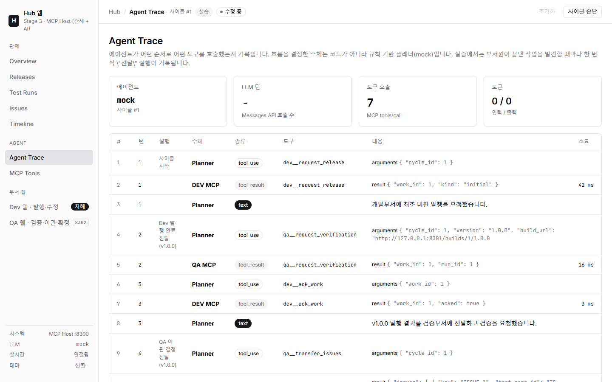

<!--
발표 자료 사용법
- 발표용 웹 슬라이드(디자인 적용본): https://claude.ai/artifact/WUimdrsFjSxwH6Cxoafmza
  이 파일은 같은 내용의 Markdown 원고다.
- VS Code의 "Marp for VS Code" 확장으로 열면 슬라이드로 보이고, PDF/PPTX로 내보낼 수 있다.
- 확장 없이도 일반 Markdown 문서로 읽을 수 있다. 슬라이드 경계는 '---' 이다.
- 각 슬라이드 아래 HTML 주석은 발표자 노트다.
- 이미지 경로는 이 파일(docs/) 기준 상대 경로다.
-->

# A2A (Agent2Agent)

## 에이전트는 어떻게 함께 일하는가

릴리즈·검증 협업 시스템을 Standalone → API → MCP → A2A로 구현하며 본 기술 흐름

2026-10-16 · A2A Practice 프로젝트

---

## 목차

1. **기존 기술** — 같은 업무를 Standalone, REST API, MCP로 만들면
2. **A2A 개념과 필요성** — 무엇이고 왜 생겼나
3. **핵심 구성 요소** — Agent Card, Task, Message, Artifact, Streaming
4. **장단점과 적용 기준**
5. **일반적인 구현 방식** — 토폴로지, 서버, 클라이언트
6. **예제** — 본 프로젝트 Stage 4 구현
7. **정리**

---

<!-- _class: lead -->

# 1. 기존 기술

같은 업무, 네 가지 연결 방식

---

## 오늘의 소재: 릴리즈·검증 사이클

```text
 개발부서                         검증부서
 신규 버전 발행  ───────────────▶ 테스트 12건 실행, 결과 관리
                                   ├─ 실패 있음: 이슈 등록 → 개발부서로 이관
 수정 → 차기 버전 발행 ◀───────────┘
                                   └─ 전부 통과: 버전 확정
```

| 버전 | 결과 | 처리 |
| --- | --- | --- |
| v1.0.0 | 9 PASS / 3 FAIL | 이슈 3건 이관 |
| v1.1.0 | 11 / 1 (수정 중 생긴 회귀 버그) | 이슈 1건 이관 |
| v1.2.0 | 12 / 0 | 확정 |

<!--
두 조직이 결과를 주고받으며 반복한다는 점이 연동 기술 비교에 적합하다.
PASS/FAIL은 결정적 시뮬레이터가 정하므로 네 단계 결과가 모두 같다. 차이는 연결 방식에서만 나온다.
-->

---

## 같은 업무를 4번 구현했다

```text
1. Standalone   [ Dev 함수 ── QA 함수 ]                 하나의 프로그램
2. API          [Dev] ◀──REST/Webhook──▶ [QA]           서로의 주소·형식을 안다
3. MCP          [Dev 도구] ◀── Host(AI) ──▶ [QA 도구]   AI가 함수 단위로 호출
4. A2A          [Dev Agent] ◀── Hub ──▶ [QA Agent]      업무 단위로 위임
```

- 모든 단계: SQLite 저장소 + 웹 대시보드 + 데모/실습 모드
- 결과는 4단계 모두 동일 (9/3 → 11/1 → 12/0)
- 비교 질문은 하나: **"누가 흐름을 알고, 상대를 어떻게 부르고, 일이 끝난 걸 어떻게 아는가"**

---

## Stage 1. Standalone (모놀리식)

```text
┌────────────── 하나의 프로세스 (8100) ──────────────┐
│  웹 화면 ─▶ CycleRunner ─▶ DevService / QAService   │
│                         └─▶ 같은 SQLite DB          │
└────────────────────────────────────────────────────┘
```

| 좋은 점 | 한계 |
| --- | --- |
| 가장 단순하다. 함수 호출, 트랜잭션 하나 | 부서별로 따로 배포·운영할 수 없다 |
| 연결 비용·장애가 없다 | 조직이 나뉘면 코드 소유권이 섞인다 |

> 부서가 각자 시스템을 갖게 되면? → **API**

---

## Stage 2. REST API + Webhook

```text
 Dev Server (8201)                                QA Server (8202)
  발행 ── POST /api/webhooks/release-published ──▶ 검증
       ◀── POST /api/tickets ─────────────────────  이관
       ◀── POST /api/webhooks/verification-completed
                    Hub (8200): 양쪽 상태를 모아 보는 관제
```

- 부서별 서버·DB 분리, 서로의 **URL과 데이터 형식을 합의**해서 직접 호출
- 실패 시 재시도, 모든 호출을 연동 로그로 기록

<!--
QA 코드 안에 "이관하면 Dev의 /api/tickets를 이런 JSON으로 부른다"는 흐름 지식이 들어 있다.
-->

---

## API 방식의 한계

| 문제 | 본 프로젝트에서 겪은 모습 |
| --- | --- |
| 강한 결합 | QA가 Dev의 주소·스키마·호출 순서를 안다. Dev API가 바뀌면 QA도 수정 |
| 연결 수 증가 | 참여자 N개 → 연결 최대 N×(N-1). 보안검토 부서가 끼면 호출 체인 재설계 |
| 장시간 작업 | "검증 중"을 표현하는 표준이 없다. Webhook을 직접 설계 |
| 사람 개입 | 승인 요청·회신 API를 매번 따로 설계 |
| 판단 | 흐름이 코드에 고정. 상황에 따른 유연한 판단이 어렵다 |

> AI가 중간에서 판단하며 연결하면? → **MCP**

---

## MCP (Model Context Protocol) 란

- 2024년 11월 Anthropic이 공개한 **AI 애플리케이션 ↔ 도구·데이터** 연결 표준
- 구성: **Host**(AI 앱) 안의 **Client**가 여러 **Server**에 연결
- Server가 제공하는 것: **Tools**(함수), **Resources**(데이터), **Prompts**(템플릿)
- `tools/list`로 도구를 자동 발견하고, `tools/call`로 호출
- 해결한 문제: AI 앱 N개 × 시스템 M개의 개별 연동 → N + M

```text
        Host (Claude)
        ├─ Client ──▶ Dev MCP Server : request_release, register_tickets ...
        └─ Client ──▶ QA MCP Server  : request_verification, transfer_issues ...
```

---

## Stage 3. MCP로 구현한 모습

```text
[QA 웹] 이관 클릭 → QA DB에 '완료 작업' 기록               QA는 Dev를 모른다
Host: 2초마다 qa__list_completed_work 로 확인(폴링) → 발견
  Claude: qa__transfer_issues → dev__register_tickets
          → dev__request_release → qa__ack_work
```



<!--
Agent Trace 화면: 전달 한 번마다 Claude가 어떤 도구를 어떤 인자로 불렀는지 보인다.
데모 사이클 한 번에 MCP 도구 호출 21회.
-->

---

## MCP 방식의 한계

| 한계 | 설명 |
| --- | --- |
| 수직 관계 | "에이전트 → 도구". 도구는 수동적이라 먼저 말을 걸지 못한다 |
| 세부 함수 단위 | Host가 21번의 함수 호출 순서를 모두 알아야 한다. 흐름 지식이 Host에 집중 |
| 진행 상황 | 사람이 오래 일하는 동안 Host는 **물어봐야(폴링)** 안다 |
| 상대가 에이전트라면? | QA 쪽에도 자체 판단을 하는 AI가 있다면, 그 AI를 "함수 묶음"으로 다루는 것은 부자연스럽다 |

> 상대도 **스스로 일하는 에이전트**라면? → **A2A**

---

<!-- _class: lead -->

# 2. A2A 개념과 필요성

---

## A2A (Agent2Agent Protocol) 란

> 서로 다른 프레임워크·벤더·조직이 만든 **AI 에이전트끼리** 업무를 주고받기 위한 개방형 프로토콜

- 2025년 4월 Google이 공개, 2025년 6월 Linux Foundation 프로젝트로 이관 (벤더 중립)
- 기존 웹 표준 위에 구축: **HTTP + JSON-RPC 2.0 + SSE** (gRPC, REST 바인딩도 정의)
- 본 프로젝트: 공식 Python SDK `a2a-sdk` 1.1, protocol_version 1.0

| | MCP | A2A |
| --- | --- | --- |
| 연결 대상 | 에이전트 → 도구·데이터 | 에이전트 ↔ 에이전트 |
| 상대의 성격 | 정해진 기능을 수행하는 함수 | 스스로 판단·계획하는 자율 주체 |
| 주고받는 단위 | 함수 호출 | 업무(Task) |

---

## 왜 필요한가: 에이전트 사일로 문제

```text
  영업팀 에이전트      개발팀 에이전트      검증팀 에이전트      외부 벤더 에이전트
  (프레임워크 A)       (프레임워크 B)       (사내 자체 개발)      (다른 회사)
        │                    │                    │                    │
        └──────── 서로 대화할 공통 언어가 없다 ───────────────────────┘
```

- 조직마다, 팀마다 에이전트를 만들기 시작했다. 각자 프레임워크·모델·도구가 다르다
- 연결하려면 매번 맞춤 API를 만들어야 한다 → Stage 2의 문제가 에이전트 규모로 반복
- 에이전트 업무의 특성: **오래 걸리고**, **중간에 되묻고**, **사람 승인이 끼고**, **결과물이 다양하다**
- 필요한 것: 상대의 **내부를 몰라도**, **표준화된 방식으로** 업무를 맡기고 결과를 받는 규약

---

## A2A의 설계 원칙

| 원칙 | 의미 |
| --- | --- |
| 에이전트다움을 존중 | 메모리·도구·내부 상태를 공유하지 않는다. 상대를 도구가 아닌 **동료**로 대한다 |
| 불투명성 (Opacity) | 상대가 어떤 모델·DB·방법을 쓰는지 몰라도 협업할 수 있다 |
| 기존 표준 활용 | HTTP, JSON-RPC, SSE 등 이미 쓰는 인프라 그대로 |
| 기본 보안 | 기존 웹 인증 방식(OAuth2, API Key 등)을 Agent Card에 선언 |
| 장시간 작업 지원 | 몇 초에서 며칠까지. 상태 추적, 진행 알림, 사람 개입 |
| 형식 무관 | 텍스트, 파일, 구조화 데이터(JSON) 등 다양한 결과물 |

---

<!-- _class: lead -->

# 3. 핵심 구성 요소

---

## 구성 요소 한눈에 보기

```text
  Client Agent (요청하는 쪽)                      Remote Agent (일하는 쪽)
  ──────────────────────────                      ────────────────────────
  1. 발견   GET /.well-known/agent-card.json ──▶  Agent Card (명함: 스킬, 주소, 기능)
  2. 위임   SendStreamingMessage(Message) ─────▶  Task 생성 (submitted → working)
  3. 진행   ◀──── status-update (working, "TC-05 FAIL (5/12)")
  4. 질문   ◀──── status-update (input-required, "승인 여부를 회신해 주세요")
            SendMessage(같은 taskId, "approve") ─▶
  5. 결과   ◀──── artifact-update (Artifact: test-report, issues ...)
            ◀──── status-update (completed)
```

| 개념 | 한 줄 설명 |
| --- | --- |
| Agent Card | 에이전트의 명함. 무엇을 할 수 있는지(스킬), 어디로 부르는지 |
| Task | 맡긴 업무 하나. 고유 ID와 상태(라이프사이클)를 가진다 |
| Message / Part | 대화 한 턴. 텍스트·파일·데이터 Part로 구성 |
| Artifact | 업무의 결과물 |
| Streaming | 진행 상황과 결과를 실시간으로 받는 방식(SSE) |

---

## Agent Card — 에이전트의 명함

- 위치: `https://{에이전트 주소}/.well-known/agent-card.json`
- 클라이언트는 **주소만 알면** 카드를 읽고 무엇을 맡길 수 있는지 안다

| 항목 | 내용 |
| --- | --- |
| name, description, version, provider | 누구인가 |
| supported_interfaces | 어디로, 어떤 바인딩(JSON-RPC/gRPC/REST)으로 부르나 |
| capabilities | streaming, push_notifications 지원 여부 |
| skills | 할 수 있는 일 목록 (id, 설명, 입력·출력 형식, 예시) |
| security | 필요한 인증 방식 |

> 사람으로 치면 "이력서 + 연락처". 라우팅은 **스킬 ID**로 한다

---

## Task 라이프사이클

```text
                       ┌──────────────── input-required ◀──┐
                       │  (클라이언트가 같은 Task로 회신)    │ (에이전트가 되물음)
                       ▼                                     │
  submitted ──▶ working ─────────────────────────────────────┤
                   │                                         │
                   ├──▶ completed   (정상 완료, Artifact 반환)
                   ├──▶ failed      (처리 중 오류)
                   ├──▶ canceled    (CancelTask 요청)
                   ├──▶ rejected    (에이전트가 거절: 지원하지 않는 요청)
                   └──▶ auth-required (추가 인증 필요)
```

- completed / failed / canceled / rejected는 **종료 상태**. 이후 같은 Task는 재개되지 않는다
- `contextId`로 관련 Task들을 하나의 대화·업무 맥락으로 묶는다 (본 프로젝트: `cycle-N`)

---

## Message와 Part

- **Message**: 한 번의 발화. `role`(user/agent), `messageId`, `taskId`, `contextId`, `parts`
- **Part**: 내용 조각. 한 Message에 여러 개를 섞을 수 있다

| Part 종류 | 용도 | 본 프로젝트 예 |
| --- | --- | --- |
| 텍스트 | 사람·LLM이 읽는 지시문, 설명 | "v1.1.0을 검증해 주세요." |
| 데이터(JSON) | 프로그램이 읽는 구조화 입력·출력 | `{skill, cycle_id, version, build_url, fixed_issue_keys}` |
| 파일 | 바이너리 또는 URL | (미사용, build_url로 대체) |

> 텍스트 + 데이터를 **함께** 보내는 패턴: LLM 에이전트도, 규칙 기반 에이전트도 같은 메시지를 이해한다

---

## Artifact — 업무의 결과물

- Task가 만들어 낸 산출물. 이름과 Part 목록을 가진다
- 한 Task가 여러 Artifact를 낼 수 있고, 스트리밍으로 조각내 보낼 수도 있다
- Message(대화)와 구분: Message는 "진행 중 소통", Artifact는 "납품물"

| Artifact | 만드는 에이전트 | 내용 |
| --- | --- | --- |
| `release` | Dev | 릴리즈 노트(텍스트) + `{version, build_url, fixed_issue_keys, fixes[]}` |
| `test-report` | QA | 요약(텍스트) + `{version, total, passed, failed, results[], verified, reopened, created}` |
| `issues` | QA | 이관 대상 이슈 목록 |
| `approval` | QA | 승인/반려 결과와 의견 |

---

## 장시간 작업: Streaming과 Push Notification

| 방식 | 동작 | 적합한 경우 |
| --- | --- | --- |
| 요청/응답 | `SendMessage` 후 완료(또는 현재 상태) 응답 | 짧은 작업 |
| 폴링 | `GetTask`로 상태를 반복 조회 | 단순 클라이언트 |
| **Streaming (SSE)** | `SendStreamingMessage` / `SubscribeToTask`로 연결 유지, 상태·Artifact 이벤트를 실시간 수신 | 진행률 표시, 수 분 단위 작업 |
| Push Notification | 클라이언트가 등록한 Webhook URL로 에이전트가 알림 | 수 시간~수 일, 연결 유지가 어려운 경우 |

- 본 프로젝트는 Streaming 사용 (`capabilities.streaming = true`)
- 사람이 몇 분 동안 판정해도 연결 하나, Task 하나로 진행 상황이 실시간 전달된다

---

## Human-in-the-loop: `input-required`

```text
Hub ─ SendStreamingMessage [verify-release] v1.2.0 ─▶ QA Agent
    ◀── artifact-update  test-report (12/12 PASS)
    ◀── status-update    input-required
         "v1.2.0 테스트 12건이 모두 통과했습니다. 릴리즈 승인 여부를 회신해 주세요."
         + data {question: "release-approval", options: ["approve", "reject"]}

    (Hub 승인함 → 릴리즈 매니저가 승인)

Hub ─ SendStreamingMessage (같은 taskId, contextId) "approve" ─▶ QA Agent
    ◀── artifact-update  approval {approved: true, comment}
    ◀── status-update    completed
```

- "되묻기"가 프로토콜의 **표준 상태**다. API 방식이라면 승인 요청·회신 API를 따로 만들어야 했다

---

## 주요 메서드 (JSON-RPC 바인딩)

| 메서드 | 역할 |
| --- | --- |
| `SendMessage` | 메시지를 보내 Task를 시작하거나 이어 간다 (단발 응답) |
| `SendStreamingMessage` | 위와 같으나 SSE 스트림으로 상태·Artifact 이벤트를 계속 받는다 |
| `GetTask` | Task의 현재 상태·이력·Artifact 조회 |
| `ListTasks` | Task 목록 조회 |
| `CancelTask` | 진행 중인 Task 취소 요청 |
| `SubscribeToTask` | 끊긴 스트림에 다시 붙어 이벤트 수신 |
| `*TaskPushNotificationConfig` | Push 알림용 Webhook 등록·조회·삭제 |
| `GetExtendedAgentCard` | 인증된 클라이언트에게만 공개하는 상세 카드 |

---

## MCP vs A2A — 경쟁이 아니라 보완

```text
                 A2A (에이전트 ↔ 에이전트, 수평)
     ┌──────────────┐  Task / Artifact  ┌──────────────┐
     │  Dev Agent   │ ◀───────────────▶ │  QA Agent    │
     └──────┬───────┘                   └──────┬───────┘
            │ MCP (에이전트 → 도구, 수직)        │ MCP
     ┌──────┴───────┐                   ┌──────┴───────┐
     │ Git, CI, 빌드 │                   │ 테스트 러너   │
     │ 이슈 트래커   │                   │ 결함 DB       │
     └──────────────┘                   └──────────────┘
```

| 질문 | MCP | A2A |
| --- | --- | --- |
| 무엇을 표준화하나 | 도구·데이터 접근 | 에이전트 간 업무 위임 |
| 상대가 먼저 말하나 | 아니오 (호출에 응답) | 예 (진행 알림, 되묻기) |
| 상대 내부를 아나 | 도구 이름·인자를 안다 | 스킬만 안다 (opaque) |

---

<!-- _class: lead -->

# 4. 장단점과 적용 기준

---

## 장점

| 장점 | 본 프로젝트에서 확인한 모습 |
| --- | --- |
| 느슨한 결합 | Dev·QA는 서로를 모른다. Hub도 에이전트 내부를 모르고 스킬 ID만 안다 |
| 교체 가능성 | QA Agent를 다른 구현(다른 모델, 사람 작업)으로 바꿔도 Hub 코드는 그대로 |
| 업무 단위 위임 | Hub의 상호작용: MCP 도구 호출 21회 → A2A Task 6개 |
| 표준 협업 패턴 | 장시간 작업(Task 상태), 진행 알림(스트리밍), 승인(`input-required`), 취소(`CancelTask`) |
| 발견 | 주소 목록만 설정하면 Agent Card로 스킬을 수집해 라우팅 |
| 감사 가능성 | 모든 요청/응답이 표준 형식이라 원문 그대로 기록·추적 (Message Trace 화면) |

---

## 단점과 고려사항

| 단점 | 설명 |
| --- | --- |
| 복잡도 | 비동기 스트림, Task 상태 관리, 이벤트 큐 처리가 REST보다 어렵다 |
| 복구 설계 | 스트림이 끊기면 진행 중 Task를 다시 붙이는 설계가 필요 (본 구현: Hub 재시작은 복구, 에이전트 재시작은 실패 처리) |
| 관찰 시점 | 업무 데이터는 Artifact가 도착해야 보인다. 진행 중 상세는 에이전트가 알려 주는 만큼만 |
| 성숙도 | 프로토콜·SDK가 빠르게 바뀌는 중 (SDK 1.x에서 protobuf 타입으로 변경 등) |
| 중앙 집중 | Hub 구성에서는 Hub가 단일 장애점, 흐름 지식이 Hub에 모인다 |
| 과잉 적용 | 고정된 시스템 간 데이터 전달이라면 REST가 더 단순하고 빠르다 |

---

## 언제 무엇을 쓰나

| 상황 | 권장 |
| --- | --- |
| 한 팀이 한 시스템을 만든다 | 모놀리식 |
| 정해진 시스템끼리 정해진 데이터를 주고받는다 | REST API, 메시지 큐 |
| AI 앱이 사내 시스템·파일·DB를 도구로 써야 한다 | MCP |
| 여러 자율 에이전트(다른 팀·회사·벤더)가 업무를 주고받는다 | **A2A** |
| 작업이 길고, 진행 상황 공유와 사람 승인이 필요하다 | **A2A** |
| 실제 대규모 시스템 | A2A(에이전트 간) + MCP(각 에이전트의 도구) |

---

<!-- _class: lead -->

# 5. 일반적인 구현 방식

---

## 토폴로지: 누가 누구와 이야기하나

```text
  ① Hub / Orchestrator           ② Peer (P2P)              ③ 계층형
        ┌─ Hub ─┐                Dev ◀──────▶ QA            Hub
        ▼       ▼                  ▲         ▲              ├─ 개발 Hub ─ Dev1, Dev2
       Dev      QA                 └── Sec ──┘              └─ 검증 Hub ─ QA1, QA2
```

| 구성 | 장점 | 단점 |
| --- | --- | --- |
| Hub | 관제·감사·승인을 한곳에서, 흐름이 명확 | 단일 장애점, Hub에 흐름 지식 집중 |
| Peer | 단순, 중앙 없음 | 흐름 추적·감사 어려움, 에이전트가 서로를 알아야 함 |
| 계층형 | 대규모 조직 구조 반영 | 설계 복잡 |

- A2A는 토폴로지를 강제하지 않는다. 본 프로젝트는 ① Hub 구성 (Dev ↔ Hub ↔ QA)
- Hub 자신도 Agent Card를 공개하면 다른 Hub의 하위 에이전트가 될 수 있다 (③)

---

## 서버(에이전트) 구현 4단계

```text
1. Agent Card 정의        이름, 주소, capabilities, skills
2. AgentExecutor 구현     execute(context, event_queue): 실제 일을 하고 이벤트를 낸다
                          cancel(context, event_queue):  취소 처리
3. RequestHandler 구성    DefaultRequestHandler(executor, TaskStore, card)
                          TaskStore: Task 상태 저장 (InMemory / DB)
4. 라우트 등록            /.well-known/agent-card.json + JSON-RPC 엔드포인트(/a2a)
```

- Executor 안에서 `TaskUpdater`로 상태를 바꾼다:
  `update_status(working, 메시지)` · `add_artifact(parts, name)` · `complete()` · `requires_input()` · `failed()` · `cancel()` · `reject()`
- 내부 구현은 자유: LLM, 규칙, 다른 프레임워크, **사람의 작업 대기**까지

---

## 서버 코드 예 — QA Agent의 Agent Card

```python
# 04_a2a/src/qa_agent/server.py
AgentCard(
    name="QA Department Agent",
    version="1.0.0",
    supported_interfaces=[AgentInterface(url=f"{QA_URL}/a2a",
                          protocol_binding="JSONRPC", protocol_version="1.0")],
    capabilities=AgentCapabilities(streaming=True, push_notifications=False),
    skills=[AgentSkill(
        id="verify-release", name="릴리즈 검증",
        description="빌드를 내려받아 테스트케이스 12건을 검증 ... 확정 결정 시 "
                    "input-required로 승인 여부를 묻고 'approval'을 반환한다.",
        tags=["qa", "test", "approval"], examples=["v1.1.0을 검증해 주세요."])],
)
# 라우트 등록
add_a2a_routes_to_fastapi(app,
    agent_card_routes=create_agent_card_routes(card),
    jsonrpc_routes=create_jsonrpc_routes(handler, rpc_url="/a2a"))
```

---

## 서버 코드 예 — Executor의 결과 처리

```python
# 04_a2a/src/qa_agent/agent.py  QAAgentExecutor._conclude()
await updater.add_artifact([new_text_part(summary),
                            new_data_part(report)], name="test-report")
if decision == "TRANSFERRED":                       # 실패 있음 → 이관
    await updater.add_artifact([..., new_data_part({"issues": payload})], name="issues")
    await updater.complete(updater.new_agent_message([new_text_part("... 이관 대상으로 넘깁니다.")]))
else:                                               # 전부 통과 → 승인 여부를 되묻는다
    await updater.requires_input(updater.new_agent_message([
        new_text_part("... 릴리즈 승인 여부를 회신해 주세요."),
        new_data_part({"question": "release-approval", "options": ["approve", "reject"]}),
    ]))
```

- 같은 Task로 회신이 오면 `execute()`가 다시 호출되고, 현재 상태가 `input-required`이면 승인 처리로 분기한다

---

## 클라이언트(Hub) 구현

```python
# 04_a2a/src/hub/registry.py — 발견
card = await A2ACardResolver(http, url).get_agent_card()      # 주소만 안다
client = ClientFactory(ClientConfig(streaming=True, httpx_client=http)).create(card)
skills = [s.id for s in card.skills]                          # 스킬 ID로 라우팅

# 04_a2a/src/hub/workflow.py — 위임과 스트림 처리
message = user_message("v1.1.0을 검증해 주세요.",
                       {"skill": "verify-release", "cycle_id": 1, "version": "1.1.0", ...},
                       context_id="cycle-1")
async for event in client.send_message(SendMessageRequest(message=message)):
    kind = event.WhichOneof("payload")
    if kind == "task":              ...  # Task 생성 (id, 상태)
    elif kind == "status_update":   ...  # working 진행 메시지 / input-required / completed
    elif kind == "artifact_update": ...  # 결과물 수신 → Hub 현황 반영
```

---

## 운영 시 고려사항

| 주제 | 내용 | 본 프로젝트 |
| --- | --- | --- |
| 인증·권한 | Agent Card에 인증 방식 선언, 전송은 HTTPS | 로컬 실습이라 생략 |
| 타임아웃 | 사람이 끼는 Task는 스트림이 오래 열린다 | 읽기 타임아웃 해제 (`read=None`) |
| 상태 저장 | TaskStore를 DB로 두면 재시작 후 조회 가능 | 에이전트는 InMemoryTaskStore (에이전트 재시작 시 사유와 함께 실패 처리) |
| 재연결 | 끊긴 스트림은 `GetTask`·`SubscribeToTask`로 다시 붙는다 | Hub 재시작 시 진행 중 Task에 다시 붙어 사이클을 이어 감 |
| 감사 | 원문 요청/응답 기록 | httpx 전송 계층 래퍼로 JSON-RPC·SSE 원문 저장 |
| 헬스 체크 | 카드 주기적 재수집 | 15초마다 Agent Card 재수집, UP/DOWN 표시 |

---

<!-- _class: lead -->

# 6. 예제 — 본 프로젝트 Stage 4

---

## 구성

```text
                    Browser (릴리즈 매니저)
                           │
             ┌──── Hub / Orchestrator (8400) ─── hub.db ─── Claude(판단)
             │     Registry · Workflow · Decider · Approvals · Audit
             │     A2A Client
     A2A     ├────────────────────────▶ Dev Agent (8401) ─ dev.db ─ Claude(수정·릴리즈 노트)
             │                           + Dev 웹 (개발부서원)
             └────────────────────────▶ QA Agent  (8402) ─ qa.db  ─ Claude(이슈 분석)
                                         + QA 웹 (검증부서원)
  QA Agent ── GET /builds/{cycle}/{version} ──▶ Dev Agent   (빌드 산출물만 직접 다운로드)
```

| 에이전트 | 스킬 |
| --- | --- |
| Dev Department Agent | `release-build`(최초 발행), `fix-and-release`(결함 수정 후 차기 발행) |
| QA Department Agent | `verify-release`(검증, Streaming, input-required) |

---

## Agents 화면 — 수집한 Agent Card


<!--
Hub는 AGENT_URLS(두 에이전트 주소)만 설정으로 알고, 나머지는 모두 카드에서 읽는다.
-->

---

## 데모 흐름: 사이클 1회 = Task 6개

```text
Hub: Agent Card 수집 → 스킬 라우팅
 ① Hub → Dev  [release-build]   "사이클 1의 최초 버전을 발행해 주세요"      → Artifact release v1.0.0
 ② Hub → QA   [verify-release]  "v1.0.0을 검증해 주세요" (SSE 진행률)       → test-report 9/3, issues 3건
    Hub 판단: transfer_to_dev
 ③ Hub → Dev  [fix-and-release] "이슈 3건을 수정하고 차기 버전을 발행해 주세요" → release v1.1.0
 ④ Hub → QA   [verify-release]  v1.1.0                                       → test-report 11/1, issues 1건
    Hub 판단: transfer_to_dev
 ⑤ Hub → Dev  [fix-and-release] 이슈 1건                                     → release v1.2.0
 ⑥ Hub → QA   [verify-release]  v1.2.0                                       → test-report 12/0
              status: input-required "릴리즈 승인 여부를 회신해 주세요"
    Hub 판단: request_approval → 승인함 → 사람이 승인
    Hub → QA  같은 Task로 "approve"                                         → Artifact approval → completed
```

---

## 실제 메시지 — Hub가 QA에 보내는 위임

```json
{
  "role": "ROLE_USER",
  "messageId": "6f1c...",
  "contextId": "cycle-1",
  "parts": [
    { "text": "v1.1.0을(를) 검증해 주세요." },
    { "data": {
        "skill": "verify-release",
        "cycle_id": 1,
        "version": "1.1.0",
        "build_url": "http://127.0.0.1:8401/builds/1/1.1.0",
        "fixed_issue_keys": ["ISSUE-1", "ISSUE-2", "ISSUE-3"],
        "mode": "demo"
    } }
  ]
}
```

- 텍스트 Part: 사람·LLM용 지시 / 데이터 Part: 프로그램용 입력
- Hub는 "어떻게 검증할지"를 말하지 않는다. 목표와 필요한 정보만 준다

---

## 스트리밍 — 진행률이 실시간으로 온다

```text
status-update  working  "v1.1.0 빌드를 내려받고 있습니다."
status-update  working  "TC-01 PASS (1/12)"   metadata.progress {done: 1, total: 12, passed: true}
status-update  working  "TC-02 PASS (2/12)"   ...
   ...
status-update  working  "TC-11 FAIL (11/12)"  metadata.progress {done: 11, passed: false}
status-update  working  "TC-11 실패 로그를 분석하고 있습니다."     ← QA 내부 LLM이 이슈 분석
artifact-update  test-report  "v1.1.0 검증 결과: 11 PASS / 1 FAIL ..."
artifact-update  issues       "개발부서 이관 대상 이슈 1건"
status-update  completed
```


---

## Hub의 판단 — 선택지를 제한한 구조화 출력

```text
QA Task 결과            Hub가 허용하는 행동
completed + issues  →  transfer_to_dev | abort
input-required      →  request_approval | abort
그 외 / 최대 반복   →  abort
```

```json
{ "action": "request_approval",
  "reason": "검증부서가 전체 통과를 보고하고 승인을 요청했습니다.",
  "brief":  "통과 테스트 수는 v1.0.0 9/12, v1.1.0 11/12를 거쳐 v1.2.0에서 12/12가 되었고,
             ISSUE-1~4는 모두 수정 후 검증을 마쳤습니다. ... 결제·환불 금액 모니터링을 권고합니다." }
```

- Claude가 JSON 스키마(`action` enum = 허용 행동)에 맞춰 결정. 실패·이탈 시 규칙으로 대체
- QA가 묻지 않았는데 승인을 요청하는 일은 구조적으로 불가능하다

---

## 승인함 — `input-required`를 사람에게


<!--
QA Agent의 input-required가 Hub 승인함에 뜬다. 승인/반려 + 의견을 남기면 같은 Task(taskId, contextId)로 회신되고,
QA Agent가 approval Artifact를 반환하며 Task가 completed가 된다. 반려 시 사이클은 REJECTED.
-->

---

## 실습 모드 — 에이전트 뒤에서 사람이 일해도

```text
Hub    Task [verify-release] mode=manual ─▶ QA Agent: 검증 항목 12건 '대기', Task working 유지
QA 웹  [김검증] TC-02 FAIL + 이슈 등록 ──▶ status-update "TC-02 FAIL 판정 (김검증)" + progress
QA 웹  [이검증] TC-08 FAIL ...         ──▶ status-update ...
QA 웹  [박검증] Dev 이관 클릭          ──▶ artifact test-report, issues → completed
Hub    판단 transfer_to_dev → Task [fix-and-release] mode=manual ─▶ Dev Agent
Dev 웹 [최개발] 착수 → 수정 완료       ──▶ status-update "ISSUE-1 수정 완료 (최개발)"
Dev 웹 v1.1.0 발행                    ──▶ artifact release → completed
```

- Hub 코드는 데모와 **같다** (`mode`만 전달). 에이전트 내부는 opaque
- 사람이 몇 분 걸려도 Hub에게는 **working 상태의 Task 하나**, 진행은 에이전트가 먼저 알려 준다
- 비교: Stage 3 MCP에서는 같은 상황에서 Host가 2초마다 폴링해야 했다

---

## 취소 — `CancelTask`

```text
Hub 웹 [사이클 중단]
  └─ Hub → Dev Agent : CancelTask(taskId)
       └─ DevAgentExecutor.cancel(): 부서원 대기(future)를 취소
            └─ status-update  canceled  "작업이 취소되었습니다."
  └─ 이후 Dev 웹에서 발행 시도 → 409 (위임받은 업무가 없음)
```

- "하던 일을 멈춰 달라"도 표준 메서드다. API 방식이라면 중단 API와 상태 정리를 따로 설계해야 한다

---

## Message Trace — 모든 A2A 원문 기록


<!--
httpx 전송 계층을 감싼 AuditTransport가 JSON-RPC 요청/응답, SSE 이벤트 원문을 hub.db에 저장한다.
표준 형식이기 때문에 어떤 에이전트와의 대화든 같은 방식으로 감사할 수 있다.
-->

---

## 4단계 실측 비교 (같은 시나리오, 지연 0)

| 단계 | mock | LLM | 상호작용 (사이클 1회) | 사람 작업 완료 감지 |
| --- | --- | --- | --- | --- |
| 1. Standalone | 약 1초 | 약 46초 | 함수 호출 (LLM 10회) | 같은 DB |
| 2. API | 약 1초 | 약 34초 | REST 9회 | Webhook |
| 3. MCP | 약 1초 | 약 48초 | MCP 도구 21회 (15턴) | 2초 폴링 |
| 4. A2A | 약 2초 | 약 50초 | **A2A Task 6개** | **Task 스트리밍** |

- 결과(9/3 → 11/1 → 12/0)는 모두 같다
- 시간은 대부분 LLM 문서 작성에 쓰인다. 연결 방식 자체의 비용은 작다
- 차이는 **중앙이 아는 것의 크기**: 함수 21개의 순서 vs 업무 6건

---

<!-- _class: lead -->

# 7. 정리

---

## 배운 점

1. **연결 기술의 발전은 "흐름 지식"이 옮겨 가는 과정이다**
   코드 → 각 서비스 → 중앙 AI(함수 단위) → 중앙은 업무 단위, 방법은 각 에이전트
2. **A2A의 가치는 표준화된 협업 패턴이다**
   장시간 작업, 진행 알림, 승인 요청, 취소를 직접 설계하지 않는다
3. **에이전트 뒤에 무엇이 있든 협업 방식은 같다**
   AI가 일하든 사람이 일하든 Hub는 Task, 진행 메시지, Artifact만 본다
4. **MCP와 A2A는 층이 다르다**
   도구 접근은 MCP, 에이전트 간 업무는 A2A. 함께 쓰는 것이 자연스럽다
5. **대가도 분명하다**
   스트림·Task 복구, Hub 단일 장애점, 관찰 시점의 한계는 함께 설계해야 한다

---

## 다음 단계 (선택 과제)

| 과제 | 내용 | 배울 점 |
| --- | --- | --- |
| Hub Agent Card | Hub를 `run-release-cycle` 스킬을 가진 에이전트로 공개 | 오케스트레이터도 에이전트가 되는 계층 구조 |
| Peer 모드 | Hub 없이 Dev ↔ QA 직접 협업 | 토폴로지에 따른 감사·관제의 차이 |
| A2A + MCP | 각 에이전트가 내부 도구(Git, 테스트 러너)를 MCP로 사용 | 실제 시스템 구성에 가까운 형태 |
| Task 복구 | DB TaskStore + `SubscribeToTask` 재구독 | 장애 내성 |

---

## 직접 해 보기

```powershell
cd D:\users\yk\A2A_Class\A2A-Practice\04_a2a
uv sync
uv run run.py --mock        # Claude 사용: --mock 제거 (.env에 키 필요)
```

| 웹 | 주소 | 할 일 |
| --- | --- | --- |
| Hub | <http://localhost:8400> | 데모 실행 / 실습 시작, Agents, Message Trace, 승인함 |
| Dev 웹 | <http://localhost:8401> | 작업자 "최개발" → 발행, 티켓 수정 |
| QA 웹 | <http://localhost:8402> | 작업자 "김검증·이검증·박검증" → 판정, 이관, 확정 |

상세: `docs/04_A2A_개발완료보고서.md`, `04_a2a/docs/USER_SCENARIO.md`

---

## 참고 자료

- A2A 프로토콜 사양과 문서: <https://a2a-protocol.org>
- A2A GitHub (사양, SDK): <https://github.com/a2aproject>
- MCP 사양과 문서: <https://modelcontextprotocol.io>
- 본 프로젝트 문서
  - `docs/00_프로젝트_개요.md` — 업무 시나리오, 공통 설계
  - `docs/01~04_*_개발완료보고서.md` — 단계별 상세
  - `docs/05_기술비교_종합.md` — 4단계 비교

---

<!-- _class: lead -->

# Q & A
